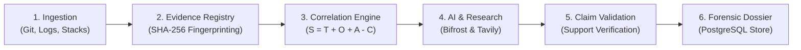
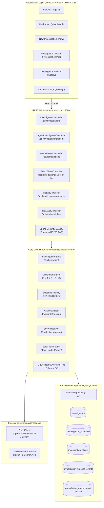
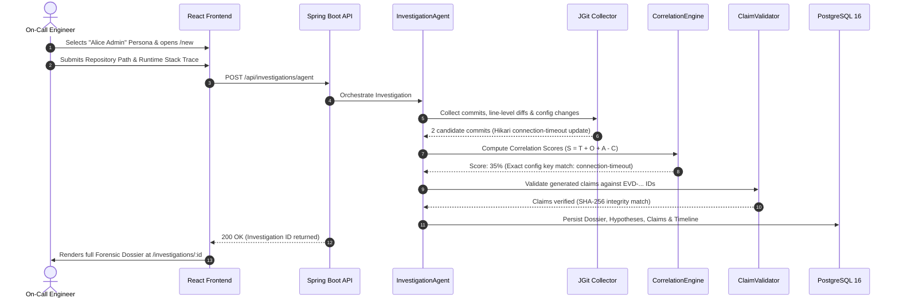

<div align="center">

  

  # TraceBack 2.0

  **Autonomous Software Investigation Agent**

  *"Don't just tell developers that something broke. Show them the evidence."*

  <p>
    <a href="https://www.oracle.com/java/technologies/downloads/#java21"></a>
    <a href="https://spring.io/projects/spring-boot"></a>
    <a href="https://react.dev/"></a>
    <a href="https://www.typescriptlang.org/"></a>
    <a href="https://vitejs.dev/"></a>
    <a href="https://tailwindcss.com/"></a>
    <a href="https://www.postgresql.org/"></a>
    <a href="https://www.docker.com/"></a>
  </p>

</div>

TraceBack 2.0 investigates software failures by analysing Git history, identifying suspicious changes, generating and evaluating hypotheses, validating claims against forensic evidence, and producing an auditable investigation dossier.

---

## Introduction

When a mission-critical service fails in production or staging, on-call software engineers face severe cognitive overload. Modern applications are composed of decoupled microservices, continuous deployment pipelines, and fragmented observability tools. When an outage strikes, telemetry is scattered across disconnected silos:
- **Application Logs & Metrics** live in monitoring systems (Datadog, ELK, CloudWatch).
- **Source Code Changes & Commits** live in version control systems (GitHub, GitLab).
- **Runtime Crashes & Stack Traces** live in issue trackers, Slack alerts, or terminal outputs.
- **Service Configurations** live in repository branches, environment variables, or container manifests.

Incident triage inevitably turns into frantic manual detective work under high-stress conditions. Engineers spend hours manually skimming logs, browsing through recent Git commits, and guessing which change triggered the failure.

**TraceBack 2.0** automates this entire diagnostic lifecycle. By correlating development history directly with runtime failure telemetry, TraceBack reconstructs the causal timeline between code changes, configuration adjustments, and runtime exceptions. It generates ranked diagnostic hypotheses backed by a transparent scoring formula, grounds every claim against cryptographically hashed evidence, and produces a comprehensive forensic dossier.

---

## Why TraceBack? — The Problem with Conventional Debugging

Conventional triage methodologies and naive AI wrappers suffer from systematic engineering flaws during incident response:

| Diagnostic Approach | How It Operates | Primary Failure Mode |
| :--- | :--- | :--- |
| **Log Aggregators & APMs** | Ingest and index log lines, metric spikes, and distributed traces. | Shows *what* failed at runtime, but remains completely blind to source code diffs, author intent, and recent commits. |
| **Naive Git Blame / "Latest Commit"** | Flags the most recent commit before the incident onset. | Misses latent regressions, fails completely on configuration drift, and falsely blames harmless cosmetic updates. |
| **Ungrounded LLM Wrappers** | Feeds raw stack traces into an unanchored prompt and asks for a diagnosis. | Hallucinates plausible-sounding explanations without verifiable proof, citing fictitious line numbers and non-existent configuration keys. |
| **TraceBack 2.0** | **Deterministic-first correlation, cryptographic evidence hashing, and post-reasoning claim validation.** | **Grounds every claim in verified artifacts (SHA-256), enforces transparent scoring ($S = T + O + A - C$), and abstains honestly when data is inconclusive.** |

---

## How TraceBack Works — Investigation Pipeline

TraceBack operates through a rigorous six-stage investigation pipeline that separates deterministic evidence collection from generative reasoning:



1. **Multi-Source Telemetry Ingestion**  
   The platform accepts runtime failure symptoms (Java JVM nested exceptions, Node.js V8 call stacks, Python tracebacks) and structured or multiline logs. Simultaneously, the Git collector uses Eclipse JGit to inspect the target repository, extracting recent commits, line-level patch hunks, author metadata, and configuration files.

2. **Evidence Extraction & Cryptographic Fingerprinting**  
   Every extracted fact—whether a configuration delta, a code change hunk, an environment property, or a stack trace frame—is registered as an immutable `EvidenceItem` stamped with a unique identifier (`EVD-...`) and a cryptographic SHA-256 digest of its canonical content.

3. **Deterministic Multi-Signal Correlation**  
   Candidate commits are evaluated through an objective heuristic formula:
   $$\text{Score } S = T + O + A - C$$
   - **$T$ (Temporal Proximity, max 30 pts):** Weights commits closer to the incident onset.
   - **$O$ (Code & Config Overlap, max 30 pts):** Measures exact stack frame line/file intersections and configuration key deltas.
   - **$A$ (Independent Agreement, max 25 pts):** Rewards multiple telemetry streams pointing to the same culprit.
   - **$C$ (Contradiction Penalty, max 30 pts):** Penalizes cosmetic changes, superseded configuration updates, or post-incident commits.

4. **AI-Assisted Reasoning & External Technical Research**  
   When configured, the investigation orchestrator invokes the **Bifrost AI Gateway** (OpenAI-compatible client with virtual key management and retry controls) to synthesize a coherent diagnostic narrative. If third-party libraries are implicated, TraceBack queries the **Tavily Search API** for library documentation and known bug patterns. If external APIs are unavailable or unconfigured, TraceBack automatically falls back to deterministic analysis.

5. **Strict Post-Reasoning Claim Validation**  
   Before any agent assertion is published, an independent `ClaimValidator` inspects every generated claim. Claims that reference invalid evidence IDs, unverified diffs, or cross-tenant artifacts are immediately rejected and marked `UNSUPPORTED`.

6. **Forensic Dossier Generation & Cold Persistence**  
   The investigation results—ranked hypotheses, validated claims, chronological timeline events, and SHA-256 evidence records—are persisted to PostgreSQL and rendered in the interactive web interface.

---

## Key Features

- **Deterministic Multi-Signal Correlation Engine**  
  Eliminates subjective guesswork by ranking candidate causes with an inspectable scoring breakdown ($S = T + O + A - C$).
- **Multi-Language Stack Trace Adapters**  
  Specialized AST-aware stack trace parsers for **Java** (JVM nested causes), **Node.js** (V8 asynchronous call stacks), and **Python** (tracebacks).
- **Deep Git & Working-Tree Forensics**  
  Line-level diff extraction, configuration delta parsing (YAML, JSON, `.properties`), and working-tree filesystem anomaly detection.
- **Cryptographic Evidence Registry**  
  Every piece of evidence is immutably registered with a unique ID and a SHA-256 checksum to prevent hallucination and tampering.
- **Post-Reasoning Claim Validation**  
  All LLM assertions must pass strict support checks against registered evidence; ungrounded statements are surfaced as unsupported.
- **Honest Abstention Protocol**  
  When available telemetry does not contain sufficient data to prove causation, TraceBack explicitly emits an `INSUFFICIENT_EVIDENCE` verdict rather than manufacturing a false lead.
- **Dual-Custody Remediation & Git Ref Freezing**  
  Enterprise safety framework featuring Role-Based Access Control (`ADMIN`, `OPERATOR`, `VIEWER`), two-person dual-custody approval for break-glass remediation, Git branch/ref locking, and an append-only operation journal.
- **External Technical Research Integration**  
  Automated research service querying library documentation and bug patterns via the Tavily Search API with query caching and search budgeting.
- **Bifrost AI Gateway Integration**  
  Enterprise-ready client supporting virtual keys (`sk-bf-...`), model routing, timeout budgets, and exponential backoff retry.
- **Full-Stack Forensic Workbench**  
  React 18 single-page application featuring a dark-themed UI, live backend health status, 7-tab investigation dossier, interactive timeline, and dev persona switcher.

---

## Architecture Overview

TraceBack is built as a modular Spring Boot monolith paired with a modern React single-page application:



---

## Technology Stack

| Layer | Component | Version / Technology | Purpose |
| :--- | :--- | :--- | :--- |
| **Backend Runtime** | Java | **Java 21 LTS** | Core backend language |
| **Framework** | Spring Boot | **3.3.4** | Multi-module monolith, dependency injection, and REST endpoints |
| **Security** | Spring Security OAuth2 | **3.3.4** | Stateless RS256 JWT validation, RBAC, and dev persona bridge |
| **Git Integration** | Eclipse JGit | **6.9.0** | In-process Git repository inspection, commit analysis, and diffing |
| **Database** | PostgreSQL | **16+** (tested on 16 & 18.3) | Relational persistence, JSONB metadata indexing, and transactional isolation |
| **Database Migrations**| Flyway | **10.10.0** | Versioned schema migrations (V1 through V7) |
| **Frontend Framework**| React | **18.3.1** | Reactive user interface and forensic workbench |
| **Language & Tooling**| TypeScript / Vite | **5.x / 5.x** | Type-safe frontend client and rapid bundling |
| **Styling** | Tailwind CSS | **3.4.x** | Dark-first responsive design and custom forensic styling |
| **AI Gateway** | Bifrost | Virtual Proxy (`sk-bf-...`) | OpenAI-compatible proxy routing, model routing, and retry control |
| **External Research** | Tavily | Search API (`tvly-...`) | Contextual technical research for library signatures and bug patterns |
| **Containerization** | Docker & Compose | Compose 3.8 | Local PostgreSQL database container management |

> [!NOTE]
> **Deferred Architectural Components:** Technologies such as Apache Kafka (event streaming broker) and Redis (caching) are supported via feature flags (`FEATURE_KAFKA_INGESTION_ENABLED=false`) and are intentionally deferred in favor of a cohesive, low-overhead modular Spring Boot architecture.

---

## Project Structure

```text
TraceBack/
├── traceback-core/              # Domain logic, JGit collectors, parsers, scoring, and validators
│   ├── src/main/java/com/traceback/core/
│   │   ├── agent/               # Autonomous InvestigationAgent, Bifrost & Tavily clients
│   │   ├── correlation/         # CorrelationEngine (S = T + O + A - C scoring rules)
│   │   ├── domain/              # Entities: Investigation, EvidenceItem, Claim, TimelineEvent
│   │   ├── evidence/            # EvidenceRegistry, EvidenceExtractor, SHA-256 hasher
│   │   ├── git/                 # GitCollector (JGit), GitWorkingTreeCollector, PathValidator
│   │   ├── remediation/         # Dual-custody break-glass logic, Git ref locking, Operation journal
│   │   ├── security/            # SecretRedactor, RemediationSecurityContext
│   │   ├── stacktrace/          # JavaStackTraceAdapter, NodeStackTraceAdapter, PythonStackTraceAdapter
│   │   └── validation/          # ClaimValidator, DeterministicClaimValidator
├── traceback-ingestion/         # Event ingestion DTOs, validation, and REST controller
│   └── src/main/java/com/traceback/ingestion/
├── traceback-api/               # Spring Boot entry point, REST controllers, and Flyway migrations
│   ├── src/main/java/com/traceback/api/
│   │   ├── config/              # SecurityConfig (OAuth2, CORS, JWT decoder), AppConfig
│   │   ├── controller/          # Investigation, Agent, Remediation, BreakGlass, Health, DevAuth
│   │   └── security/            # DevKeyManager, StrictJwtAuthenticationConverter
│   └── src/main/resources/
│       ├── application.yml      # Base Spring Boot configuration
│       └── db/migration/        # Flyway SQL migrations (V1__initial_schema.sql to V7)
├── frontend/                    # Interactive Investigation Dashboard (React 18 + Vite SPA)
│   ├── src/
│   │   ├── api/                 # Typed client API services (investigations, auth, remediations)
│   │   ├── components/          # Reusable UI widgets, layout, sidebar, evidence cards, tabs
│   │   ├── context/             # AuthContext, DevPersona context
│   │   ├── pages/               # LandingPage, DashboardPage, NewInvestigationPage, Dossier, History, Settings
│   │   └── test/                # 20 Vitest test suites (173 unit/component tests)
│   ├── public/assets/           # Official project branding and assets (traceback-logo.png)
│   └── package.json
├── docs/                        # Technical architecture, scenario benchmarks, and roadmaps
│   ├── architecture.md          # Architectural blueprints and scoring specifications
│   ├── incident-scenarios.md    # Curated failure scenario definitions
│   └── screenshots/             # Interface screenshots of workbench views
├── fixtures/                    # Test fixtures and reproducible synthetic repository generator
├── docker-compose.yml           # PostgreSQL 16 container definition with healthchecks
├── pom.xml                      # Maven multi-module root POM
└── .env.example                 # Environment configuration template
```

---

## Screenshots of Dashboard & Forensic Dossier

### Executive Dashboard & Live System Telemetry
The central landing view provides system health indicators, incident metrics, and recent investigations.


---

### Investigation Dossier & Primary Root Cause
The forensic dossier displays the diagnosed failure, ground verdict, suspected root cause, and positive scoring factors.


---

### Evidence Explorer with Cryptographic Fingerprints
Every item of code, configuration, or stack trace telemetry is indexed with an immutable SHA-256 hash.


---

### Strict Claim-to-Evidence Matrix
Every hypothesis assertion must pass through the `ClaimValidator` to verify support against registered evidence.


---

### Reconstructed Chronological Timeline
Aligns developer commits, CI build events, configuration modifications, and runtime exceptions along a single unified timeline.


---

## Prerequisites

Ensure your local development environment meets the following minimum requirements:

- **Java Development Kit (JDK):** Version **21 LTS** (Eclipse Temurin, OpenJDK, or Oracle JDK 21). Verify with `java -version`.
- **Apache Maven:** Version **3.8+** (Version **3.9+** recommended). Verify with `mvn -v`.
- **Node.js & npm:** Node.js **18.x** or **20.x+** (Node 22 supported) and npm **9+**. Verify with `node -v` and `npm -v`.
- **Docker & Docker Compose:** Docker Engine 20.10+ and Docker Compose v2 (required for running the PostgreSQL 16 container).
- **Git:** Version **2.30+** installed and available on your system `PATH`.

---

## Local Setup & Installation Instructions

### Step 1: Clone the Repository

```bash
git clone https://github.com/your-org/TraceBack.git
cd TraceBack
```

### Step 2: Configure Environment Variables

Create your local `.env` file from the provided template:

```bash
cp .env.example .env
```

### Step 3: Start the PostgreSQL Database

Launch the containerized PostgreSQL 16 database using Docker Compose:

```bash
docker-compose up -d postgres
```

Verify that the database container is healthy:

```bash
docker-compose ps
```

### Step 4: Build Backend Multi-Module Reactor

Compile and package all Java modules (`traceback-core`, `traceback-ingestion`, `traceback-api`):

```bash
mvn clean install -DskipTests
```

### Step 5: Install Frontend Dependencies

```bash
cd frontend
npm install
cd ..
```

---

## Environment Variable Configuration using `.env.example`

TraceBack reads configuration from environment variables (or `.env` in development). The table below lists all key parameters defined in `.env.example`:

| Environment Variable | Default Value | Description |
| :--- | :--- | :--- |
| `SERVER_PORT` | `8080` | Spring Boot server port |
| `SPRING_PROFILES_ACTIVE` | `dev` | Active Spring profile (`dev` enables dev auth bridge; `prod` enforces strict external JWT) |
| `DB_HOST` | `localhost` | PostgreSQL database host |
| `DB_PORT` | `5432` | PostgreSQL database port |
| `DB_NAME` | `traceback_db` | PostgreSQL database name |
| `DB_USER` | `traceback_user` | PostgreSQL database user |
| `DB_PASSWORD` | `traceback_password` | PostgreSQL database password |
| `VITE_API_BASE_URL` | `http://localhost:8080/api` | Base URL used by the frontend to contact the backend |
| `BIFROST_BASE_URL` | `http://localhost:8080/v1` | URL for the OpenAI-compatible Bifrost AI Gateway proxy |
| `BIFROST_API_KEY` | `sk-bf-placeholder-key` | Virtual API key for Bifrost gateway authentication |
| `BIFROST_MODEL` | `gpt-4o` | LLM model identifier routed via Bifrost |
| `BIFROST_TIMEOUT_SECONDS` | `15` | Maximum HTTP request timeout for Bifrost inference |
| `BIFROST_MAX_RETRIES` | `2` | Maximum retry attempts on HTTP 429 or 5xx gateway errors |
| `TAVILY_BASE_URL` | `https://api.tavily.com` | Base URL for the Tavily Technical Research Search API |
| `TAVILY_API_KEY` | `tvly-placeholder-key` | API key for Tavily search queries |
| `TAVILY_MAX_SEARCHES` | `3` | Maximum search budget per investigation |
| `TAVILY_TIMEOUT_SECONDS` | `10` | Timeout for external research queries |
| `TRACEBACK_ALLOWED_REPO_ROOTS` | *(Current Workspace Root)* | Comma-separated list of filesystem roots authorized for Git analysis |
| `CORS_ALLOWED_ORIGIN_PATTERNS` | `http://localhost:5173,http://localhost:8080` | Allowed origins for cross-origin browser requests |

---

## Backend & Frontend Startup Commands

### Terminal 1: Start Spring Boot Backend

Start the backend application with the `dev` profile active:

```bash
mvn spring-boot:run -pl traceback-api
```

*Alternatively, execute the packaged JAR directly:*

```bash
java -Dspring.profiles.active=dev -jar traceback-api/target/traceback-api-1.0.0-SNAPSHOT.jar
```

- **API Base:** `http://localhost:8080`
- **Health Check:** `http://localhost:8080/actuator/health` or `http://localhost:8080/api/health`

### Terminal 2: Start React Frontend Dev Server

```bash
cd frontend
npm run dev
```

- **Frontend Application:** `http://localhost:5173`

---

## Testing Instructions

### Backend Unit & Integration Tests

Execute unit and integration tests across all multi-module Maven subprojects:

```bash
# Run all safe backend unit and integration tests
mvn test

# Run tests for a specific module
mvn test -pl traceback-core
```

### Frontend Unit & Component Tests

Execute the Vitest test suite (20 test suites, 173 component/unit tests):

```bash
cd frontend
npm test

# Alternatively, run tests with coverage or single-run
npx vitest run
```

### Frontend Production Build Verification

Validate that the frontend TypeScript code compiles cleanly to static production assets:

```bash
cd frontend
npm run build
```

---

## Example Investigation Workflow

Below is a typical end-to-end investigation scenario demonstrating how TraceBack diagnoses a database starvation outage:



1. **Access the Workbench:** Open `http://localhost:5173` in your browser. Authenticate using the **Dev Persona Switcher** in the header by selecting **Alice Admin** (`ALICE_ADMIN`).
2. **Dispatch an Investigation:** Navigate to **New Investigation** (`/new`). Select a preset (e.g. *HikariCP Pool Starvation*) or input your local repository path along with the runtime exception message:
   ```text
   org.springframework.dao.DataAccessResourceFailureException: Unable to obtain connection from database;
   nested exception is java.sql.SQLTimeoutException: Connection timeout after 2000ms.
   ```
3. **Inspect the Reconstructed Finding:** Navigate to the generated dossier at `/investigations/{id}`.
4. **Audit the Evidence:** 
   - Inspect the **Primary Suspected Root Cause**: commit `ee51c22` (*"perf(db): optimize connection pool parameters for low memory"*).
   - Review the deterministic scoring breakdown showing positive factor attribution for exact configuration delta matching (`connection-timeout: 30000 -> 2000`).
   - Audit the registered **Evidence Items** and check their SHA-256 hashes against your local repository.

---

## Security & Data-Handling Notes

- **Path Traversal & Repository Boundary Defense:**  
  TraceBack validates all repository paths against an explicit allowlist (`TRACEBACK_ALLOWED_REPO_ROOTS`). Paths are strictly resolved using real-path canonicalization to prevent symlink attacks and directory traversal (`../`). Probing unauthorized directories triggers an immediate `SecurityException` and HTTP 403 Forbidden.
- **Zero Client Credential Exposure:**  
  All sensitive third-party API credentials (`BIFROST_API_KEY`, `TAVILY_API_KEY`, GitHub tokens) reside exclusively on the Spring Boot backend server. No credentials or keys are leaked into the client JavaScript bundle.
- **Automatic Secret Redaction:**  
  The `SecretRedactor` service intercepts raw diffs, logs, and stack traces, sanitizing passwords, AWS secret keys, GitHub tokens, and bearer tokens before persistence or external LLM dispatch.
- **Role-Based Access Control (RBAC):**  
  Spring Security OAuth2 resource server enforces strict permission boundaries:
  - `VIEWER`: Read-only access to completed investigations and dossiers.
  - `OPERATOR`: Permitted to trigger new investigations and propose remediations.
  - `ADMIN`: Full authority, including dual-custody approval and Git ref freezing.
- **Dual-Custody Break-Glass Authorization:**  
  High-risk remediation actions require independent approval from two separate administrators (`ALICE_ADMIN` and `BOB_ADMIN`), preventing unilateral changes during critical outages.
- **Production CORS Policy:**  
  In the `prod` Spring profile, wildcard (`*`) and localhost CORS origins are strictly forbidden, failing server startup if insecure origin patterns are configured.

---

## Current Limitations

To maintain engineering integrity, TraceBack 2.0 explicitly defines its technical boundaries:

1. **Live Upstream AI Validation:**  
   The Bifrost and Tavily client integrations include full exponential backoff, secret masking, and JSON serialization. In test environments, tests run against deterministic mock fixtures and fallback engines. Live upstream latency, rate-limiting, and quota behaviors depend on active third-party cloud credentials.
2. **Filesystem Repository Requirement:**  
   TraceBack currently analyzes local repositories available on the server filesystem. Direct on-the-fly cloning of remote URLs (e.g. `https://github.com/org/repo.git`) without pre-cloning is on the active roadmap.
3. **Language Adapter Coverage:**  
   Dedicated deep AST and stack trace adapters are implemented for **Java** (JVM), **Node.js** (V8), and **Python**. Other languages (such as Go, Rust, and C#) are processed via generic path and regex matching.
4. **Heuristic Confidence Scores are Not Calibrated Probabilities:**  
   The confidence score generated by $S = T + O + A - C$ is a deterministic ranking metric designed to order competing hypotheses. It represents relative evidentiary weight, not an empirical frequentist or Bayesian probability of causation.
5. **Configuration Proof vs. Deployment Proof:**  
   Detecting a configuration modification in Git establishes correlation with runtime errors, but does not prove the modified configuration was actively running in the container without runtime environment introspection. In such cases, TraceBack assigns a `PROBABLE` verdict rather than `CONFIRMED`.
6. **Filesystem Anomaly Attribution:**  
   The working-tree collector identifies missing or modified files, but cannot attribute the responsible operating system process without OS-level audit logs (`auditd`, Windows Event Logs).

---

## Team & Acknowledgements

Developed for the Hackathon by the **TraceBack Engineering Team**.

Special thanks to the open-source ecosystems powering TraceBack:
- [Spring Boot](https://spring.io/projects/spring-boot) & [Spring Security](https://spring.io/projects/spring-security)
- [Eclipse JGit](https://www.eclipse.org/jgit/)
- [React](https://react.dev/) & [Vite](https://vitejs.dev/)
- [Tailwind CSS](https://tailwindcss.com/) & [Lucide Icons](https://lucide.dev/)
- [PostgreSQL](https://www.postgresql.org/) & [Flyway](https://flywaydb.org/)
