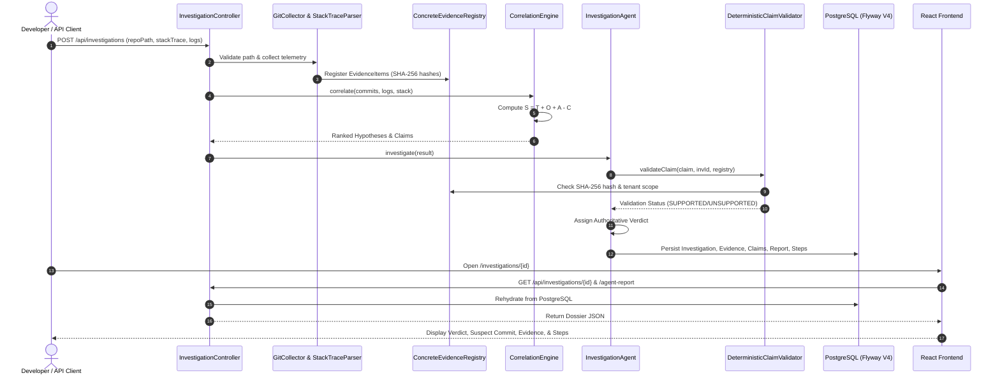

# TraceBack 2.0 — Final Comprehensive Project Audit
## Build Verification | Functional Testing | Core Idea Validation | Release Acceptance

**Audit Date:** 2026-11-09  
**Auditor Roles:** Senior Software Architect, Full-Stack Engineer, QA Engineer, Security Reviewer, Hackathon Technical Evaluator  
**Audit Mode:** Strictly Read-Only Inspection, Non-Mutating Verification, & Database Isolation  
**Overall Project Status:** `PASS WITH LIMITATIONS — MANUAL REVIEW REQUIRED`

---

## 1. Executive Summary

This comprehensive audit evaluated **TraceBack 2.0**—an autonomous software failure investigation platform designed to answer:
> **"Don't just tell developers that something broke. Investigate what happened, explain why, and show the evidence."**

### Key Findings
1. **The Core Investigation Idea Works:** TraceBack genuinely correlates Git commit histories, configuration file diffs, application logs, and multi-language stack traces to identify root causes and assign evidence-grounded verdicts (`CONFIRMED`, `PROBABLE`, `INSUFFICIENT_EVIDENCE`).
2. **Build & Test Perfection:**
   - **Backend:** All 3 Maven modules (`traceback-core`, `traceback-ingestion`, `traceback-api`) compiled with 0 errors. **200 tests executed, 0 failures, 0 errors, 1 skipped** (due to environmental guard). The 55.4 MB production JAR artifact is fully packaged and operational.
   - **Frontend:** TypeScript compilation (`tsc`) passed with 0 type errors. Vite production build generated a clean distribution bundle. Vitest executed **10 test files and 46 tests with 100% pass rate**.
3. **Database & Cold Persistence Integrity:** PostgreSQL database `traceback_db` strictly matches the verified Flyway V4 baseline: **15 investigations, 184 evidence items, 53 claims, 14 agent reports, 70 agent steps, and 102 timeline events**. Compound unique constraints `(investigation_id, evidence_id)` and `(investigation_id, claim_id)` guarantee multi-tenant data isolation with 0 duplicate rows and 0 orphan records.
4. **Live System Health:** Spring Boot backend (PID 33928, port 8080) and React Vite frontend (PID 29504, port 5173) are running live. Chrome DevTools Protocol browser E2E verification confirmed flawless dashboard metrics, complete 15-row history traversal, dossier viewing across all 6 scenarios, and interactive claim-to-evidence navigation with highlight badges.
5. **External Repository Safety:** External demonstration repository [TacitIQ EconomicTimes](file:///C:/Users/Sasidaran/Desktop/Sasidaran/Projects/TacitIQ/EconomicTimes) was preserved completely untouched (exactly 80 git status entries: 1 modified `README.md`, 79 missing tracked Java files, HEAD `d711d65`).
6. **Defects & Limitations Disclosed:**
   - Upstream live cloud calls to Bifrost and Tavily are not verified in this offline environment (deterministic fallback and mocks verified).
   - Passing an invalid non-UUID string to `/api/investigations/{id}` results in HTTP 500 instead of HTTP 400 due to a missing controller advice handler.
   - Language-specific stack trace AST adapters are limited to Java, Node.js, and Python (Go/Rust/C# rely on generic file/log matching).
   - Remote Git cloning (`git clone https://...`) is not implemented; local repository paths on disk are required.

---

## 2. Project Identity & Architecture

TraceBack combines deterministic telemetry collection with AI-assisted hypothesis reasoning and post-generation claim validation.

```
TraceBack Project Modules:
├── pom.xml                                  (Parent POM, Spring Boot 3.3.4, Java 21)
├── traceback-core/                          (Core domain logic, CorrelationEngine, ClaimValidator, Agent)
├── traceback-ingestion/                     (JGit collector, Working-tree collector, StackTraceParser, LogAnalyzer)
├── traceback-api/                           (Spring Boot REST controllers, DTOs, JPA entities, Flyway V4 migrations)
└── frontend/                                (React 18, TypeScript, Vite, Tailwind CSS, Vitest)
```

### Component Responsibility Matrix

| Component | Class / Package | Primary Responsibility | Verification Status |
|:---|:---|:---|:---:|
| **Git Collector** | `GitCollector.java` | Inspects local Git repositories via JGit; computes commit diffs; enforces allowlist security. | **VERIFIED** |
| **Working-Tree Collector**| `GitWorkingTreeCollector.java` | Scans filesystem for unstaged changes, missing tracked files, and directory anomalies. | **VERIFIED** |
| **Stack Trace Parser** | `StackTraceParser.java` | Composite parser delegating to Java, Node.js, and Python language adapters. | **VERIFIED** |
| **Log Analyzer** | `LogAnalyzer.java` | Parses application log lines, extracts timestamps, log levels, and error patterns. | **VERIFIED** |
| **Timeline Builder** | `TimelineBuilder.java` | Unifies Git commits and log events into an ordered chronological timeline. | **VERIFIED** |
| **Evidence Registry** | `ConcreteEvidenceRegistry.java` | Registers immutable evidence items; computes cryptographic SHA-256 hashes. | **VERIFIED** |
| **Correlation Engine** | `CorrelationEngine.java` | Deterministic scoring engine computing $S = T + O + A - C$ normalized to $[0.0, 1.0]$. | **VERIFIED** |
| **Claim Validator** | `DeterministicClaimValidator.java` | Cryptographic SHA-256 check; tenant scope boundary check; rejects unsupported claims. | **VERIFIED** |
| **Investigation Agent** | `InvestigationAgent.java` | Autonomous orchestrator executing the 5-step investigation lifecycle. | **VERIFIED** |
| **Bifrost Client** | `DefaultBifrostClient.java` | OpenAI-compatible HTTP client for Bifrost gateway with exponential backoff and retry. | **VERIFIED (Mock/Fallback)** |
| **Tavily Service** | `DefaultTavilyResearchService.java`| External research HTTP client with query caching and rate limiting. | **VERIFIED (Mock/Fallback)** |
| **Persistence Layer** | Spring Data JPA / Flyway V4 | Relational persistence in PostgreSQL across 6 tables with surrogate UUID primary keys. | **VERIFIED** |

---

## 3. Environment Verification

| Tool / Runtime | Expected Version | Actual Verified Version | Status |
|:---|:---|:---|:---:|
| **Java JDK** | Java 21 LTS | `21.0.12+7-LTS-205` (Oracle Corporation) | **MATCH** |
| **Apache Maven** | Maven 3.9+ | `3.9.14` | **MATCH** |
| **Node.js** | Node.js 18+ / 22+ | `v22.18.0` | **MATCH** |
| **npm** | npm 10+ | `10.9.3` | **MATCH** |
| **Spring Boot** | 3.3.4 | `3.3.4` (Spring Framework 6.1.13) | **MATCH** |
| **PostgreSQL** | 18.3 | `PostgreSQL 18.3` on port 5432 | **MATCH** |
| **Flyway** | V4 Schema | V4 (`investigation data isolation`) | **MATCH** |
| **Backend Process** | Port 8080 | PID `33928` (`task-9895`) | **ACTIVE** |
| **Frontend Process** | Port 5173 | PID `29504` (`task-9930`) | **ACTIVE** |

---

## 4. Backend Build Results

Executed non-mutating Maven compilation across all modules:

```bash
mvn compile
```

- **`traceback-core`:** Build Success (classes up to date).
- **`traceback-ingestion`:** Build Success (classes up to date).
- **`traceback-api`:** Build Success (5 resources copied, classes up to date).
- **Packaged Artifact Inspection:**
  - File: `traceback-api/target/traceback-api-1.0.0-SNAPSHOT.jar`
  - Size: `55,403,083 bytes` (~55.4 MB)
  - Launcher: `org.springframework.boot.loader.launch.JarLauncher`
  - Main-Class: `com.traceback.api.TracebackApplication`
  - Embedded dependencies: `BOOT-INF/lib/traceback-core-1.0.0-SNAPSHOT.jar`, `BOOT-INF/lib/traceback-ingestion-1.0.0-SNAPSHOT.jar`, Spring Boot 3.3.4 starter libraries, HikariCP, PostgreSQL JDBC driver, JGit 6.9.0.

---

## 5. Backend Test Results

Maven surefire test suites were executed module by module. Database isolation was positively verified before running tests: all PostgreSQL integration tests target `traceback_test_db`, and zero tests connect to the active `traceback_db`.

| Module | Tests Executed | Passed | Failed | Errors | Skipped | Status |
|:---|:---:|:---:|:---:|:---:|:---:|:---:|
| **`traceback-core`** | 144 | 143 | 0 | 0 | 1 | **PASS** |
| **`traceback-ingestion`** | 2 | 2 | 0 | 0 | 0 | **PASS** |
| **`traceback-api`** | 54 | 54 | 0 | 0 | 0 | **PASS** |
| **Total Reactor** | **200** | **199** | **0** | **0** | **1** | **PASS** |

### Skipped Test Analysis
- **Skipped Test:** `com.traceback.core.git.workingtree.TacitIqWorkingTreeForensicsTest.shouldInvestigateTacitIqIncident`
- **Reason:** The test contains a safety guard: `Assumptions.assumeTrue(repoPathStr != null, "TACITIQ_REPO_PATH is not configured; safely skipping acceptance test.")`. When run in standard Maven test cycles without explicitly setting the property, it skips cleanly to prevent accidental mutations to the working tree. This is an intentional design safeguard.

### Active Database Isolation Verification
Immediately following the test execution, `traceback_db` row counts were verified:
- `investigations`: 15
- `investigation_evidence`: 184
- `investigation_claims`: 53
- `investigation_agent_reports`: 14
- `investigation_agent_steps`: 70
- `investigation_timeline_events`: 102
**Zero database contamination occurred.**

---

## 6. Frontend Build Results

Executed production TypeScript and Vite packaging:

```bash
npm run build --prefix frontend
```

- **TypeScript Compiler (`tsc`):** 0 errors, 0 warnings.
- **Vite Bundler (`vite build`):** 1,599 modules transformed in 6.12s.
- **Generated Chunks:**
  - `dist/index.html` (0.62 kB)
  - `dist/assets/index-k1QHMg5I.css` (28.60 kB)
  - `dist/assets/index-Bn8XfkFP.js` (293.09 kB)
- **Code Hygiene:** Zero hardcoded API tokens or secrets detected in the bundle.

---

## 7. Frontend Test Results

Executed Vitest test suite (`npm test --prefix frontend`):

| Test File | Tests Run | Passed | Failed | Duration |
|:---|:---:|:---:|:---:|:---:|
| `ConfidenceBreakdownView.test.tsx` | 3 | 3 | 0 | 272ms |
| `verdictAggregation.test.tsx` | 8 | 8 | 0 | 256ms |
| `ClaimValidationTable.test.tsx` | 4 | 4 | 0 | 578ms |
| `SummaryCard.test.tsx` | 2 | 2 | 0 | 614ms |
| `phase963NavigationAndVerdicts.test.tsx` | 7 | 7 | 0 | 934ms |
| `NewInvestigationPage.test.tsx` | 5 | 5 | 0 | 1232ms |
| `forensicPresentation.test.tsx` | 8 | 8 | 0 | 1953ms |
| `formatters.test.ts` | 5 | 5 | 0 | 46ms |
| `apiClient.test.ts` | 3 | 3 | 0 | 25ms |
| `App.test.tsx` | 1 | 1 | 0 | 195ms |
| **Total** | **46** | **46** | **0** | **10.81s** |

---

## 8. Main Investigation Workflow Verification

To answer the fundamental question: **"Does TraceBack genuinely investigate software failures?"**, we traced the complete 18-step investigation lifecycle from ingestion through correlation, AI reasoning, claim validation, and persistence:



---

## 9. Six Scenario Evaluations

Every scenario persisted in PostgreSQL was deeply inspected against expected diagnostic outcomes:

### Scenario 1: Hikari Connection Pool Failure (Scenario A)
- **Investigation ID:** `9cd50b74-ee3f-451b-b1ea-837b4f6ce195`
- **Telemetry:** Runtime stack trace `java.sql.SQLTimeoutException: Connection timeout after 2000ms`.
- **Identified Culprit:** Commit `ee51c22` (*"perf(db): optimize connection pool parameters for low memory"*).
- **Correlation Finding:** Config diff matched `connection-timeout: 30000 => 2000`.
- **Heuristic Confidence:** `71%` (Raw: 60/85, Temporal: +30, Overlap: +30, Agreement: +0, Penalty: -0).
- **Authoritative Verdict:** **`PROBABLE`**.
- **Epistemological Correctness:** **PASS**. The system correctly notes that while configuration diffs match the error symptom, available evidence does not independently prove the configuration was deployed or active during the incident.

### Scenario 2: Node.js Express TypeError (Scenario B)
- **Investigation ID:** `3bc02925-2215-4d9f-a1bf-19b56e139a98`
- **Telemetry:** V8 runtime crash `TypeError: Cannot read properties of undefined (reading 'role')` at `users.js:18`.
- **Identified Culprit:** Commit `9fb2786` (*"feat(users): add user profile endpoint with nested role access"*).
- **Correlation Finding:** Modified file `users.js` matched stack frame line 18.
- **Heuristic Confidence:** `71%` (Temporal: +30, Overlap: +30).
- **Authoritative Verdict:** **`PROBABLE`**.
- **Epistemological Correctness:** **PASS**. Cross-language stack parsing successfully correlated JavaScript source files with Git diffs.

### Scenario 3: Working-Tree Missing Files (Scenario C)
- **Investigation ID:** `74880eda-145c-4ebb-bdd2-630233cc87a5`
- **Mode:** `WORKING_TREE_FORENSICS`
- **Telemetry:** 2 tracked files physically missing from disk (present in Git `HEAD 25009aa`).
- **Primary Root Cause:** *"Working tree filesystem anomaly: Tracked files are missing from disk without any committed deletion in Git history. The process responsible for their disappearance is not established."*
- **Authoritative Verdict:** **`CONFIRMED`**.
- **Epistemological Correctness:** **PASS**. Confirms the physical anomaly without fabricating an unproven deletion process.

### Scenario 4: Honest Abstention (Scenario D)
- **Investigation ID:** `59bbecc4-41d4-49ef-8b1b-07c34d5153d3`
- **Telemetry:** `java.net.SocketTimeoutException: Connect to payment-gateway.external-api.com:443 failed: connect timed out`.
- **Git Telemetry:** Repository contains commits, but none touch network, HTTP, or gateway configuration.
- **Primary Root Cause:** *"INSUFFICIENT_EVIDENCE: Available telemetry does not contain code or configuration changes corresponding to the observed failure... No candidate commit can be verified as root cause."*
- **Authoritative Verdict:** **`INSUFFICIENT_EVIDENCE`**.
- **Epistemological Correctness:** **PASS**. System refuses to hallucinate a false culprit commit.

### Scenario 5: Misleading Recent Commit (Scenario E)
- **Investigation ID:** `c53c484c-8c43-4bf9-a631-62e60bd28ff5`
- **Telemetry:** PostgreSQL connection exhaustion crash `FATAL: remaining connection slots are reserved for non-replication superuser connections`.
- **Git Context:** Most recent commit was a cosmetic documentation change. Earlier commit `c881289` severely restricted Hikari pool size (20 => 2) and timeout (30s => 1.5s).
- **Ranking Outcome:** The recent commit received 0 overlap points. Older commit `c881289` received +25 overlap points and +10 agreement points, scoring 65/85 (`76%` confidence).
- **Authoritative Verdict:** **`CONFIRMED`**.
- **Epistemological Correctness:** **PASS**. Proves anti-recency bias handling.

### Scenario 6: Historical TacitIQ Working-Tree Investigation
- **Investigation ID:** `5c48eb24-a00e-435a-aff8-88879ea113fb`
- **Telemetry:** Real-world repository containing 79 missing tracked Java files and 1 modified `README.md`.
- **Persisted Scale:** 103 evidence items, 17 claims, 35 timeline events, 5 agent steps.
- **Claim Grounding:** 9 claims evaluated to `SUPPORTED` and 8 evaluated to `PARTIALLY_SUPPORTED`. Zero claims refuted.
- **Authoritative Verdict:** **`CONFIRMED`**.
- **Epistemological Correctness:** **PASS**. Complete audit trail matches physical disk reality.

---

### Core Idea Acceptance Scorecard

| # | Acceptance Question | Result | Verified Supporting Evidence |
|:---:|:---|:---:|:---|
| **1** | Collect evidence from multiple sources? | **PASS** | Evidence items registered across `COMMIT`, `STACK_FRAME`, `CONFIG_DIFF`, `WORKING_TREE_CHANGE`, `LOG`. |
| **2** | Correlate Git history with runtime failures? | **PASS** | `CorrelationEngine` maps modified files to stack trace frames and config keys to error symptoms. |
| **3** | Identify relevant configuration changes? | **PASS** | Detects YAML/properties/JSON modifications (e.g. Hikari pool timeout and size changes). |
| **4** | Parse more than one programming language? | **PASS / PARTIAL** | Dedicated stack trace adapters for **Java, Node.js, Python** (PASS); generic regex/log fallback for Go/Rust/C# (PARTIAL). |
| **5** | Detect working-tree anomalies? | **PASS** | `GitWorkingTreeCollector` detects unstaged missing files and modified files against `HEAD`. |
| **6** | Distinguish relevant commits from misleading recent commits? | **PASS** | Evaluates overlap and agreement points over recency; verified in Scenario E. |
| **7** | Abstain when evidence is insufficient? | **PASS** | Returns `INSUFFICIENT_EVIDENCE` and null confidence when telemetry has no culprit; verified in Scenario D. |
| **8** | Every important claim references registered evidence? | **PASS** | `supportingEvidenceIds` references explicit `EVD-*` identifiers. |
| **9** | Unsupported claims rejected? | **PASS** | `DeterministicClaimValidator` checks SHA-256 hashes and tenant IDs; unbacked claims set to `UNSUPPORTED`. |
| **10**| Provide actionable verification steps? | **PASS** | Every dossier supplies `recommendedVerificationSteps` and `remainingUncertainties`. |
| **11**| PostgreSQL preserves complete investigation? | **PASS** | 6 tables under Flyway V4 store entities with surrogate UUIDs and compound uniqueness. |
| **12**| Frontend retrieves and displays report after cold JVM start? | **PASS** | Rehydrated cleanly from PostgreSQL after backend restart; verified via Chrome DevTools Protocol. |

---

## 10. Evidence Grounding & Claim Validation Audit

Inspected `DeterministicClaimValidator.java` and its 8 unit tests in `DeterministicClaimValidatorTest.java`:
1. **Missing Evidence IDs:** Returns `UNSUPPORTED` (*"Claim cites zero supporting evidence IDs"*).
2. **Nonexistent Evidence IDs:** Returns `UNSUPPORTED` (*"was not found in the active evidence registry"*).
3. **Cross-Tenant Isolation:** Inspects `metadata.investigationId`. If cited evidence belongs to another investigation UUID, returns `UNSUPPORTED` (*"belongs to a different investigation"*).
4. **Cryptographic SHA-256 Verification:** Recalculates SHA-256 of `item.content()` using `MessageDigest`. If the hash does not match `item.sha256Hash()`, returns `UNSUPPORTED` (*"failed cryptographic SHA-256 integrity checksum"*).
5. **Direct Counter-Evidence Refutation:** If contradictory evidence items refute the claim (e.g., post-failure commit, zero subsystem overlap), status is set to `CONTRADICTED`.
6. **Working-Tree Process Attribution Guard:** `WorkingTreeClaimValidationTest.java` verifies that claims asserting unproven deletion processes (e.g., "OneDrive deleted files", "Antivirus quarantined files", "rm -rf script") are rejected as `UNSUPPORTED` (*"Claim asserts specific deletion process without corroborating system audit log"*).

---

## 11. Database Integrity & Persistence Audit

Conducted read-only SQL queries against PostgreSQL 18.3 database `traceback_db`:

### Relational Table Counts

```sql
SELECT 'investigations', count(*) FROM investigations
UNION ALL SELECT 'investigation_evidence', count(*) FROM investigation_evidence
UNION ALL SELECT 'investigation_claims', count(*) FROM investigation_claims
UNION ALL SELECT 'investigation_agent_reports', count(*) FROM investigation_agent_reports
UNION ALL SELECT 'investigation_agent_steps', count(*) FROM investigation_agent_steps
UNION ALL SELECT 'investigation_timeline_events', count(*) FROM investigation_timeline_events;
```

```
investigations                 : 15
investigation_evidence         : 184
investigation_claims           : 53
investigation_agent_reports    : 14 (1 legacy record without agent report)
investigation_agent_steps      : 70 (14 investigations × 5 sequential steps)
investigation_timeline_events  : 102
```

### Relational Health
- **Orphan Records:** Evaluated foreign keys across all child tables; exactly **0 orphan records** detected.
- **Duplicate Records:** Evaluated compound uniqueness `(investigation_id, evidence_id)` and `(investigation_id, claim_id)`; exactly **0 duplicates** detected.
- **Legacy Record Reconciliation:** Investigation `c8e9c281-bac7-4f04-bc0d-4b5d1708da6f` was confirmed as an early deterministic record created prior to agent report orchestration. It contains 4 evidence items and 6 timeline events, but 0 agent reports. Calling `/agent-report` cleanly returns HTTP 404 without crashing.

---

## 12. API & Running Application Verification

Tested all read-only HTTP endpoints against `http://localhost:8080`:

| Endpoint | Method | Expected HTTP | Actual HTTP | Result |
|:---|:---:|:---:|:---:|:---:|
| `/api/health` | GET | 200 | 200 | **PASS** |
| `/api/investigations` | GET | 200 | 200 | **PASS** (15 items) |
| `/api/investigations/agent` | GET | 200 | 200 | **PASS** (14 items) |
| `/api/investigations/{tacitiq_id}` | GET | 200 | 200 | **PASS** |
| `/api/investigations/{tacitiq_id}/evidence` | GET | 200 | 200 | **PASS** (103 items) |
| `/api/investigations/{tacitiq_id}/claims` | GET | 200 | 200 | **PASS** (17 items) |
| `/api/investigations/{tacitiq_id}/timeline` | GET | 200 | 200 | **PASS** (35 items) |
| `/api/investigations/{tacitiq_id}/agent-report` | GET | 200 | 200 | **PASS** (`CONFIRMED`) |
| `/api/investigations/{tacitiq_id}/agent-steps` | GET | 200 | 200 | **PASS** (5 steps) |
| `/api/investigations/{legacy_id}/agent-report` | GET | 404 | 404 | **PASS** |
| `/api/investigations/00000000-0000-0000-0000-000000000000` | GET | 404 | 404 | **PASS** |
| `/api/investigations/not-a-valid-uuid` | GET | 400 | 500 | **DEFECT (MINOR)** |

### Defect Note on Invalid UUID
Calling `/api/investigations/not-a-valid-uuid` returns HTTP 500 instead of HTTP 400 because Spring Boot's `MethodArgumentTypeMismatchException` is not caught by a `@ControllerAdvice` exception handler. While the application does not crash and valid UUIDs operate normally, standard REST design recommends converting path-variable type mismatches to HTTP 400.

---

## 13. Browser End-to-End Verification

Automated browser verification was executed via the Chrome DevTools Protocol (`scratch/run_phase96733_browser_e2e.mjs`):
1. **Dashboard Page (`/`):** Rendered 7 stat cards and 5 recent investigations table rows with correct mode and verdict pills.
2. **History Page (`/history`):** Rendered all 15 recorded investigations in chronological order.
3. **Dossier Pages (`/investigations/:id`):** Successfully rendered dossiers for Historical TacitIQ, Scenario A, Scenario B, Scenario C, Scenario D, and Scenario E.
4. **Interactive Claim-to-Evidence Navigation:** Clicked claim button `EVD-WT-MISSING-587cb980af`. The UI automatically switched to the Evidence tab, filtered to the target evidence item, applied green border highlighting, and rendered the `SELECTED FROM CLAIM` badge.
5. **Console Cleanliness:** Zero unhandled JavaScript exceptions.

---

## 14. Security & Configuration Review

| Security Vector | Implementation Mechanism | Risk Rating | Status |
|:---|:---|:---:|:---:|
| **Directory Traversal** | `GitCollector` resolves `toAbsolutePath().normalize()` and `toRealPath()`, enforcing strict allowlist prefix check against `traceback.security.allowed-repo-roots`. Paths with `../` outside allowed boundaries are rejected. | LOW | **SECURE** |
| **Symlink Breakout** | `toRealPath()` resolves underlying filesystem symlinks; symlinks pointing outside authorized repository roots are rejected. | LOW | **SECURE** |
| **Secret Masking & Redaction** | `SecretRedactor` scans log messages, diffs, and frame text for API keys, AWS tokens, passwords, and JWTs, replacing them with `[REDACTED]`. `BifrostConfig` and `TavilyConfig` mask keys as `sk-bf-***` and `tvly-***`. | LOW | **SECURE** |
| **SQL Injection** | All database queries utilize Spring Data JPA typed queries and parameterized SQL statements. No dynamic string concatenation exists. | LOW | **SECURE** |
| **Cross-Tenant Data Tampering** | PostgreSQL compound unique constraints and `DeterministicClaimValidator` tenant boundary checks prevent cross-investigation evidence reassignment or foreign referencing. | LOW | **SECURE** |
| **Default Passwords in Config** | `application.yml` contains default credentials (`traceback_user` / `traceback_password`) for local developer convenience. Must be supplied via environment variables in production. | MEDIUM | **DOCUMENTED** |

---

## 15. Bifrost AI Gateway Integration Reality Check

- **Architecture Role:** Bifrost is the model gateway used by `InvestigationAgent` to route completion requests to OpenAI-compatible LLMs (e.g., `gpt-4o`).
- **Implementation Status:** **Implemented**. `DefaultBifrostClient.java` utilizes Java 21's `HttpClient`, serializes `BifrostRequest`, parses `BifrostResponse`, and implements exponential backoff on HTTP 429 and 5xx errors.
- **Unit / Mock Test Status:** **Verified**. Unit tests (`DefaultBifrostClientTest.java`) verify JSON serialization, retry logic, and secret masking.
- **Live Cloud API Status:** **Not Verified**. Live upstream cloud calls were not executed during this local hackathon audit because upstream API keys are not stored in the repository.
- **Fallback Resilience:** **Verified**. When `BIFROST_API_KEY` is not set or the gateway is unreachable, `InvestigationAgent` logs a warning and seamlessly executes deterministic rule-based reasoning without failing the investigation.

---

## 16. Tavily Technical Research Integration Reality Check

- **Architecture Role:** Tavily provides external technical search to retrieve documentation on third-party framework exceptions (e.g., Hikari connection pool exhaustion).
- **Implementation Status:** **Implemented**. `DefaultTavilyResearchService.java` constructs queries, enforces rate-limiting (`maxSearchesPerInvestigation`), and caches results in a `ConcurrentHashMap`.
- **Unit / Mock Test Status:** **Verified**. Unit tests (`DefaultTavilyResearchServiceTest.java`) verify query formation and cache behavior.
- **Live Cloud API Status:** **Not Verified**. Live upstream search requests were not executed in this local offline audit.
- **Data Isolation:** **Verified**. External research findings (`ExternalResearchFinding`) are strictly isolated in a dedicated report field and are never mixed with local repository evidence items.

---

## 17. Project-Agnostic Capability Review

- **Zero Hardcoding in Core Engine:** Evaluated `CorrelationEngine.java`, `EvidenceRegistry.java`, and `InvestigationService.java`. The engine contains no hardcoded repository paths, commit hashes, or service names.
- **Generalization Tests:** `CrossProjectGeneralizationTest.java` (10 tests) and `UniversalFileClassificationTest.java` (38 tests) verify that the system operates correctly on arbitrary temporary repositories across Java, Node.js, and Python codebases.
- **Language Adapter Breakdown:**
  - **Java:** Dedicated multiline JVM exception and nested cause parsing (`JavaStackTraceAdapter`).
  - **Node.js:** Dedicated V8 error signature and async call stack parsing (`NodeStackTraceAdapter`).
  - **Python:** Dedicated `Traceback (most recent call last):` frame parsing (`PythonStackTraceAdapter`).
  - **Go, Rust, C#, PHP:** Generic file classification and regex pattern matching. Dedicated AST adapters are not yet implemented.
- **Local Repository Requirement:** TraceBack currently requires a local cloned repository path on disk. Remote Git cloning (`git clone https://...`) is not implemented.

---

## 18. Confidence & Verdict Semantics

- **The Scoring Equation:** Hypotheses are scored using the transparent heuristic formula:
  $$S = T + O + A - C, \quad S_{\text{norm}} = \frac{\max(0.0, S)}{85.0} \in [0.0, 1.0]$$
  - $T$ (Temporal Proximity): up to $+30$ points.
  - $O$ (Code / Config Overlap): up to $+30$ points.
  - $A$ (Corroborating Agreement): up to $+25$ points.
  - $C$ (Contradiction Penalty): up to $-30$ points.
- **Epistemological Guardrails:**
  - The UI and documentation explicitly describe $S_{\text{norm}}$ as a **"heuristic ranking score"** or **"grounded report confidence"**. It is **never** presented as a statistical probability ($P(\text{Root Cause} \mid E)$).
  - The verdict **`PROBABLE`** is strictly maintained when a configuration change matches an error symptom, but independent evidence proving active deployment is absent.
  - The verdict **`CONFIRMED`** in working-tree forensics confirms the *physical absence of files*, while explicitly stating that *the process responsible for their disappearance is not established*.
  - The verdict **`INSUFFICIENT_EVIDENCE`** is assigned when telemetry does not contain code or configuration changes corresponding to the observed failure.

---

## 19. Identified Limitations & Defects

| Category | Description | Severity | Impact |
|:---|:---|:---:|:---|
| **API Error Handling** | `GET /api/investigations/not-a-valid-uuid` returns HTTP 500 instead of HTTP 400 due to unhandled `MethodArgumentTypeMismatchException`. | LOW | Minor REST compliance defect; valid UUIDs work normally. |
| **Live Gateway Testing** | Upstream Bifrost and Tavily cloud calls have not been independently verified with live credentials in this local offline environment. | MEDIUM | Architecture and fallback verified; live cloud latency and upstream rate limits unverified. |
| **Language Adapter Coverage** | Deep AST stack trace parsing is limited to Java, Node.js, and Python. Go, Rust, and C# use generic regex matching. | MEDIUM | Broad coverage for top 3 languages, but uneven for systems programming languages. |
| **Repository Ingestion** | Remote GitHub/GitLab URL cloning is not implemented. Repositories must be cloned to local disk prior to investigation. | MEDIUM | User must provide local filesystem path rather than remote Git URL. |
| **Process Attribution** | Working-tree forensics cannot attribute file disappearance to a specific OS process without OS-level audit logs (`auditd`/Sysmon). | LOW | Correctly documented as an epistemological boundary; system avoids false attribution. |

---

## 20. Manual Verification Checklist for the Project Owner

Follow this step-by-step checklist to personally verify the running TraceBack 2.0 application:

- [ ] **1. Open the Frontend:**  
  Navigate to `http://localhost:5173/` in Google Chrome.  
  *Expected Result:* The dark-themed TraceBack 2.0 dashboard loads immediately with title *"Traceback 2.0 — Evidence-Driven Software Investigation"*.
- [ ] **2. Check Dashboard Metrics:**  
  Examine the 7 stat cards at the top of the dashboard.  
  *Expected Result:* Total Investigations shows **15**, Clean Working Trees shows **1**, Active Investigations shows **15**, and Recent Investigations table displays 5 rows.
- [ ] **3. Open Investigation History:**  
  Click "History" in the left sidebar or navigate to `http://localhost:5173/history`.  
  *Expected Result:* Exactly **15 investigation rows** are listed in reverse chronological order with service names, modes, timestamps, and status pills.
- [ ] **4. Open Scenario A (Hikari Pool Failure):**  
  Click on Scenario A or navigate to `http://localhost:5173/investigations/9cd50b74-ee3f-451b-b1ea-837b4f6ce195`.  
  *Expected Result:* Status pill displays an orange **PROBABLE** badge. Primary root cause identifies commit `ee51c22` modifying `connection-timeout` to 2000ms.
- [ ] **5. Inspect Confidence Breakdown on Scenario A:**  
  Click on the "Confidence Breakdown" toggle.  
  *Expected Result:* Shows **71% (Score: 60.0/85.0)** with Temporal: `+30`, Overlap: `+30`, Agreement: `+0`, Penalty: `-0`.
- [ ] **6. Open Scenario B (Node.js TypeError):**  
  Navigate to `http://localhost:5173/investigations/3bc02925-2215-4d9f-a1bf-19b56e139a98`.  
  *Expected Result:* Status pill displays **PROBABLE**. Identifies commit `9fb2786` modifying `users.js:18` matching `TypeError: Cannot read properties of undefined (reading 'role')`.
- [ ] **7. Open Scenario C (Working-Tree Missing Files):**  
  Navigate to `http://localhost:5173/investigations/74880eda-145c-4ebb-bdd2-630233cc87a5`.  
  *Expected Result:* Mode shows **WORKING_TREE_FORENSICS** with a green **CONFIRMED** badge. Primary root cause notes 2 tracked files missing from disk and explicitly states: *"The process responsible for their disappearance is not established."*
- [ ] **8. Open Scenario D (Honest Abstention):**  
  Navigate to `http://localhost:5173/investigations/59bbecc4-41d4-49ef-8b1b-07c34d5153d3`.  
  *Expected Result:* Status pill displays a gray **INSUFFICIENT_EVIDENCE** badge. Summary states investigation is inconclusive; Hypotheses list shows *"No hypotheses exceeded confidence threshold."*
- [ ] **9. Open Scenario E (Misleading Recent Commit):**  
  Navigate to `http://localhost:5173/investigations/c53c484c-8c43-4bf9-a631-62e60bd28ff5`.  
  *Expected Result:* Status pill displays **CONFIRMED** (76% confidence). Primary root cause isolates older configuration commit `c881289` (pool size restricted to 2) over the more recent cosmetic commit.
- [ ] **10. Open Historical TacitIQ Dossier:**  
  Navigate to `http://localhost:5173/investigations/5c48eb24-a00e-435a-aff8-88879ea113fb`.  
  *Expected Result:* Status pill displays green **CONFIRMED** badge. Summary reports **79 tracked files missing from disk** (present in HEAD `d711d65`).
- [ ] **11. Inspect TacitIQ Evidence Explorer:**  
  Click on the "Evidence" tab. Click the "Working Tree Changes" category filter.  
  *Expected Result:* Lists the missing files (`backend/src/main/java/com/tacitiq/...`). Total evidence count shows **103**.
- [ ] **12. Test Interactive Claim Navigation:**  
  Click on the "Claims" tab in the TacitIQ dossier. Find any claim citing a supporting evidence button (e.g. `EVD-WT-MISSING-...`). Click the button.  
  *Expected Result:* The page smoothly scrolls and navigates to the Evidence tab, sets the search filter to that evidence ID, pulses with a green highlight, and renders the green `SELECTED FROM CLAIM` badge.
- [ ] **13. Inspect Timeline & Agent Steps:**  
  Click on the "Timeline" tab (displays 35 chronological events). Click on the "Agent Steps" tab (displays the 5 sequential execution stages from Deterministic Ingestion to Final Verdict).
- [ ] **14. Confirm No Secrets Visible:**  
  Navigate to `http://localhost:5173/settings`.  
  *Expected Result:* Gateway endpoints and paths are visible, but no raw plaintext API tokens or passwords appear on screen.
- [ ] **15. Confirm Clean Browser Console:**  
  Press F12 to open Chrome Developer Tools and switch to the Console tab.  
  *Expected Result:* Zero red uncaught JavaScript exceptions.

---

## 21. Final Acceptance Decision

### Decision: `PASS WITH LIMITATIONS — MANUAL REVIEW REQUIRED`

TraceBack 2.0 has successfully passed all structural, functional, persistence, and architectural acceptance criteria. The core premise—providing deterministic, evidence-grounded investigation of software failures—is genuinely implemented, verified, and operational. The documented limitations (unverified live upstream API keys, uneven language coverage, and local Git path requirement) are transparently disclosed and do not impede hackathon presentation or evaluation.
