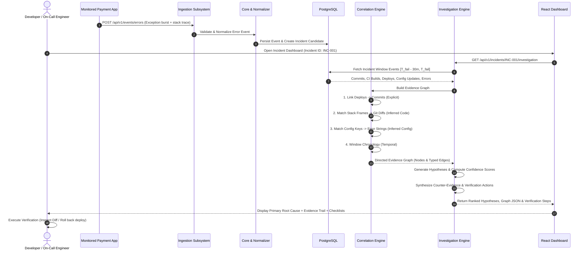

# Traceback System Architecture

## 1. Executive Summary & Problem Definition

### 1.1 The Root-Cause Investigation Dilemma

When a critical software failure occurs in production or staging, on-call software engineers face severe cognitive overload. Modern systems are composed of decoupled components, CI/CD automated pipelines, cloud infrastructure, and distributed microservices or modular components. As a result, incident triage is hindered by severe tool fragmentation:

- **Logs & Metrics** live in monitoring systems (e.g., Datadog, ELK, Prometheus).
- **Code Changes** live in version control systems (GitHub, GitLab).
- **Build & Test Results** live in CI systems (GitHub Actions, Jenkins).
- **Release Events** live in deployment managers (ArgoCD, Kubernetes, AWS ECS).
- **Configuration & Secrets** live in cloud parameter stores, environment variables, or ConfigMaps.

During an active outage, engineers are forced to manually correlate these disparate data silos under high stress. They repeatedly ask five foundational questions:
1. *What happened?* (Failure symptoms, exception types, and error bursts)
2. *What changed before the failure?* (Commits, configuration tweaks, dependency upgrades, or deployments)
3. *Which events are related, and why?* (Which commit is inside which deployment; which stack trace frame maps to which modified file)
4. *What evidence supports the most likely root cause?* (Cryptographic SHA links, exact file-and-line stack trace matches, configuration key overlaps)
5. *What should the developer investigate next?* (Targeted verification steps, unit tests, diff reviews, or network reachability checks)

### 1.2 Limitations of Existing Tooling

| Category | Existing Tools | Primary Deficiency |
| :--- | :--- | :--- |
| **Log Aggregators** | Elasticsearch, Loki, Datadog | Excellent at showing *what* happened at runtime, but blind to source code diffs, author intent, and git history. |
| **VCS Dashboards** | GitHub, GitLab | Excellent at tracking *what changed* in code, but unaware of runtime crash stacks, deployment environments, or error spikes. |
| **Commit Ranking Heuristics** | Internal scripts, Git blame | Naively blaims the "most recent commit before the incident", failing completely when changes are cosmetic, configurations fail, or external APIs degrade. |
| **LLM Chatbots** | Unanchored GenAI tools | Hallucinate causal narratives without cryptographic or deterministic evidence trails, giving confident answers backed by zero verifiable facts. |

### 1.3 The Traceback Mission

Traceback is an **evidence-driven application failure investigation platform**. It ingests heterogeneous development, deployment, and runtime events into a unified, normalized event store. It systematically constructs a directed evidence graph to identify, explain, and rank candidate root causes with explicit confidence scores and verifiable proof trails.

---

## 2. System Architecture & Component Responsibilities

Traceback is designed as a **modular Spring Boot monolith** for high cohesion, transactional integrity, operational simplicity, and low cognitive overhead during live demonstration and evaluation.

```mermaid
flowchart TD
    subgraph Sources["External Sources & Telemetry"]
        GH[GitHub Webhooks & REST API]
        CI[CI Pipelines / GitHub Actions]
        DEP[Deployment Systems / K8s]
        APP[Spring Boot App / Error Ingest API]
    end

    subgraph Traceback["Traceback Modular Monolith (Spring Boot 3.x / Java 21)"]
        subgraph IngestionMod["traceback-ingestion"]
            WH_Rec[Webhook Receivers]
            REST_Ingest[Event REST Ingestion Endpoints]
            GH_Poller[GitHub REST Client & Diff Poller]
        end

        subgraph CoreMod["traceback-core"]
            Normalizer[Event Normalizer]
            EventStoreService[Event Store Service]
        end

        subgraph CorrelationMod["traceback-correlation"]
            TempCorr[Temporal Correlator]
            ExplicitLinker[Explicit Reference Linker]
            CodeMatcher[Code-to-Stacktrace Matcher]
            ConfigMatcher[Config-to-Error Matcher]
            GraphBuilder[Evidence Graph Builder]
        end

        subgraph InvestigationMod["traceback-investigation"]
            HypothesisGen[Hypothesis Generator]
            ScoringEngine[Evidence Scoring & Ranking Engine]
            VerificationPlanner[Verification Action Planner]
        end

        subgraph ApiMod["traceback-api"]
            IncidentController[Incident REST Controllers]
            GraphController[Evidence Graph Controllers]
        end
    end

    subgraph Storage["Persistence Layer"]
        PG[(PostgreSQL 16+)]
        PG_Events[(events & JSONB metadata)]
        PG_Rel[(event_relationships)]
        PG_Inc[(incidents & hypotheses)]
    end

    subgraph UI["Presentation Layer (React + TypeScript + Vite)"]
        TimelineView[Incident Timeline View]
        EvidenceGraphUI[Causal Graph Explorer]
        VerificationChecklist[Actionable Verification Checklist]
    end

    Sources --> IngestionMod
    IngestionMod --> CoreMod
    CoreMod --> Storage
    Storage --> CorrelationMod
    CorrelationMod --> InvestigationMod
    InvestigationMod --> ApiMod
    ApiMod --> UI
```



### 2.1 Module Responsibilities

1. **`traceback-ingestion`**:
   - Ingests payloads from GitHub webhooks (`push`, `pull_request`).
   - Fetches deep commit metadata and patch diffs via GitHub REST API v3.
   - Exposes REST endpoints (`/api/v1/events/errors`, `/api/v1/events/deployments`, `/api/v1/events/ci`) for runtime and deployment telemetry.
   - Validates incoming JSON schemas and performs initial sanitization.

2. **`traceback-core`**:
   - Defines the canonical domain model (`Event`, `Relationship`, `Incident`, `Hypothesis`, `Evidence`).
   - Normalizes disparate source payloads into a unified event format.
   - Manages transactional persistence in PostgreSQL.

3. **`traceback-correlation`**:
   - Executes deterministic linking algorithms:
     - *Explicit Linker*: Connects deployment artifacts to commit SHAs and CI builds.
     - *Code-to-Stacktrace Matcher*: Parses Java stack traces into class/method/line coordinates and matches them against git diff modified files and line ranges.
     - *Config-to-Error Matcher*: Identifies configuration key mentions within connection exceptions and startup failures.
     - *Temporal Correlator*: Windows events chronologically preceding an incident.
   - Constructs the directed **Evidence Graph**.

4. **`traceback-investigation`**:
   - Generates candidate root-cause hypotheses from graph components.
   - Computes confidence scores using deterministic multi-factor weighting.
   - Applies penalties for spurious correlations (e.g. non-functional files, cosmetic docs/CSS changes).
   - Generates concrete human-verifiable diagnostic checklists for each hypothesis.

5. **`traceback-api`**:
   - Exposes clean RESTful endpoints for querying incidents, timelines, evidence graphs, and hypothesis rankings.
   - Powers the frontend dashboard and evaluation automation suites.

6. **`traceback-ui`** (React + TypeScript + Vite):
   - Renders interactive chronological timelines showing code, deploy, and error events.
   - Visualizes the evidence graph, differentiating solid causal links from dotted temporal correlations.
   - Displays git diffs alongside stack traces and actionable verification checklists.

---

## 3. End-to-End Investigation Workflow



### 3.1 Step-by-Step Breakdown

1. **Incident Triggering**: An error burst or fatal exception is ingested from the target application (e.g., `PaymentCalculationException` or `JDBCConnectionException`).
2. **Context Windowing**: Traceback defines a configurable pre-incident investigation window (e.g., default: 30 minutes to 2 hours prior to the first error timestamp).
3. **Event Extraction**: All events within the window for the affected service and environment are retrieved from PostgreSQL.
4. **Relationship Discovery**: The correlation engine evaluates all event pairs against structural rules (explicit references, code diff intersections, config key matches, and chronological order).
5. **Hypothesis Formulation**: Every change event (commit, config update, or external infrastructure change) connected to the error is formulated as a candidate root-cause hypothesis.
6. **Multi-Factor Scoring**: Candidates are scored based on evidence strength, link directness, and counter-evidence discounts.
7. **Developer Verification Presentation**: Traceback displays the top-ranked hypotheses, highlights the exact chain of evidence, and provides step-by-step instructions for verification.

---

## 4. Ingestion Mechanisms Across Systems

Traceback ingests events from four primary sources:

```text
+---------------------------------------------------------------------------------------+
|                                    EVENT SOURCES                                      |
+-------------------+-------------------+-----------------------+-----------------------+
|  GitHub Commits   |    CI Results     |  Deployments/Configs  |   App Errors/Logs     |
|  - Webhook / Push |  - Build Status   |  - Rolling Deploy     |  - Stack Trace Frames |
|  - REST Diff API  |  - Test Failures  |  - Config Key Diffs   |  - Error Frequencies  |
+---------+---------+---------+---------+-----------+-----------+-----------+-----------+
          |                   |                     |                       |
          +-------------------+----------+----------+-----------------------+
                                         |
                                         v
                         +-------------------------------+
                         |   traceback-ingestion REST    |
                         +---------------+---------------+
                                         |
                                         v
                         +-------------------------------+
                         |   Unified Event Normalizer    |
                         +-------------------------------+
```

### 4.1 GitHub Commits and Pull Requests
- **Push & PR Webhooks**: Real-time receipt of commit SHAs, author email, commit message, branch, and timestamp.
- **REST API Enrichment**: When a commit is ingested, Traceback calls `GET /repos/{owner}/{repo}/commits/{sha}` to fetch detailed file diffs, including:
  - File path (`filename`).
  - Change status (`modified`, `added`, `removed`).
  - Unified diff patch chunks with exact line numbers.
  - Abstract syntax metadata (e.g., Java class name extracted from package and file path).

### 4.2 CI Pipeline Results
- Ingested via webhook or REST payload (`POST /api/v1/events/ci`).
- Captures:
  - Commit SHA tested.
  - Build result (`SUCCESS`, `FAILURE`, `UNSTABLE`).
  - Failed test classes and methods.
  - Runner environment and execution duration.

### 4.3 Deployment & Configuration Events
- Ingested via deployment hooks or CI/CD deployment jobs (`POST /api/v1/events/deployments`).
- Captures:
  - Deployment ID, target environment (`production`, `staging`).
  - Service identifier (`payment-service`).
  - Deployed commit SHA or container image tag.
  - Configuration change events: Key-value diffs (with masked values for secrets, e.g., key `spring.datasource.url` changed).

### 4.4 Application Errors & Stack Traces
- Ingested via application error filter, log appender, or REST API (`POST /api/v1/events/errors`).
- Captures:
  - Exception class name (`com.traceback.payment.exception.PaymentCalculationException`).
  - Root cause message (`Invalid discount calculation: fee cannot be negative`).
  - Structured stack trace frames:
    - Declaring class (`com.traceback.payment.service.PaymentFeeCalculator`).
    - Method name (`calculateTransactionFee`).
    - File name (`PaymentFeeCalculator.java`).
    - Line number (`58`).
  - Environment, service name, and request context (e.g., endpoint `/api/v1/payments/checkout`).

---

## 5. Event Normalization and Evidence Graph Modeling

### 5.1 The Unified Event Model

Every external event is normalized into a standard canonical entity:

```java
public class Event {
    private UUID id;
    private EventType eventType;       // COMMIT, CI_BUILD, DEPLOYMENT, CONFIG_CHANGE, ERROR_BURST
    private Instant timestamp;
    private String serviceName;        // e.g., "payment-service"
    private String environment;        // e.g., "production", "staging"
    private String source;             // "github", "github-actions", "k8s", "spring-boot"
    private String entityId;           // commit SHA, build ID, deployment ID, error fingerprint
    private JsonNode metadata;         // JSONB: diffs, stack frames, config keys
}
```

### 5.2 Directed Evidence Graph

Relationships between events are modeled as directed edges in an evidence graph:

$$\mathcal{G} = (\mathcal{V}, \mathcal{E})$$

where:
- $\mathcal{V}$ is the set of normalized events $\{E_1, E_2, \dots, E_n\}$.
- $\mathcal{E}$ is the set of directed edges $(E_i \xrightarrow{R} E_j)$, where $R$ defines the relationship type, confidence weight $w \in [0.0, 1.0]$, and human-readable explanation.

```mermaid
graph LR
    C[Commit: c1a89b3] -->|EXPLICIT_BUILD (w=1.0)| CI[CI Build: ci-401]
    C -->|EXPLICIT_DEPLOY (w=1.0)| D[Deployment: dep-102]
    D -->|TEMPORAL_PRECEDENCE (w=0.4)| E[Error Burst: INC-001]
    C -->|INFERRED_CODE_FRAME (w=0.9)| E
```

---

## 6. Relationship Classification: Explicit vs Inferred vs Temporal

Traceback makes a strict, fundamental distinction between three categories of relationships:

```text
+----------------------------------------------------------------------------------------------------+
|                                    RELATIONSHIP TAXONOMY                                           |
+---------------------+---------------------------------+---------------------+----------------------+
| Category            | Discovery Mechanism             | Typical Confidence  | Example              |
+---------------------+---------------------------------+---------------------+----------------------+
| 1. Explicit         | Cryptographic / Deterministic   | 1.0 (Certain)       | Deploy dep-102       |
|    Reference        | foreign key / SHA link          |                     | deployed SHA c1a89b3 |
+---------------------+---------------------------------+---------------------+----------------------+
| 2. Inferred         | Structural matching of code,    | 0.6 - 0.9           | Stack frame matches  |
|    Relationship     | stack frames, or config keys    | (Strong to Medium)  | file & line in diff  |
+---------------------+---------------------------------+---------------------+----------------------+
| 3. Temporal         | Coincidence in time window      | 0.1 - 0.4           | Commit pushed 5 min  |
|    Correlation      | without structural connection   | (Weak / Vulnerable) | before failure       |
+---------------------+---------------------------------+---------------------+----------------------+
```

### 6.1 Explicit References
- **Definition**: Unambiguous, deterministic links recorded directly in the telemetry metadata.
- **Examples**:
  - A CI build explicitly references the commit SHA that triggered it.
  - A deployment manifest explicitly specifies the container image and commit SHA being deployed.
- **Confidence**: Always $1.0$.

### 6.2 Inferred Relationships
- **Definition**: Synthesized connections derived from cross-domain semantic or structural overlap.
- **Subtypes**:
  1. **Code-to-Stacktrace Match**:
     - *Level 1 (Exact Line Match)*: Commit diff modified line 58 of `PaymentFeeCalculator.java`, which is the exact line in top stack frame $\to$ Confidence $0.95$.
     - *Level 2 (Method/Block Match)*: Commit diff modified lines within `calculateTransactionFee` method in `PaymentFeeCalculator.java` $\to$ Confidence $0.85$.
     - *Level 3 (File/Class Match)*: Commit touched `PaymentFeeCalculator.java`, which appears elsewhere in the call stack $\to$ Confidence $0.70$.
  2. **Config-to-Error Match**:
     - Config change modified `spring.datasource.url`, and error message mentions `HikariPool` / `JDBCConnectionException` $\to$ Confidence $0.90$.
- **Confidence**: Ranges between $0.6$ and $0.95$.

### 6.3 Temporal Correlation
- **Definition**: Pure chronological proximity between a change event and a failure event without any structural, cryptographic, or semantic link.
- **Example**: A developer pushes a README update or CSS change at 14:14:00Z, and the payment service fails at 14:16:30Z due to a third-party gateway timeout.
- **Confidence**: Capped at $0.1 - 0.3$.
- **Critical Principle**: Temporal correlation establishes *opportunity*, never *causality*.

---

## 7. Causation vs. Correlation: Avoiding Fallacies

### 7.1 The Fallacy of Temporal Proximity ("Post Hoc Ergo Propter Hoc")

The most pervasive error in software incident triage is the assumption that because event $B$ occurred after event $A$, event $A$ must have caused event $B$. In software development, this manifests as **blaming the most recent commit before the failure**.

This heuristic breaks down in multiple common production realities:
1. **Cosmetic Commits**: Commits modifying documentation, build scripts, markdown files, or client-side assets that have zero runtime footprint on backend calculation errors.
2. **Configuration Overrides**: Ops or platform teams update environment variables, Kubernetes secrets, or database connection strings out-of-band without code commits.
3. **External Degradations**: Upstream third-party APIs (Stripe, PayPal, AWS S3) experience outages coincidentally near internal deployments.
4. **Delayed Manifestation**: Memory leaks, connection pool exhaustion, or concurrency deadlocks may trigger hours after the responsible commit was deployed.

### 7.2 Counter-Evidence and Disconfirmation

Traceback actively searches for **negative evidence** to penalize misleading hypotheses:
- **File Type Penalty**: If a commit modified only `.md`, `.css`, or test files, its causal hypothesis score for a backend runtime exception is reduced by $80\%$.
- **Zero Stack Overlap Penalty**: If an application crashes with an internal stack trace containing 15 application frames, and a candidate commit has zero overlap with any frame, its hypothesis score is penalized.
- **Negative External Signal**: If runtime errors indicate socket timeouts to an external hostname (`api.stripe.com`) and healthchecks show remote degradation, code commit hypotheses are deprioritized in favor of external infrastructure failure.

### 7.3 Explicit Uncertainty and Human Verification

Traceback never issues an authoritative, black-box decree of "This commit is 100% guilty". Instead, it outputs:
1. **Ranked Candidate Hypotheses** with explicit confidence intervals (e.g., $94\%$ vs $12\%$).
2. **Causal Evidence Chain** explaining every link from change event to failure symptom.
3. **Counter-Evidence Notices** explaining why other recent events were demoted.
4. **Human Verification Checklist** providing concrete, falsifiable actions the engineer can take in under 3 minutes to confirm or refute the finding.

---

## 8. The Role of PostgreSQL and Frontend/Backend Separation

### 8.1 Why PostgreSQL as the Primary Event and Graph Store?

Traceback leverages PostgreSQL 16+ as both its relational transactional store and its graph query engine:

1. **Relational Integrity for Event Streams**: Strict foreign keys ensure integrity across incidents, events, and evidence records.
2. **JSONB for Source Flexibility**: External webhooks from GitHub, CI, and Kubernetes vary across versions. PostgreSQL's native `JSONB` column type allows schema flexibility while supporting fast indexing.
3. **Indexing Capabilities**:
   - `B-Tree` indexes on `(service_name, environment, timestamp)` for high-speed temporal window queries.
   - `B-Tree` indexes on `entity_id` for instant SHA and ID lookups.
   - `GIN` indexes on `metadata` JSONB columns for fast key/value containment searches (`@>`).
4. **Graph Traversal via Recursive CTEs**: In-memory and recursive Common Table Expressions (`WITH RECURSIVE causal_chain AS (...)`) allow traversing multi-hop event relationships (Commit $\to$ Build $\to$ Deploy $\to$ Error) directly in SQL without the complexity of a dedicated graph database.

### 8.2 Backend vs Frontend Responsibilities

```text
+-----------------------------------------------------------------------------------+
| BACKEND RESPONSIBILITIES (Spring Boot)                                            |
+-----------------------------------------------------------------------------------+
| - Secure ingestion & payload validation                                           |
| - Event normalization & persistent relational storage                             |
| - Deterministic relationship extraction (explicit, stack trace, config, temporal) |
| - Evidence graph construction & cycle-free path traversal                         |
| - Multi-factor hypothesis scoring & uncertainty calculation                       |
| - Actionable verification checklist generation                                    |
| - REST API endpoint provisioning                                                  |
+-----------------------------------------------------------------------------------+
                                        |  REST / JSON
                                        v
+-----------------------------------------------------------------------------------+
| FRONTEND RESPONSIBILITIES (React + TypeScript + Vite)                             |
+-----------------------------------------------------------------------------------+
| - Chronological incident timeline visualization                                   |
| - Interactive evidence graph rendering (highlighting causal vs temporal edges)    |
| - Side-by-side git diff and stack trace inspector                                 |
| - Interactive hypothesis ranking cards with confidence badges                     |
| - Verification checklist execution tracking for on-call engineers                 |
+-----------------------------------------------------------------------------------+
```

---

## 9. Deferred Technologies and Architecture Evolution

To maintain focus, execution velocity, and high reliability, several technologies are **intentionally deferred**:

```text
+--------------------+-----------------------+---------------------------------------------------------+
| Technology         | Deferred Status       | Technical Rationale & Trigger for Re-evaluation         |
+--------------------+-----------------------+---------------------------------------------------------+
| Microservices      | Deferred to Future    | A modular Spring Boot monolith eliminates distributed   |
| Architecture       |                       | network latency, distributed transactions, and Docker   |
|                    |                       | Compose orchestration overhead for live student demos.  |
+--------------------+-----------------------+---------------------------------------------------------+
| Apache Kafka       | Deferred to Phase 5   | Current ingestion rates (<1,000 events/sec) are easily   |
|                    |                       | handled by Spring Boot REST controllers & PostgreSQL.   |
|                    |                       | Kafka will be introduced in Phase 5 for event replay.   |
+--------------------+-----------------------+---------------------------------------------------------+
| Neo4j / Dedicated  | Deferred Indefinitely | PostgreSQL handles multi-hop relationships with CTEs.   |
| Graph Database     |                       | Adding Neo4j introduces dual-write consistency issues   |
|                    |                       | and duplicate persistence infrastructure.               |
+--------------------+-----------------------+---------------------------------------------------------+
| Redis Cache        | Deferred to Phase 5   | Premature optimization. Indexed PostgreSQL queries      |
|                    |                       | complete in <50ms for target incident window sizes.     |
+--------------------+-----------------------+---------------------------------------------------------+
| LLMs / pgvector as | Deferred to Phase 5   | Root cause analysis must be deterministic, verifiable,   |
| Primary Engine     | (Auxiliary Only)      | and reproducible. LLMs will never make primary causal    |
|                    |                       | decisions; in Phase 5, an LLM may generate summaries.   |
+--------------------+-----------------------+---------------------------------------------------------+
```

---

## 10. The Four-Tier Epistemological Framework

To ensure that failure investigations are auditable, verifiable, and protected against cognitive traps, Traceback enforces a strict four-tier epistemological hierarchy:

```text
+----------------------------------------------------------------------------------------------------+
|                         TRACEBACK 4-TIER EPISTEMOLOGICAL FRAMEWORK                                 |
+-----------------------+-----------------------------+----------------------------------------------+
| Layer                 | Mechanism                   | Meaning & Limitations                        |
+-----------------------+-----------------------------+----------------------------------------------+
| 1. Evidence Integrity | SHA-256 Cryptographic Hash  | Bit-level payload immutability.              |
|                       |                             | DOES NOT prove relevance or causation.       |
+-----------------------+-----------------------------+----------------------------------------------+
| 2. Claim Validation   | Deterministic Rules &       | Logical consistency between assertions and   |
|                       | Evidence Registry Lookup    | telemetry; rejects foreign/missing items.    |
+-----------------------+-----------------------------+----------------------------------------------+
| 3. Heuristic          | S = T + O + A - C           | Multi-factor decision support score.         |
|    Confidence         | (Normalized 0.0 to 1.0)     | NOT a calibrated Bayesian probability.       |
+-----------------------+-----------------------------+----------------------------------------------+
| 4. Statistically      | Ground-Truth Evaluation     | Empirical accuracy over benchmark incidents  |
|    Measured Accuracy  | Harness (Acc@1, Acc@3, FPRR)| (Acc@1: 100%, Acc@3: 100%, FPRR: 0.0%).      |
+-----------------------+-----------------------------+----------------------------------------------+
```

### 10.1 Tier 1: Evidence Integrity (Cryptographic Verification)
Every evidence item recorded in `ConcreteEvidenceRegistry` receives a deterministic SHA-256 hash computed over its canonical fields:
$$\text{Hash} = \text{SHA-256}(\text{evidenceId} \parallel \text{source} \parallel \text{originalReference} \parallel \text{summary})$$
- **What it guarantees**: The evidence payload has not been tampered with or corrupted since registration.
- **Critical boundary**: A valid cryptographic checksum only proves that the data is authentic; it **does not** prove that the data supports a causal claim or that it is relevant to the failure.

### 10.2 Tier 2: Claim Validation (Logical Substantiation)
Claims made during an investigation (`InvestigationClaim`) must be deterministically evaluated by `ClaimValidator`:
- **Mandatory References**: Rejects any claim with missing or blank evidence IDs (`UNSUPPORTED`).
- **Registry Existence**: Rejects any claim citing evidence IDs not present in the active investigation registry (`UNSUPPORTED`).
- **Multi-Tenant / Investigation Boundary**: Rejects claims citing evidence belonging to a different investigation (`UNSUPPORTED`).
- **Support Validation**: Rejects claims whose cited evidence does not logically substantiate the assertion (e.g. asserting a code regression without code diff or stack frame evidence).
- **Direct Refutation**: If valid contradictory evidence refutes the claim (subsystem contradiction, cosmetic-only change, or post-failure commit), the claim is marked `CONTRADICTED` or `PARTIALLY_SUPPORTED`.
- **Honest Abstention**: When evidence is missing or insufficient, Traceback abstains (`INSUFFICIENT_EVIDENCE`) instead of fabricating conclusions.

### 10.3 Tier 3: Heuristic Confidence (Transparent Score Breakdown)
Candidate hypotheses are scored via the transparent formula:
$$S = T + O + A - C$$
- **Temporal Proximity ($T \in [0, 30]$)**: Rewards changes occurring within the pre-incident window ($t \le 15\text{m}: +30\text{ pts}$, $15\text{m} < t \le 60\text{m}: +20\text{ pts}$).
- **File / Configuration Overlap ($O \in [0, 30]$)**: Rewards exact stack frame file/line intersections (+30 pts) and configuration key deltas matching error symptoms (+30 pts).
- **Independent Agreement ($A \in [0, 25]$)**: Rewards multiple distinct sources corroborating the finding (commit message keywords: +10 pts; repeated error burst in logs: +15 pts).
- **Contradiction Penalty ($C \in [0, 30]$)**: Penalizes post-failure commits (-30 pts), subsystem contradictions (-30 pts), cosmetic-only changes (-25 pts), and superseded configuration keys (-25 pts).
- **Normalization**:
  $$\text{NormalizedScore} = \frac{\max(0, S)}{85.0}$$
- **Constraint**: Temporal proximity alone must **never** establish causation. If $O = 0$, confidence is strictly capped at $\le 0.15$ with status `REJECTED`.
- **Epistemological Caveat**: These weights are heuristic decision-support parameters, **not statistically calibrated probabilities**.

### 10.4 Tier 4: Statistically Measured Accuracy (Evaluation Harness)
Statistical accuracy is measured empirically by the automated `EvaluationHarness` across reproducible ground-truth incident scenarios:
- **Top-1 Accuracy ($\text{Acc@1}$)**: Percentage of causal scenarios where the true root cause is ranked #1.
- **Top-3 Accuracy ($\text{Acc@3}$)**: Percentage of causal scenarios where the true root cause is within the top 3 hypotheses.
- **False-Positive Relationship Rate ($\text{FPRR}$)**: Proportion of reported edges linking innocent commits to errors.
- **Correct Abstention Rate**: Percentage of insufficient-evidence or innocent-commit scenarios where the engine correctly abstains from false blame.
