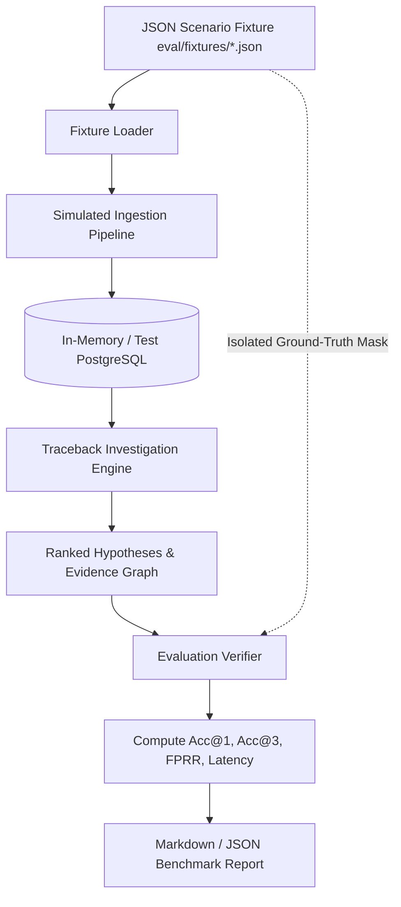

# Traceback Evaluation Plan and Methodology

## 1. Executive Summary & Evaluation Goals

Traceback is designed to provide **evidence-driven** failure investigation, moving software engineering beyond ungrounded guesswork and naive heuristics. 

To prove that Traceback provides tangible value, this document defines an empirical evaluation methodology that:
1. Benchmarks Traceback against standard industry practice and a deterministic baseline.
2. Defines four concrete, measurable evaluation metrics.
3. Outlines an expansion roadmap from 3 initial scenarios to 15–20 diverse failure incidents.
4. Distinguishes proposed benchmark targets from current measured implementation status.
5. Details an automated evaluation test harness.

---

## 2. Baseline Model: The "Most Recent Commit" (MRC) Heuristic

### 2.1 Baseline Definition
In production environments without specialized correlation tools, the default developer instinct is to check the deployment log and git history to identify **who deployed or merged last**.

The **Most Recent Commit (MRC)** baseline algorithm is defined as:
$$\text{Candidate}_{\text{MRC}} = \arg\max_{c \in \mathcal{C}} \{\text{timestamp}(c) \mid \text{timestamp}(c) \le T_{\text{failure}}\}$$
where $\mathcal{C}$ is the set of all commits within the pre-incident window, and $T_{\text{failure}}$ is the timestamp of the first observed error.

### 2.2 Why Compare Against the MRC Baseline?
- **Real-World Relevance**: MRC is the de-facto mental shortcut used by on-call engineers under stress.
- **Vulnerability to Noise**: MRC fails systematically whenever:
  - The latest commit is cosmetic (e.g., markdown, CSS, comments).
  - The failure is caused by an environmental configuration change.
  - The failure is caused by an external dependency or infrastructure outage.
  - The regression was introduced several commits prior, but only manifested under specific load or user flows.

---

## 3. Measurable Evaluation Metrics

Traceback is evaluated across four quantitative dimensions:

```text
+--------------------------------------------------------------------------------------------------+
|                                    EVALUATION METRIC SUITE                                       |
+---------------------+---------------------------+------------------------------------------------+
| Dimension           | Metric                    | Objective                                      |
+---------------------+---------------------------+------------------------------------------------+
| Accuracy            | Top-1 & Top-3 Accuracy    | Maximize probability that true root cause is   |
|                     | (Acc@1, Acc@3)            | presented in top recommendations               |
+---------------------+---------------------------+------------------------------------------------+
| Precision / Noise   | False-Positive            | Minimize spurious or misleading relationships  |
|                     | Relationship Rate (FPRR)  | presented to the engineer                      |
+---------------------+---------------------------+------------------------------------------------+
| Computational Speed | Investigation Latency     | Guarantee sub-second response times for        |
|                     | (milliseconds)            | real-time interactive triage                   |
+---------------------+---------------------------+------------------------------------------------+
| Human Productivity  | Time-to-Identify (TTI)    | Reduce human developer time spent diagnosing   |
|                     | (minutes to resolution)   | an incident from raw logs vs Traceback         |
+---------------------+---------------------------+------------------------------------------------+
```

### 3.1 Metric 1: Top-1 and Top-3 Root-Cause Accuracy

- **Top-1 Accuracy ($\text{Acc@1}$)**: Percentage of evaluation incidents where the ground-truth root cause entity (e.g., commit SHA, config change ID, or external outage signature) is ranked as the **#1 primary hypothesis**.
- **Top-3 Accuracy ($\text{Acc@3}$)**: Percentage of evaluation incidents where the ground-truth root cause entity is contained within the **top 3 ranked hypotheses**.

$$\text{Acc@K} = \frac{1}{|I|} \sum_{i=1}^{|I|} \mathbb{I}\left(\text{RootCause}_i \in \text{TopHypotheses}_i[1 \dots K]\right)$$
where $I$ is the benchmark dataset of incidents, and $\mathbb{I}(\cdot)$ is the indicator function.

### 3.2 Metric 2: False-Positive Relationship Rate (FPRR)

Measures the proportion of reported edges in the evidence graph that are spurious, non-causal, or misleading:

$$\text{FPRR} = \frac{|\mathcal{E}_{\text{reported}} \cap \mathcal{E}_{\text{spurious}}|}{|\mathcal{E}_{\text{reported}}|}$$

An evidence relationship is considered a false positive if:
- It connects an innocent commit to an error based solely on temporal proximity without code or semantic link.
- It asserts an inferred match that is semantically invalid (e.g., matching a generic `Utility.java` without method or stack alignment).

### 3.3 Metric 3: Investigation Latency ($L_{\text{inv}}$)

The wall-clock execution time (in milliseconds) required by the Traceback engine to complete an investigation:

$$L_{\text{inv}} = t_{\text{retrieval}} + t_{\text{graph\_build}} + t_{\text{scoring}} + t_{\text{synthesis}}$$

Latency will be benchmarked under three workload profiles:
- **Small Incident**: $\le 100$ candidate events in window.
- **Medium Incident**: $\le 1,000$ candidate events in window.
- **Large Incident**: $\le 10,000$ candidate events in window.

### 3.4 Metric 4: Human Developer Time-to-Identify (TTI)

Measures the human duration (in minutes) from incident notification to correct root-cause identification and verification.

Evaluated in a controlled laboratory study with software engineers tasked with diagnosing reproducible incidents:
- **Condition A (Control)**: Standard developer tools (terminal, `git log`, `grep`, raw stack traces).
- **Condition B (Treatment)**: Traceback dashboard (interactive timeline, evidence graph, verification checklist).

$$\Delta \text{TTI} = \frac{\overline{\text{TTI}}_{\text{Control}} - \overline{\text{TTI}}_{\text{Traceback}}}{\overline{\text{TTI}}_{\text{Control}}} \times 100\%$$

---

## 4. Proposed Targets vs. Current Status

> [!IMPORTANT]
> **Explicit Status Distinction**:
> In accordance with project governance, proposed benchmark targets are clearly distinguished from current measured results. At Phase 0, all implementations are design specifications, and empirical benchmarks will be measured during Phases 3 and 5.

| Metric | MRC Baseline (Expected) | Traceback Proposed Target | Current Measured Status (Phase 0) |
| :--- | :--- | :--- | :--- |
| **Top-1 Accuracy ($\text{Acc@1}$)** | $\approx 33.3\%$ *(fails Scenarios B & C)* | $\ge 80.0\%$ | **Unmeasured** *(Pending Phase 3)* |
| **Top-3 Accuracy ($\text{Acc@3}$)** | $\approx 33.3\%$ *(fails Scenarios B & C)* | $\ge 95.0\%$ | **Unmeasured** *(Pending Phase 3)* |
| **False-Positive Edge Rate ($\text{FPRR}$)** | $\ge 66.7\%$ *(unfiltered commits)* | $\le 15.0\%$ | **Unmeasured** *(Pending Phase 3)* |
| **Investigation Latency ($N=1,000$)** | $< 10\,\text{ms}$ *(trivial sort)* | $\le 800\,\text{ms}$ | **Unmeasured** *(Pending Phase 3)* |
| **Investigation Latency ($N=10,000$)**| $< 50\,\text{ms}$ | $\le 2,500\,\text{ms}$ | **Unmeasured** *(Pending Phase 3)* |
| **Developer TTI Reduction ($\Delta\text{TTI}$)**| $0\%$ (Baseline reference) | $\ge 50.0\%$ reduction | **Unmeasured** *(Pending Phase 5 user study)* |

---

## 5. Benchmark Scenarios & Expansion Plan

### 5.1 Initial Benchmark Suite (Phase 0 Target: 3 Scenarios)

The evaluation suite begins with the three foundational reproducible scenarios specified in [`docs/incident-scenarios.md`](incident-scenarios.md):
- **Scenario A (`INC-2026-001`)**: Code Regression (Fee math inversion in `PaymentFeeCalculator.java`).
  - *Baseline outcome*: Fails or ranks cosmetic README commit first.
  - *Traceback target*: Acc@1 = 100% via stack-frame diff matching.
- **Scenario B (`INC-2026-002`)**: Configuration Failure (Database port misconfigured to `5433`).
  - *Baseline outcome*: Fails 100% (blames innocent UI commit).
  - *Traceback target*: Acc@1 = 100% via config key diff matching.
- **Scenario C (`INC-2026-003`)**: Misleading Recent Commit (Upstream Stripe API read timeout).
  - *Baseline outcome*: Fails 100% (blames Dave's innocent avatar CSS commit).
  - *Traceback target*: Acc@1 = 100% by flagging external timeout and demoting commit.

### 5.2 Expanded Benchmark Suite (Phases 3–5 Target: 15–20 Scenarios)

As the engine matures, the benchmark dataset will expand to cover 15–20 diverse real-world incident archetypes:

```text
+--------------------------------------------------------------------------------------------------+
|                                    EXPANDED INCIDENT TAXONOMY                                    |
+--------------------------+--------------------+--------------------------------------------------+
| Incident Archetype       | Target Count       | Description / Failure Mechanics                  |
+--------------------------+--------------------+--------------------------------------------------+
| 1. Code Regressions      | 4 scenarios        | NullPointerException, Off-by-one loop error,      |
|                          |                    | regex catastrophic backtracking, enum mismatch   |
+--------------------------+--------------------+--------------------------------------------------+
| 2. Configuration & Env   | 4 scenarios        | DB pool size starvation, secret token typo,      |
|                          |                    | TLS certificate path missing, timeout too short  |
+--------------------------+--------------------+--------------------------------------------------+
| 3. Schema & Migrations   | 3 scenarios        | Flyway migration column missing, Hibernate DDL   |
|                          |                    | type mismatch, enum ordinal drift                |
+--------------------------+--------------------+--------------------------------------------------+
| 4. External Dependencies | 3 scenarios        | Stripe 504 timeout, AWS S3 rate limit (429),     |
|                          |                    | DNS resolution failure on auth provider          |
+--------------------------+--------------------+--------------------------------------------------+
| 5. Concurrency & Leaks   | 3 scenarios        | ThreadPoolExecutor saturation, HikariCP leak,    |
|                          |                    | database transaction lock timeout                |
+--------------------------+--------------------+--------------------------------------------------+
| 6. Misleading Activity   | 3 scenarios        | Mass documentation merge, dependency bump with   |
|                          |                    | no runtime effect, scheduled batch job overlap   |
+--------------------------+--------------------+--------------------------------------------------+
```

---

## 6. Automated Evaluation Harness Architecture

An automated evaluation runner will be implemented in Java/JUnit 5 under `traceback-evaluation`:



### 6.1 Harness Execution Steps
1. **Fixture Ingestion**: Ingests all `inputEvents` into a fresh PostgreSQL test instance using the standard `traceback-ingestion` controllers.
2. **Investigation Invocation**: Triggers `GET /api/v1/incidents/{incidentId}/investigation` with the scenario time window.
3. **Metric Calculation**:
   - Checks if the returned Top-1 hypothesis entity matches `groundTruth.rootCauseEntityId`.
   - Checks if `groundTruth.rootCauseEntityId` is within the Top-3 hypotheses.
   - Calculates spurious edges by comparing reported edges against `groundTruth.expectedEvidenceTypes`.
   - Records execution duration in milliseconds.
4. **CI Regression Gate**: The test suite will fail in continuous integration if any scenario regression drops accuracy below the target threshold.
