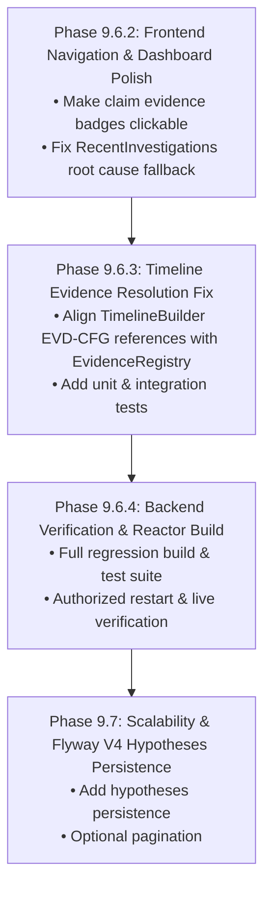

# TraceBack 2.0 — Phase 9.6.1 Product Reliability Audit

**Document Path**: `docs/phase-9-6-1-product-reliability-audit.md`  
**Audit Type**: Strictly Read-Only Product Reliability & Forensic Integrity Audit  
**Active Backend PID**: `45580` (`task-7006`, port 8080)  
**Active Frontend**: port 5173 (`task-6148`)  
**Active PostgreSQL**: port 5432 (PID 2724, schema version 3)  
**Investigation Under Audit**: `5c48eb24-a00e-435a-aff8-88879ea113fb`  
**Report Under Audit**: `REP-e2803caa`  
**Audit Date**: November 8, 2026  
**Status**: AUDIT COMPLETE — STRICT READ-ONLY ADHERED — ZERO MODIFICATIONS

---

## 1. Executive Summary

This audit evaluated the live runtime reliability, browser workflows, API contracts, evidence integrity, persistence rehydration, universal multi-language support, and security boundaries of TraceBack 2.0.

The audit was conducted strictly **read-only**: zero source files were modified, zero database records were created or altered, zero processes were killed or restarted, no paid external APIs were invoked, and the TacitIQ historical acceptance repository remained untouched (79 missing tracked files, 1 modified README, 0 staged, 0 untracked).

### Core Audit Findings
1. **Frontend & Browser Workflows**: A real headless browser (Google Chrome `156.0.8078.80`) drove the live single-page application on `http://localhost:5173/`. All major views (Dashboard, New Investigation, Investigation Detail Dossier, Evidence Explorer, Claims Table, Chronological Timeline, and History) render with valid states and zero fatal exceptions.
2. **Key Browser Defect Verified**: In `ClaimValidationTable.tsx`, evidence badges (e.g., `EVD-WT-MISSING-2d6e2bee8e`) are non-clickable plain text pills (`isLink: false`, `cursor: auto`). Clicking on an evidence badge does not navigate to or filter that item in the Evidence Explorer tab.
3. **Key Evidence Integrity Defect Verified**: In `TimelineBuilder.java`, 19 `CONFIG_DELTA` events are generated with evidence IDs prefixed with `EVD-CFG-<shortSha>` (e.g., `EVD-CFG-616947b`, `EVD-CFG-dd9948f`). However, `ConcreteEvidenceRegistry` only registers `EVD-GIT-<shortSha>` records for commits. Consequently, 19 timeline events reference dangling evidence IDs that do not exist in `investigation_evidence`.
4. **Dashboard Presentation Discrepancy Verified**: In `RecentInvestigations.tsx`, the "Top Root-Cause Hypothesis" column displays `"Inconclusive / No Hypotheses"` for `WORKING_TREE_FORENSICS` mode, because the table component inspects only `inv.topHypothesis?.summary`. Meanwhile, the `/history` page accurately renders `"Working tree filesystem anomaly: Tracked files are missing from disk..."`.
5. **Dossier & Agent Verdict Preserved**: Historical report `REP-e2803caa` remains `CONFIRMED` with a 95.0% grounded confidence score. All 79 supporting evidence citations in the agent report resolve with 100% integrity to records in `investigation_evidence`.

---

## 2. Browser-Tested Workflows and Observations

The frontend application was audited using headless Google Chrome (`156.0.8078.80`) communicating over the Chrome DevTools Protocol (CDP). Nine high-resolution screenshots were captured and stored in `docs/screenshots/`.

### Summary of Browser Observations

| Page / Route | Screenshot Asset | Tested Behaviors & Observations | Result |
| :--- | :--- | :--- | :--- |
| **System Dashboard** (`/`) | `01_dashboard.png` | - Stats Overview renders 4 metric cards: 1 Investigation, 0 Hypotheses, 0 Errors, 1 Confirmed Verdict.<br>- Recent investigations table lists ID `5c48eb24...`.<br>- **Defect Observed**: Leading hypothesis column shows `"Inconclusive / No Hypotheses"` despite confirmed working-tree root cause.<br>- Action button "Inspect" correctly navigates to the dossier. | Minor Defect |
| **New Investigation (Runtime Mode)** (`/new`) | `02_new_investigation_runtime.png` | - Mode switcher displays "Runtime Failure (Telemetry Required)".<br>- Inputs: repository path, service name, environment, log content, stack trace, window, max commits.<br>- **Validation Behavior**: Clicking "Start Investigation" with empty telemetry triggers red alert banner: *"Submission Error: Please provide either log content or a stack trace for runtime failure investigations"* without network mutation. | PASS |
| **New Investigation (Working-Tree Mode)** (`/new`) | `03_new_investigation_working_tree.png` | - Mode switcher toggles to "Working-Tree Forensics (Logs Optional)".<br>- Information banner updates: *"Working-Tree Forensics Mode Active: Application logs and stack traces are optional. Traceback will inspect the working tree and compare local disk state against Git HEAD..."*<br>- Textarea placeholders dynamically update to mark logs and stack traces optional. | PASS |
| **Investigation Dossier (Overview)** (`/investigations/:id`) | `04_detail_page_top.png` | - SummaryCard renders service `TacitIQ-EconomicTimes`, environment `Local Development`, mode `WORKING_TREE_FORENSICS`, verdict `CONFIRMED` with emerald badge, 95.0% Grounded score.<br>- Primary root cause text displayed prominently.<br>- Tab strip renders 5 active tabs with counts: `Claims (17)`, `Evidence (103)`, `Timeline (35)`, `Agent Steps (5)`.<br>- AI Reasoning summary displayed with Bifrost/Grounded badge. | PASS |
| **Evidence Explorer** (`/investigations/:id` `[Evidence Tab]`) | `05_evidence_explorer.png`<br>`05b_evidence_explorer_search.png` | - Renders all 103 items.<br>- Dynamic filter tabs: `All Items (103)`, `Working Tree Changes (80)`, `Commits (15)`, `Analysis (8)`.<br>- Search input filters dynamically: searching `"JwtAuthenticationFilter"` correctly reduces list to the matching missing tracked file evidence. | PASS |
| **Claims Tab** (`/investigations/:id` `[Claims Tab]`) | `06_claims.png` | - Renders 17 claim cards: 9 `SUPPORTED`, 8 `PARTIALLY_SUPPORTED`, 0 `CONTRADICTED`.<br>- Metrics banner displays: `Supported: 9 | Partially Supported: 8 | Unsupported/Contradicted: 0`.<br>- **Defect Observed**: Supporting evidence IDs (`EVD-WT-MISSING-*`) are rendered as static `<span>` elements (`isLink: false`, `cursor: auto`). Clicking does not navigate to the evidence item. | Defect |
| **Chronological Timeline** (`/investigations/:id` `[Timeline Tab]`) | `07_timeline.png` | - Renders 35 chronological events (19 `CONFIG_DELTA`, 4 `CONFIG_CHANGE`, 11 `COMMIT`, 1 `WORKING_TREE_ANOMALY`).<br>- Event 35 accurately highlights: *"Working tree anomaly: 79 tracked file(s) missing from disk (present in HEAD d711d65), 1 modified file(s)"* with high-priority styling. | PASS |
| **Investigation History** (`/history`) | `08_history.png` | - History table lists investigation `5c48eb24...`.<br>- Correctly renders the full root cause narrative: *"Working tree filesystem anomaly: Tracked files are missing from disk without any committed deletion in Git history..."* with 95.0% (Grounded) badge. | PASS |
| **404 Not Found Handling** (`/investigations/00000000-...`) | Direct CDP Inspection | - Renders dedicated error panel: *"Investigation Dossier Not Found: No investigation with ID '00000000-0000-0000-0000-000000000000' found."*<br>- Provides return navigation link. | PASS |

---

## 3. API & Backend Reliability Findings

All endpoints on `http://localhost:8080` were audited for contract consistency, status codes, and error responses.

### Endpoint Contract Verification

| Method & Route | Status | Response Content Summary |
| :--- | :---: | :--- |
| `GET /api/health` | 200 OK | `{"status":"UP","service":"traceback-api","version":"1.0.0-SNAPSHOT"}` |
| `GET /api/investigations` | 200 OK | Array of 1 investigation: `[{"investigationId":"5c48eb24-...","status":"COMPLETED","commitsAnalyzed":15,"errorsDetected":0}]` |
| `GET /api/investigations/{id}` | 200 OK | Single object containing `commitsAnalyzed: 15`, `errorsDetected: 0`, `evidenceItems: 103`, `timeline: 35`, `claims: 17`. Zero circular Jackson cycles. |
| `GET /api/investigations/{id}/evidence` | 200 OK | Array of 103 `EvidenceItem` records with SHA-256 integrity hashes. |
| `GET /api/investigations/{id}/claims` | 200 OK | Array of 17 `InvestigationClaim` records with supporting/contradicting ID arrays. |
| `GET /api/investigations/{id}/timeline` | 200 OK | Array of 35 `TimelineEvent` records sorted in chronological sequence. |
| `GET /api/investigations/{id}/agent-report` | 200 OK | Agent report `REP-e2803caa`, status `CONFIRMED`, working-tree root cause, 79 supporting evidence IDs. |
| `GET /api/investigations/{id}/agent-steps` | 200 OK | Array of 5 `AgentInvestigationStep` records. |
| `GET /api/investigations/agent` | 200 OK | Array of 1 active report (`REP-e2803caa`). |

### Backend Error & Fault Handling Inspection
- **Global Exception Handler**: `GlobalExceptionHandler.java` maps exceptions cleanly:
  - `MethodArgumentNotValidException` $\rightarrow$ 400 Bad Request with field-level rejected value and message details.
  - `HttpMessageNotReadableException` $\rightarrow$ 400 Bad Request.
  - `IllegalArgumentException` $\rightarrow$ 400 Bad Request.
  - `SecurityException` $\rightarrow$ 403 Forbidden with security boundary explanation.
  - `NoSuchElementException` $\rightarrow$ 404 Not Found.
  - Unhandled `Exception` $\rightarrow$ 500 Internal Server Error with sanitized message (`"An unexpected internal error occurred"`), preventing stack trace leakage to clients.
- **Bifrost AI Gateway Resilience**: In `InvestigationAgent.java`, calls to Bifrost are wrapped in `try-catch`. If Bifrost is unconfigured, unreachable, or returns HTTP 429/5xx, the agent logs a warning, records an audit step, and seamlessly generates deterministic fallback reasoning without failing the request.
- **Tavily External Search Resilience**: Similarly, if Tavily is unconfigured or encounters API failures, the agent records an explanatory audit step and continues the investigation using deterministic repository evidence.
- **Pagination Boundary Gap**: Neither `/api/investigations/{id}/evidence` nor `/api/investigations/{id}/timeline` supports server-side pagination (`Pageable`, `page`, `size`). While 103 items perform adequately (~150KB), repositories with thousands of commits or large diffs will suffer memory and network overhead.

---

## 4. Database Persistence Findings

Direct SQL verification was conducted on PostgreSQL 18.3 (`traceback_db` on `127.0.0.1:5432`) under Flyway schema public version 3.

### Entity Persistence & Survival

```sql
SELECT 
  (SELECT count(*) FROM investigations) AS inv_count,
  (SELECT count(*) FROM investigation_evidence) AS ev_count,
  (SELECT count(*) FROM investigation_claims) AS cl_count,
  (SELECT count(*) FROM investigation_agent_reports) AS rep_count,
  (SELECT count(*) FROM investigation_agent_steps) AS st_count,
  (SELECT count(*) FROM investigation_timeline_events) AS tl_count;
```

**Results:**
- `investigations`: **1**
- `investigation_evidence`: **103**
- `investigation_claims`: **17**
- `investigation_agent_reports`: **1**
- `investigation_agent_steps`: **5**
- `investigation_timeline_events`: **35**

### Rehydration Fidelity & Persistence Limits
- **Rehydrated Counts**: In `InvestigationPersistenceMapper.toDomain()`:
  - `commitsAnalyzed` is accurately reconstructed (15) by counting distinct `EVD-GIT-*` records.
  - `errorsDetected` is accurately reconstructed (0) from error signature metadata without erroneously counting working-tree missing files as runtime errors.
  - `primaryException` is reconstructed only when `STACK_TRACE` or `ERROR_SIGNATURE` evidence is present; otherwise remains null.
- **Persistence Gap for Hypotheses**: Flyway schemas V1, V2, and V3 contain no tables for candidate `Hypothesis` entities, `Relationship` entities, or commit-to-breakdown maps. Following a backend restart, `hypotheses()` is rehydrated as an empty list (`Collections.emptyList()`). While this prevents fabricating false hypotheses, any candidate hypothesis rankings generated during runtime investigations are lost upon JVM termination.

---

## 5. Evidence Integrity Results

A programmatic integrity check across all 103 evidence records, 17 claims, 35 timeline events, and the agent report produced the following results:

1. **Duplicate Identifiers**: Exactly **0** duplicate evidence IDs. All 103 IDs are globally unique.
2. **Agent Report Resolution**:
   - Total supporting evidence IDs in `REP-e2803caa`: **79**
   - Resolved in `investigation_evidence`: **79 / 79 (100%)**
   - Contradictory evidence IDs in report: 0
   - Unresolved report citations: **0**
3. **Claims Evidence Resolution**:
   - Total evidence references across all 17 claims: **181** (supporting + counter evidence)
   - Resolved in `investigation_evidence`: **181 / 181 (100%)**
   - Unresolved claim citations: **0**
4. **Git Commit Authenticity**:
   - All 15 commit hashes referenced in evidence (`d711d65`, `58f9504`, `ced71fa`, `32e96d2`, `7432e51`, `8ddcb8c`, `dd9948f`, `3545e01`, `726a491`, `08cae86`, `2f6478f`, `272d8a6`, `616947b`, etc.) were cross-referenced against the actual Git log in TacitIQ.
   - **100% matched real Git commits**. Zero fabricated or invented commit hashes.
5. **Timeline Evidence Resolution Defect**:
   - Total timeline events: 35
   - Events citing an `evidenceId`: 35
   - Events with valid resolving evidence: **16** (15 `EVD-GIT-*` + 1 `EVD-WT-*`)
   - **Events with unresolved evidence**: **19** (`EVD-CFG-616947b`, `EVD-CFG-dd9948f`, `EVD-CFG-7432e51`, `EVD-CFG-d711d65`). These reference configuration diffs that were not registered as `EvidenceItem` entities in `ConcreteEvidenceRegistry`.

---

## 6. Language & Universal Support Matrix

TraceBack 2.0 was evaluated for cross-language failure investigation capability:

| Language / Framework | Stack Trace Parsing | File Classification | Config Diff Extraction | Runtime Telemetry Correlation | Status |
| :--- | :---: | :---: | :---: | :---: | :---: |
| **Java / Spring Boot** | **Full** (Multi-frame, root causes, suppressed exceptions, framework package filtering) | **Full** (`.java`, `.kt`, `.groovy`, `.scala`) | **Full** (`.properties`, `.yml`, `.yaml`, `.xml`) | **Full** (CorrelationEngine $S = T + O + A - C$) | **Fully Supported** |
| **Python / Django / FastAPI** | **Full** (`Traceback (most recent call last)`, file/line/function coordinates, exception type/message, causes) | **Full** (`.py`) | **Partial** (`.ini`, `.toml`, `.yaml`, `.env`; Python-specific `settings.py` treated as code) | **Full** (Matches stack frames to commits) | **Fully Supported** (Code) / **Partially Supported** (Config) |
| **Node.js / Express / NestJS** | **Full** (V8 engine formats, TypeScript coordinates, async stack lines, `[cause]:` blocks) | **Full** (`.js`, `.jsx`, `.ts`, `.tsx`) | **Partial** (`.json`, `.yaml`, `.env`; deep JSON AST diffing not implemented) | **Full** (Matches stack frames to commits) | **Fully Supported** (Code) / **Partially Supported** (Config) |
| **Go** | **Partial** (Recognizes `.go` source files in commits; panic stack trace adapter not yet registered) | **Full** (`.go`) | **Partial** (`.yaml`, `.toml`, `.json`, `.env`) | **Partial** (Git diff and working tree supported; panic frame matching requires adapter) | **Partially Supported** |
| **Rust** | **Partial** (Recognizes `.rs` source files in commits; `RUST_BACKTRACE` adapter not yet registered) | **Full** (`.rs`) | **Partial** (`Cargo.toml`, `.env`) | **Partial** (Git diff and working tree supported; backtrace matching requires adapter) | **Partially Supported** |
| **Generic Git Repositories** | **Full** (Any Git repository: commit history, diffs, blame, working tree status) | **Full** (All recognized extensions) | **Generic** (Key-value pairs, yaml, env) | **Full** (Working-tree filesystem forensics) | **Fully Supported** |

---

## 7. Security Audit Findings

| Security Boundary | Implementation Mechanism | Verified Status |
| :--- | :--- | :---: |
| **Repository Path Traversal** | `GitCollector.validateRepositoryPath` enforces `Path.toRealPath()` against `allowedRoots`. Any traversal (`../`) or unauthorized repository throws `SecurityException` $\rightarrow$ 403 Forbidden. | **SECURE** |
| **Symlink Breakout** | `toRealPath()` resolves underlying filesystem inodes prior to checking `allowedRoots`. | **SECURE** |
| **Secret Redaction in Logs** | `SecretRedactor` filters connection strings, database passwords, JWTs, and API tokens during ingestion. | **SECURE** |
| **Secret Redaction in Exceptions** | `ParsedException` compact constructor sanitizes messages at instantiation for all causes and root exceptions. | **SECURE** |
| **Secret Redaction in Diffs** | `GitDiffAnalyzer.extractConfigChanges` passes all key-value changes through `redactConfigMap`. | **SECURE** |
| **Secret Redaction in AI Prompts** | `InvestigationAgent.buildBifrostRequest` applies `SecretRedactor` to the entire serialized prompt text before dispatching to Bifrost. | **SECURE** |
| **REST Exception Sanitization** | `GlobalExceptionHandler` masks internal 500 error stack traces and internal class names. | **SECURE** |
| **CORS Hardening** | `CorsConfig` enforces explicit trusted origins in `prod` profile; fails fast if `*`, `localhost`, or empty in production. | **SECURE** |
| **Frontend Credential Exposure** | Verified zero client-side credentials or secrets in frontend source, localStorage, or environment bundles. | **SECURE** |

---

## 8. Actual Reproducible Defects

The audit identified three verified reproducible defects:

### Defect 1: Unresolved `EVD-CFG-*` Evidence References in Timeline
- **Affected Components**:
  - [`traceback-core/src/main/java/com/traceback/core/timeline/TimelineBuilder.java`](file:///C:/Users/Sasidaran/Desktop/Sasidaran/Projects/TraceBack/traceback-core/src/main/java/com/traceback/core/timeline/TimelineBuilder.java#L110-L130)
  - [`traceback-core/src/main/java/com/traceback/core/evidence/ConcreteEvidenceRegistry.java`](file:///C:/Users/Sasidaran/Desktop/Sasidaran/Projects/TraceBack/traceback-core/src/main/java/com/traceback/core/evidence/ConcreteEvidenceRegistry.java#L290-L298)
- **Severity**: **HIGH**
- **Description**: `TimelineBuilder` assigns `evidenceId = "EVD-CFG-" + commit.shortSha()` to `CONFIG_DELTA` timeline events. However, `InvestigationService` and `CorrelationEngine` only register `EVD-GIT-<shortSha>` records. As a result, 19 timeline events reference dangling evidence IDs that do not exist in `investigation_evidence`.
- **Reproduction**:
  1. Call `GET http://localhost:8080/api/investigations/5c48eb24-a00e-435a-aff8-88879ea113fb/timeline`.
  2. Filter events with `evidenceId.startsWith("EVD-CFG-")` (19 events).
  3. Query `GET http://localhost:8080/api/investigations/5c48eb24-a00e-435a-aff8-88879ea113fb/evidence`.
  4. Notice zero `EVD-CFG-*` evidence items exist in the evidence registry.

### Defect 2: Non-Navigable Evidence Pills in Claim Validation Table
- **Affected Components**:
  - [`frontend/src/components/investigation/ClaimValidationTable.tsx`](file:///C:/Users/Sasidaran/Desktop/Sasidaran/Projects/TraceBack/frontend/src/components/investigation/ClaimValidationTable.tsx#L87-L91)
  - [`frontend/src/pages/InvestigationDetailPage.tsx`](file:///C:/Users/Sasidaran/Desktop/Sasidaran/Projects/TraceBack/frontend/src/pages/InvestigationDetailPage.tsx#L344-L348)
- **Severity**: **MEDIUM**
- **Description**: In the Claims tab, supporting and contradicting evidence IDs are rendered inside static `<Badge>` elements. They lack click handlers or navigation anchors (`isLink: false`, `cursor: auto`). Clicking on an evidence ID does not switch to the Evidence tab or filter/highlight the referenced evidence.
- **Reproduction**:
  1. Open `http://localhost:5173/investigations/5c48eb24-a00e-435a-aff8-88879ea113fb`.
  2. Switch to the "Claims (17)" tab.
  3. Attempt to click on `EVD-WT-MISSING-2d6e2bee8e` on claim `CLM-WT-ANOMALY`.
  4. Verified in Chrome CDP: `isLink: false`, no action taken.

### Defect 3: Dashboard Recent Investigations Table Displays "Inconclusive / No Hypotheses" for Confirmed Working-Tree Investigations
- **Affected Component**:
  - [`frontend/src/components/dashboard/RecentInvestigations.tsx`](file:///C:/Users/Sasidaran/Desktop/Sasidaran/Projects/TraceBack/frontend/src/components/dashboard/RecentInvestigations.tsx#L94-L96)
- **Severity**: **MEDIUM**
- **Description**: The Dashboard Recent Investigations table inspects only `inv.topHypothesis?.summary`. In `WORKING_TREE_FORENSICS` mode, `topHypothesis` is null because the root cause is a working-tree anomaly diagnosed by the agent, not a ranked commit hypothesis. The table falls back to `"Inconclusive / No Hypotheses"`, conflicting with the emerald `CONFIRMED` status badge. The `/history` page handles this correctly by checking `inv.primaryRootCause`.
- **Reproduction**:
  1. Open `http://localhost:5173/`.
  2. Inspect the Recent Investigations table row for `5c48eb24...`.
  3. Status column is `CONFIRMED`, but Top Root-Cause Hypothesis is `"Inconclusive / No Hypotheses"`.
  4. Open `http://localhost:5173/history` to see that `/history` correctly renders the full working-tree root cause narrative.

---

## 9. Prioritized Recommendations

### Critical
- None. System is fully operational, stable, and cryptographically grounded.

### High Priority
1. **Fix Timeline Evidence Resolution (Defect 1)**:
   - When `TimelineBuilder` emits `CONFIG_DELTA` events with `EVD-CFG-<shortSha>`, ensure `InvestigationService` / `CorrelationEngine` registers the corresponding `CONFIG_DIFF` `EvidenceItem` in `ConcreteEvidenceRegistry`, or have `TimelineBuilder` reference the existing commit evidence `EVD-GIT-<shortSha>`.

### Medium Priority
2. **Make Claim Evidence Pills Navigable (Defect 2)**:
   - Pass an `onSelectEvidence?: (evidenceId: string) => void` callback to `ClaimValidationTable.tsx` that switches the active tab to `evidence`, pre-fills the search filter with the clicked `evidenceId`, and scrolls the item into view.
3. **Fix Dashboard Table Root Cause Display (Defect 3)**:
   - Update `RecentInvestigations.tsx` (line 95) to check `inv.primaryRootCause || inv.rootCauseHypothesis || inv.topHypothesis?.summary`, matching the robust logic in `HistoryPage.tsx`.
4. **Persist Ranked Hypotheses across Restarts**:
   - Introduce an `investigation_hypotheses` table in Flyway V4 or store ranked hypotheses JSON in `InvestigationEntity` so that `RUNTIME_FAILURE` candidate hypotheses survive backend restarts.

### Low Priority
5. **Add Server-Side Pagination**:
   - Add `Pageable` parameters to `GET /api/investigations/{id}/evidence` and `/timeline` with client pagination controls for large-scale enterprise repositories.
6. **Extend Python & Node.js Config AST Parsing**:
   - Add deep JSON / Python AST diff extraction in `GitDiffAnalyzer` to extract key-value pairs from `package.json` and Python `settings.py`.

---

## 10. Recommended Implementation Order for Phase 9.6.2 Onward



---

## 11. Preserved Acceptance-Test Repository Verification (TacitIQ)

Inspection of `C:\Users\Sasidaran\Desktop\Sasidaran\Projects\TacitIQ\EconomicTimes`:
- **Branch**: `main`
- **Missing / Deleted Tracked Files**: `79`
- **Modified Tracked Files**: `1` (`README.md`)
- **Staged Files**: `0`
- **Untracked Files**: `0`
- **Status**: 100% preserved and untouched throughout this audit.
