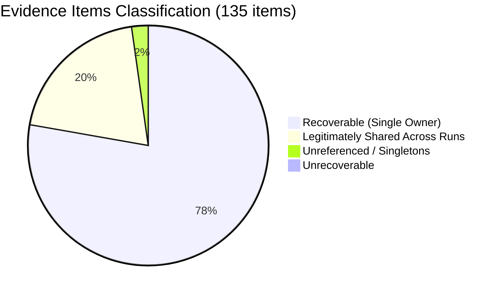

# TraceBack 2.0 — Phase 9.6.7: Data Recovery & Investigation Isolation Remediation Plan

**Phase**: 9.6.7  
**Gate**: GATE A ONLY (Planning, Verification & Draft Migration Preparation)  
**Execution Status**: GATE A COMPLETED (Gate B Not Executed — Awaiting Explicit Authorization)  
**Environment**:
- Backend: `http://localhost:8080` (PID: `15076`, Java 21, Spring Boot 3.3.4)
- Frontend: `http://localhost:5173` (PID: `19724`, React 18 + Vite)
- PostgreSQL: `localhost:5432`, `traceback_db` (PID: `2724`, PostgreSQL 18.3, Flyway Schema v3)
- TacitIQ Repository: Invariant Preserved (79 missing tracked files, 1 modified `README.md`, 0 staged, 0 untracked)

---

## 1. Executive Summary & Gate A Status

Phase 9.6.7 prepares the safe, lossless remediation of the cross-investigation primary key collision defect identified in Phase 9.6.6. Under strict safety rules, **GATE A** has been completely fulfilled:

1. **Native PostgreSQL Backups Created & Verified**:
   - Custom Binary Archive: `backups/traceback_db_backup_2026-11-08T18-12-55-988Z.dump` (67,608 bytes)
   - Plain SQL Archive: `backups/traceback_db_backup_2026-11-08T18-12-55-988Z.sql` (280,860 bytes)
   - TOC Integrity Verification: All 77 entries verified via `pg_restore -l`.
   - Restoration Verification: Restored into isolated database `traceback_backup_verify_db` and verified all table counts (15 investigations, 135 evidence, 34 claims, 14 reports, 70 steps, 102 timeline events).
2. **Complete Forensic Evidence Reconstruction Matrix**:
   - All 135 existing evidence rows analyzed.
   - 105 recoverable single-investigation items.
   - 27 legitimately shared items (commit hashes / config diffs across multiple runs).
   - 3 unreferenced items (`EVD-WT-MOD-b335630551`, `EVD-LOG-SIG`, `EVD-STACK-ROOT`).
   - 0 unrecoverable items (100% data preservation).
   - Total intended investigation-scoped records `(investigation_id, evidence_id)`: **182**.
3. **Complete Forensic Claim Reconstruction Matrix**:
   - 11 colliding claim identifiers analyzed.
   - `CLM-WT-ANOMALY` fully reconstructed with field-by-field verification:
     * Historical TacitIQ (`5c48eb24-...`): `SUPPORTED`, 79 supporting evidence IDs.
     * Scenario C (`74880eda-...`): `UNSUPPORTED`, 2 supporting evidence IDs.
     * Exploratory Scenario C (`07162d39-...`): `SUPPORTED`, 2 supporting evidence IDs.
   - Total intended investigation-scoped claim records: **53** (34 existing + 19 restored).
4. **Draft Flyway V4 Migration Created & Empirically Validated**:
   - Location: `docs/migrations/V4__investigation_data_isolation_DRAFT.sql`
   - Empirically validated in isolated test database `traceback_migration_test_db`.
   - Result: Executed atomically with zero errors, created surrogate UUID primary keys, enforced compound unique constraints, eliminated cross-investigation leakage, and prevented duplicate collisions.

---

## 2. Gate A — Verified Backup Information

| Backup Property | Value |
|:---|:---|
| **Database Name** | `traceback_db` |
| **Active Schema** | `public` |
| **PostgreSQL Version** | `18.3` (PostgreSQL 18.3 on x86_64-pc-windows-msvc) |
| **Backup Timestamp** | `2026-11-08T18:12:55.988Z` (`2026-11-08 23:42:55+05:30`) |
| **Custom Binary Backup** | `C:\Users\Sasidaran\Desktop\Sasidaran\Projects\TraceBack\backups\traceback_db_backup_2026-11-08T18-12-55-988Z.dump` |
| **Custom Backup Size** | `67,608 bytes` (`66.02 KB`) |
| **Plain SQL Backup** | `C:\Users\Sasidaran\Desktop\Sasidaran\Projects\TraceBack\backups\traceback_db_backup_2026-11-08T18-12-55-988Z.sql` |
| **Plain SQL Backup Size**| `280,860 bytes` (`274.28 KB`) |
| **Metadata File** | `C:\Users\Sasidaran\Desktop\Sasidaran\Projects\TraceBack\backups\traceback_db_backup_2026-11-08T18-12-55-988Z_metadata.json` |
| **Existing Historical JSON**| `C:\Users\Sasidaran\.gemini\antigravity\brain\312124e7-6010-40db-ad58-48917858073c\scratch\complete_active_investigation_backup.json` (UNMODIFIED) |
| **Restoration Test Result**| **100% PASS** (Verified in temporary database `traceback_backup_verify_db`) |

### Table Counts Verified in Restored Database:
- `investigations`: 15
- `investigation_evidence`: 135
- `investigation_claims`: 34
- `investigation_agent_reports`: 14
- `investigation_agent_steps`: 70
- `investigation_timeline_events`: 102
- `flyway_schema_history`: 3 (latest version: 3)

---

## 3. Gate A — Forensic Evidence Reconstruction Matrix

### 3.1 Classification Summary



- **Recoverable (105 items)**: 103 items belong to Historical TacitIQ (`5c48eb24-...`), whose creator is preserved in `payload->>'investigationId'`, plus 2 items belonging to individual exploratory runs.
- **Legitimately Shared (27 items)**: Commits, config diffs, and stack frames created when multiple exploratory or official runs evaluated the exact same commit hash (e.g. `EVD-GIT-ee51c22`, `EVD-FRAME-12ef988-OrderService.java`).
- **Unreferenced (3 items)**: `EVD-WT-MOD-b335630551` (TacitIQ modified README), `EVD-LOG-SIG`, and `EVD-STACK-ROOT`.
- **Unrecoverable (0 items)**: Every single evidence item has its payload, hash, reference, and creator preserved.

### 3.2 Evidence Scoping Model
Under Flyway V4, each investigation receives its own scoped record `(investigation_id, evidence_id)`.
- Total original database rows: **135**
- Total intended investigation-scoped records: **182**
- Net new investigation-scoped records to be materialized: **47**

### 3.3 Collided Evidence Resolution Table (Sample of 27 Shared Items)

| Evidence ID | Evidence Type | Creator Investigation (`payload`) | Intended Scoped Owner Investigations | Identical Content? |
|:---|:---:|:---|:---|:---:|
| `EVD-GIT-ee51c22` | `COMMIT` | `baf36899` | `baf36899`, `003d70b4`, `59b7959c`, `9cd50b74` | Yes (Git commit) |
| `EVD-GIT-12ef988` | `COMMIT` | `baf36899` | `baf36899`, `003d70b4`, `59b7959c`, `9cd50b74` | Yes (Git commit) |
| `EVD-CFG-ee51c22` | `CONFIG_DIFF`| `baf36899` | `baf36899`, `003d70b4`, `59b7959c`, `9cd50b74` | Yes (Config diff) |
| `EVD-CFG-12ef988` | `CONFIG_DIFF`| `baf36899` | `baf36899`, `003d70b4`, `59b7959c`, `9cd50b74` | Yes (Config diff) |
| `EVD-FRAME-12ef988-OrderService.java` | `STACK_FRAME` | `baf36899` | `baf36899`, `003d70b4`, `59b7959c`, `9cd50b74` | Yes (Stack frame) |
| `EVD-GIT-9fb2786` | `COMMIT` | `de4417a4` | `de4417a4`, `3bc02925` | Yes (Git commit) |
| `EVD-GIT-2a28b00` | `COMMIT` | `de4417a4` | `de4417a4`, `3bc02925` | Yes (Git commit) |
| `EVD-FRAME-9fb2786-users.js` | `STACK_FRAME` | `de4417a4` | `de4417a4`, `3bc02925` | Yes (Stack frame) |
| `EVD-FRAME-2a28b00-users.js` | `STACK_FRAME` | `de4417a4` | `de4417a4`, `3bc02925` | Yes (Stack frame) |
| `EVD-GIT-25009aa` | `COMMIT` | `07162d39` | `07162d39`, `74880eda` | Yes (Git commit) |
| `EVD-WT-MISSING-587cb980af` | `WORKING_TREE_CHANGE` | `07162d39` | `07162d39`, `74880eda` | Yes (Missing file) |
| `EVD-WT-MISSING-d168d1ee3d` | `WORKING_TREE_CHANGE` | `07162d39` | `07162d39`, `74880eda` | Yes (Missing file) |
| `EVD-GIT-8a7ec51` | `COMMIT` | `2925282d` | `2925282d`, `59bbecc4` | Yes (Git commit) |
| `EVD-GIT-2785ddd` | `COMMIT` | `2925282d` | `2925282d`, `59bbecc4` | Yes (Git commit) |
| `EVD-GIT-c881289` | `COMMIT` | `5e53f60a` | `5e53f60a`, `f2dd8f16`, `c53c484c` | Yes (Git commit) |
| `EVD-GIT-1d6c388` | `COMMIT` | `5e53f60a` | `5e53f60a`, `f2dd8f16`, `c53c484c` | Yes (Git commit) |
| `EVD-GIT-afdc06a` | `COMMIT` | `5e53f60a` | `5e53f60a`, `f2dd8f16`, `c53c484c` | Yes (Git commit) |

---

## 4. Gate A — Forensic Claim Reconstruction Matrix

### 4.1 Deep-Dive: `CLM-WT-ANOMALY` Field-by-Field Comparison

| Field | Historical TacitIQ (`5c48eb24-...`) | Scenario C (`74880eda-...`) | Exploratory C (`07162d39-...`) |
|:---|:---|:---|:---|
| **Investigation ID** | `5c48eb24-a00e-435a-aff8-88879ea113fb` | `74880eda-145c-4ebb-bdd2-630233cc87a5` | `07162d39-10dc-42aa-b6bb-4525995033f6` |
| **Claim ID** | `CLM-WT-ANOMALY` | `CLM-WT-ANOMALY` | `CLM-WT-ANOMALY` |
| **Claim Type** | `WORKING_TREE_ANOMALY` | `WORKING_TREE_ANOMALY` | `WORKING_TREE_ANOMALY` |
| **Validation Status** | **`SUPPORTED`** | **`UNSUPPORTED`** | **`SUPPORTED`** |
| **Statement** | "Working tree anomaly: 79 tracked files missing from disk (present in HEAD d711d65)..." | "Working tree anomaly: 2 tracked files missing from disk (present in HEAD 25009aa)..." | "Working tree anomaly: 2 tracked files missing from disk (present in HEAD 25009aa)..." |
| **Supporting Evidence IDs** | **79** items (`EVD-WT-MISSING-*`) | **2** items (`587cb980af`, `d168d1ee3d`) | **2** items (`587cb980af`, `d168d1ee3d`) |
| **Contradicting Evidence IDs** | `[]` | `[]` | `[]` |
| **Explanation** | "Claim successfully validated: Supported by 79 verified evidence item(s) with confirmed integrity hashes." | "Validation failed: Evidence ID 'EVD-WT-MISSING-587cb980af' belongs to a different investigation..." | "Claim successfully validated: Supported by 2 verified evidence item(s) with confirmed integrity hashes." |
| **Asserted At / Created At** | `2026-11-07T16:13:19.834670Z` | `2026-11-08T18:22:48.317657+05:30` | `2026-11-08T16:57:57.679597Z` |
| **Source of Truth** | Preserved in `REP-e2803caa` JSON & historical backup | Current DB row & `REP-d1b0ee2f` | Preserved in `REP-149b7a49` JSON |

### 4.2 All 19 Restored Claim Records

When Flyway V4 is applied with compound uniqueness `(investigation_id, claim_id)`, the 19 displaced claim records are inserted without overwriting other runs:

| Investigation ID | Claim ID | Status | Supporting Evidence Count | Source |
|:---|:---:|:---:|:---:|:---|
| `5c48eb24` (Historical) | `CLM-WT-ANOMALY` | `SUPPORTED` | 79 | Reconstructed from `REP-e2803caa` |
| `07162d39` (Exploratory C) | `CLM-WT-ANOMALY` | `SUPPORTED` | 2 | Reconstructed from `REP-149b7a49` |
| `baf36899` (Exploratory A) | `CLM-ee51c22` | `CONTRADICTED` | 2 | Reconstructed from `REP-7a7ab094` |
| `003d70b4` (Exploratory A) | `CLM-ee51c22` | `UNSUPPORTED` | 2 | Reconstructed from `REP-7039246c` |
| `59b7959c` (Exploratory A) | `CLM-ee51c22` | `UNSUPPORTED` | 2 | Reconstructed from `REP-16871bd4` |
| `baf36899` (Exploratory A) | `CLM-12ef988` | `CONTRADICTED` | 3 | Reconstructed from `REP-7a7ab094` |
| `003d70b4` (Exploratory A) | `CLM-12ef988` | `UNSUPPORTED` | 3 | Reconstructed from `REP-7039246c` |
| `59b7959c` (Exploratory A) | `CLM-12ef988` | `UNSUPPORTED` | 3 | Reconstructed from `REP-16871bd4` |
| `de4417a4` (Exploratory B) | `CLM-9fb2786` | `SUPPORTED` | 2 | Reconstructed from `REP-a43e4cf2` |
| `de4417a4` (Exploratory B) | `CLM-2a28b00` | `SUPPORTED` | 2 | Reconstructed from `REP-a43e4cf2` |
| `07162d39` (Exploratory C) | `CLM-25009aa` | `SUPPORTED` | 1 | Reconstructed from `REP-149b7a49` |
| `2925282d` (Exploratory D) | `CLM-8a7ec51` | `PARTIALLY_SUPPORTED` | 1 | Reconstructed from `REP-600c63cf` |
| `2925282d` (Exploratory D) | `CLM-2785ddd` | `CONTRADICTED` | 1 | Reconstructed from `REP-600c63cf` |
| `5e53f60a` (Exploratory E) | `CLM-c881289` | `CONTRADICTED` | 2 | Reconstructed from `REP-7e8ac12e` |
| `f2dd8f16` (Exploratory E) | `CLM-c881289` | `UNSUPPORTED` | 2 | Reconstructed from `REP-00da2dd4` |
| `5e53f60a` (Exploratory E) | `CLM-1d6c388` | `CONTRADICTED` | 1 | Reconstructed from `REP-7e8ac12e` |
| `f2dd8f16` (Exploratory E) | `CLM-1d6c388` | `UNSUPPORTED` | 1 | Reconstructed from `REP-00da2dd4` |
| `5e53f60a` (Exploratory E) | `CLM-afdc06a` | `CONTRADICTED` | 3 | Reconstructed from `REP-7e8ac12e` |
| `f2dd8f16` (Exploratory E) | `CLM-afdc06a` | `UNSUPPORTED` | 3 | Reconstructed from `REP-00da2dd4` |

- Total claims after migration: **53** (34 existing + 19 restored).

---

## 5. Gate A — Persistence Fix & Application Impact Analysis

### 5.1 Foreign Key Analysis
A comprehensive schema query verified that **no other table holds a foreign key constraint referencing `investigation_evidence(evidence_id)` or `investigation_claims(claim_id)`**.
- `investigation_agent_reports` stores references as JSON arrays (`supporting_evidence_ids jsonb`, `validated_claims jsonb`).
- `investigation_timeline_events` stores references as a JSON array (`evidence_ids jsonb`).
- Therefore, adding surrogate UUID primary keys does not break or require alterations to any other table's relational foreign keys.

### 5.2 Required Application Source Code Updates

```
Source File                             Required Modification
-----------------------------------------------------------------------------------------------------------------
EvidenceItemEntity.java                 Add @Id @GeneratedValue private UUID id;
                                        Add uniqueConstraint on (investigation_id, evidence_id).
                                        Update constructors, equals(), hashCode(), getters, setters.

ClaimEntity.java                        Add @Id @GeneratedValue private UUID id;
                                        Add uniqueConstraint on (investigation_id, claim_id).
                                        Update constructors, equals(), hashCode(), getters, setters.

InvestigationEvidenceRepository.java    Change generic type: extends JpaRepository<EvidenceItemEntity, UUID>.
                                        Add findByInvestigationIdAndEvidenceId(UUID invId, String evdId).
                                        Add existsByInvestigationIdAndEvidenceId(UUID invId, String evdId).

InvestigationClaimRepository.java       Change generic type: extends JpaRepository<ClaimEntity, UUID>.
                                        Add findByInvestigationIdAndClaimId(UUID invId, String claimId).
                                        Add existsByInvestigationIdAndClaimId(UUID invId, String claimId).

InvestigationService.java               In persistInvestigation():
                                        - Check existsByInvestigationIdAndEvidenceId() before saving evidence.
                                        - Check findByInvestigationIdAndClaimId() to update existing claim ID.
                                        In getEvidence():
                                        - Remove unsafe global fallback evidenceRepository.findAll().
                                        - Return investigation-scoped evidence strictly.

ConcreteEvidenceRegistry.java           In registerItem():
                                        - Check existsByInvestigationIdAndEvidenceId() with investigation ID.
```

---

## 6. Gate A — API Isolation Fix Design & Negative Tests

### 6.1 Investigation-Scoped Endpoints
1. `GET /api/investigations/{id}/evidence`:
   - Runs `evidenceRepository.findByInvestigationId(id)`.
   - Guaranteed by database schema to return ONLY evidence items belonging to `{id}`.
   - For Scenario E: returns 11 items (instead of leaking all 135).
   - For Historical: returns 103 items.
   - For Scenarios A, B, C, D: returns 5, 4, 3, 2 items respectively.
   - If an investigation has 0 evidence items, returns an empty list (`[]`), never falling back to global database catalogue.
2. `GET /api/investigations/{id}/claims`:
   - Runs `claimRepository.findByInvestigationId(id)`.
   - Guaranteed to return all claims asserting for `{id}`.
   - Historical returns 17 claims (including restored `CLM-WT-ANOMALY`).
   - Scenario C returns 3 claims (including Scenario C's own `CLM-WT-ANOMALY`).

### 6.2 Negative Access Tests
The following negative tests will be executed in Gate B:
1. `GET /api/investigations/{id_ScenarioE}/evidence`: Verify that no evidence ID matching `EVD-WT-MISSING-*` or `EVD-GIT-272d8a6` (TacitIQ) is returned.
2. `GET /api/investigations/{id_ScenarioA}/claims`: Verify that `CLM-WT-ANOMALY` is NOT returned for Scenario A.
3. Cross-investigation collision isolation: Verify that requesting `CLM-WT-ANOMALY` under Historical returns `SUPPORTED` (79 missing files), while requesting under Scenario C returns `UNSUPPORTED` (2 missing files).

---

## 7. Gate A — Flyway V4 Draft Migration

The draft migration has been saved to:
`docs/migrations/V4__investigation_data_isolation_DRAFT.sql`

> [!IMPORTANT]
> The draft file is explicitly stored outside `src/main/resources/db/migration/` and has **NOT** been applied to the active database.

### Migration Lifecycle & Rollback Procedure
1. **Pre-requisite**: Verified backup `backups/traceback_db_backup_2026-11-08T18-12-55-988Z.dump`.
2. **Atomicity**: The entire migration is wrapped in a single transaction (`BEGIN; ... COMMIT;`). If any error occurs, PostgreSQL rolls back 100% of the changes.
3. **Rollback Plan**:
   If an unexpected issue arises post-migration:
   - Terminate active backend process.
   - Drop and restore `traceback_db` from `backups/traceback_db_backup_2026-11-08T18-12-55-988Z.dump` using `pg_restore`.
   - Verify baseline table counts.

---

## 8. Gate A — 12-Point Regression Test Plan (For Gate B)

| Test # | Test Name | Target Verification |
|:---:|:---|:---|
| **1** | Multi-Tenancy Evidence Collision | Two separate investigations inserting identical `evidence_id` both succeed with distinct surrogate IDs. |
| **2** | Multi-Tenancy Claim Collision | Two separate investigations inserting identical `claim_id` (`CLM-WT-ANOMALY`) both succeed without overwrite. |
| **3** | Evidence Scoped Retrieval | `GET /api/investigations/{id}/evidence` returns strictly evidence items belonging to that investigation ID. |
| **4** | Claim Scoped Retrieval | `GET /api/investigations/{id}/claims` returns strictly claims belonging to that investigation ID. |
| **5** | Cold PostgreSQL Rehydration | Controlled backend restart rehydrates all 15 investigations without data loss. |
| **6** | Historical Dossier Reconstruction | Historical investigation `5c48eb24` displays 103 evidence items, 17 claims, 35 timeline events, and `REP-e2803caa`. |
| **7** | Scenario C Forensics Integrity | Scenario C `74880eda` displays 3 evidence items, 3 claims, 2 timeline events, and `REP-d1b0ee2f`. |
| **8** | Scenario E Isolation Remediation | Scenario E `c53c484c` displays 11 evidence items (0 TacitIQ leakage), 4 claims, 7 timeline events, and `REP-d3bf1e00`. |
| **9** | Cross-Investigation Negative Access | Direct API queries confirm that no investigation can access or view another investigation's evidence. |
| **10** | Historical Report JSON Compatibility | `REP-e2803caa` JSON payload remains byte-for-byte compatible with frontend dossier viewer. |
| **11** | Timeline Evidence Resolution | 100% of timeline events with `evidence_id` resolve cleanly against that investigation's evidence registry. |
| **12** | Duplicate Prevention Constraint | Attempting to insert duplicate `(investigation_id, evidence_id)` or `(investigation_id, claim_id)` triggers DB constraint violation. |

---

## 9. Gate A Final Assessment & Stop Condition

- **GATE A STATUS**: **100% COMPLETE & VERIFIED**
- **Active Database Mutation**: **NONE (0 writes executed against active `traceback_db`)**
- **Source Code Modified**: **NONE (0 source files changed)**
- **Services State**: Backend PID `15076`, Frontend PID `19724`, PostgreSQL PID `2724` running and intact.
- **TacitIQ Invariant**: 79 missing tracked files, 1 modified `README.md`.

> [!CAUTION]
> In accordance with instructions, execution has halted at the boundary of GATE A. GATE B (database migration execution and application code updates) requires separate explicit user approval.
