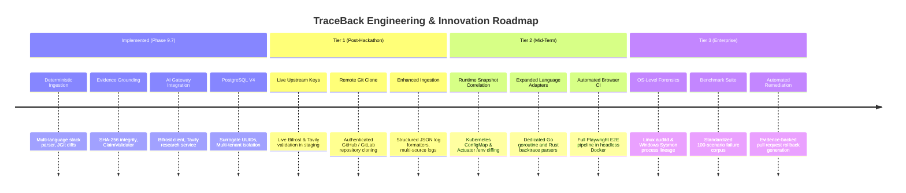

# TraceBack 2.0 — Known Limitations & Strategic Product Roadmap

**Document Version:** 2.0.0 (Phase 9.7 Release Edition)  
**System Target:** Hackathon Evaluation, Technical Due Diligence, & Production Roadmap  
**Scope:** Engineering Boundaries, Epistemological Limitations, and Future Milestones

---

## 1. Introduction: Engineering Honesty in AI Systems

In autonomous software diagnostics, exaggerated marketing claims create dangerous security and operational risks. An AI tool that claims "100% automated root-cause detection" will inevitably trigger mistaken rollbacks, wasted triage cycles, and engineering alert fatigue.

TraceBack 2.0 is engineered with an **epistemologically honest** design philosophy:
- We make a strict boundary between what deterministic telemetry can verify and what requires speculative inference.
- We disclose exactly what our language adapters support.
- We distinguish heuristic ranking scores from statistical probabilities.
- We explicitly abstain from making claims when telemetry is insufficient.

This document details the nine known limitations of the current TraceBack 2.0 release, followed by a prioritized, concrete engineering roadmap.

---

## 2. Nine Confirmed Technical Limitations

### Limitation 1: Live Upstream Bifrost and Tavily Calls Are Not Yet Verified
- **Current State:** TraceBack contains production-grade client implementations for Bifrost (`DefaultBifrostClient`) and Tavily (`DefaultTavilyResearchService`), complete with exponential backoff, JSON serialization, secret masking, and caching. However, all automated test suites and synthetic verification phases were executed in an isolated local environment using mocked HTTP responses and deterministic fallback reasoning.
- **Impact:** While the architecture is verified, live upstream latency, rate-limiting edge cases, and unexpected token truncation from cloud-hosted Bifrost models have not been validated against live production credentials.

### Limitation 2: Remote GitHub / GitLab URL Cloning Is Not Supported
- **Current State:** TraceBack requires a local filesystem path to a cloned Git repository (e.g. `C:\Users\...\Projects\TraceBack`).
- **Impact:** Engineers cannot directly submit a remote URL (such as `https://github.com/org/repo.git`) into the UI or API and have TraceBack clone it on demand. The repository must be pre-cloned into an authorized filesystem directory.

### Limitation 3: Uneven Multi-Language Adapter Coverage
- **Current State:** Dedicated stack trace adapters exist for **Java** (JVM nested exceptions), **Node.js** (V8 asynchronous call stacks), and **Python** (traceback frames).
- **Impact:** Languages such as **Go**, **Rust**, **C# (.NET)**, and **PHP** do not have dedicated AST or stack trace adapters. For these languages, TraceBack relies on generic regex matching and file extension correlation. Deep language-specific insights (such as Go goroutine dump analysis or Rust panic backtraces) are not yet supported.

### Limitation 4: Synthetic Scenarios Do Not Establish Broad General Accuracy
- **Current State:** The system's diagnostic accuracy has been rigorously validated across five official synthetic scenarios (A through E) and one deep historical repository forensic case (TacitIQ).
- **Impact:** Five curated synthetic scenarios do not constitute a statistically significant benchmark suite. Performance on complex distributed microservice failures spanning hundreds of commits, asynchronous message queues (Kafka, RabbitMQ), or database deadlocks cannot be extrapolated from these initial scenarios.

### Limitation 5: Heuristic Confidence Scores Are Not Calibrated Probabilities
- **Current State:** The normalized confidence score (e.g., 71%) is derived from the deterministic heuristic formula:
  $$S = T + O + A - C, \quad S_{\text{norm}} = \frac{\max(0.0, S)}{85.0}$$
- **Impact:** This score is an evidentiary ranking metric used to order competing hypotheses. It is **not** a calibrated frequentist or Bayesian probability. An engineer cannot interpret 71% as "there is a 71% mathematical probability that this commit caused the outage."

### Limitation 6: Configuration Diffs Do Not Prove Active Deployment
- **Current State:** TraceBack correlates Git configuration changes (e.g., changes in `application.yml` or `config.json`) with runtime error symptoms (such as `Connection timeout after 2000ms`).
- **Impact:** A commit modifying a configuration setting in Git does not prove that the change was successfully built into a container image, deployed via Helm/Terraform, and loaded by the running container. Without deployment pipeline logs or runtime environment introspection, a causal verdict must remain `PROBABLE`, not `CONFIRMED`.

### Limitation 7: Working-Tree Anomaly Detection Cannot Identify the Responsible Process
- **Current State:** TraceBack's working-tree forensic collector accurately scans the filesystem, identifies missing tracked files, and flags uncommitted filesystem deletions.
- **Impact:** TraceBack can definitively confirm *that* files are missing, but without OS-level audit telemetry (`auditd`, Windows Event Logs, or Sysmon process tracing), it cannot determine *what process* removed them (e.g. a rogue shell script, an accidental `rm -rf`, a faulty CI step, or a malicious actor).

### Limitation 8: External Research Is Contextual Context, Not Local Proof
- **Current State:** Tavily search results provide helpful context on known library bugs and configuration options (e.g., how Hikari handles pool exhaustion).
- **Impact:** External documentation can explain how a failure mode generally occurs, but it cannot prove that a specific local incident was triggered by that failure mode. External findings must remain supplementary context and cannot serve as deterministic evidence.

### Limitation 9: Real-World Enterprise Validation Is Required
- **Current State:** The system has been tested against controlled scenarios and local historical fixtures.
- **Impact:** Real-world incident response involves chaotic inputs: truncated log files, multi-tenant Kubernetes clusters, conflicting clock drifts across microservices, and incomplete Git histories. TraceBack requires extensive field trials in real production environments before being trusted for automated remediation.

---

## 3. Prioritized Strategic Roadmap

The following roadmap separates currently implemented capabilities from planned future milestones.

---

### Tier 1 — Near-Term Milestones (Immediate Post-Hackathon)

#### 1.1 Live Upstream Bifrost & Tavily Cloud Verification
- Configure dedicated staging environment with live `BIFROST_API_KEY` and `TAVILY_API_KEY`.
- Validate token consumption, streaming response handling, and upstream latency behavior under load.
- Benchmark reasoning consistency between frontier models (GPT-4o, Claude 3.5 Sonnet, Gemini 1.5 Pro) through Bifrost.

#### 1.2 Remote Git Repository Cloning
- Extend `GitCollector` to accept remote HTTPS and SSH Git URLs.
- Implement secure, isolated temporary directory checkouts with shallow cloning (`--depth 100`) to optimize network and disk usage.
- Enforce strict branch and commit pinning to prevent tampering during cloning.

#### 1.3 Enhanced Log Ingestion & Clock Synchronization
- Support ingestion from multiple concurrent log files (e.g. access logs, error logs, and garbage collection logs).
- Implement automated clock-skew compensation when ingesting telemetry from distributed nodes with drift.

---

### Tier 2 — Mid-Term Milestones (Production Readiness)

#### 2.1 Runtime Deployment & Configuration Snapshot Correlation
- Ingest live runtime configuration state via Kubernetes API (ConfigMaps/Secrets) or Spring Boot `/actuator/env`.
- Cross-reference Git configuration diffs against active running container environments.
- Elevate `PROBABLE` configuration verdicts to `CONFIRMED` when runtime deployment timing and active config parameters are verified.

#### 2.2 Extended Language & Framework Adapters
- **Go Adapter:** Parse multiline goroutine stack dumps, panic traces, and channel deadlock signatures.
- **Rust Adapter:** Parse Rust panic backtraces, unwrap error messages, and async Tokio task traces.
- **C# / .NET Adapter:** Parse CLR exception hierarchies and ASP.NET Core middleware pipelines.

#### 2.3 Headless Browser CI / CD Test Pipeline
- Transition from manual browser verification scripts to fully automated Playwright or Cypress test suites.
- Execute automated visual regression testing on every pull request to ensure dossier views and claim-to-evidence navigation never break.

---

### Tier 3 — Long-Term Enterprise Architecture

#### 3.1 OS-Level Process Forensics for Working-Tree Anomaly Attribution
- Ingest Linux `auditd` logs, Windows Sysmon events, and filesystem notification events (`inotify`/`ReadDirectoryChangesW`).
- Map missing file timestamps directly to the responsible process PID, executable path, parent process tree, and user identity.
- Transform working-tree filesystem anomaly verdicts from *"responsible process not established"* into fully attributed forensic reports.

#### 3.2 Standardized Failure Benchmark Evaluation Corpus
- Create an open-source evaluation benchmark containing 100 diverse, real-world failure scenarios (e.g. distributed deadlocks, memory leaks, misconfigured TLS certificates, dependency conflicts, and missing runtime assets).
- Measure precision, recall, and abstention accuracy across competing diagnostic tools.

#### 3.3 Automated Remediation & Safe Rollback PR Generation
- Generate automated, minimal-diff Git pull requests that revert only the verified culprit configuration key or problematic code block, rather than blindly reverting an entire release.
- Attach the cryptographic investigation dossier to the PR description for immediate human peer review.
