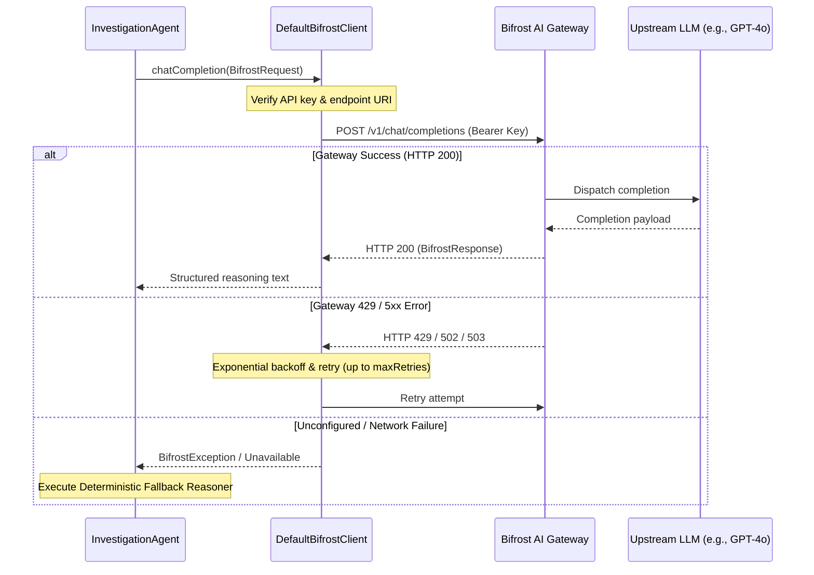

# TraceBack 2.0 — Technical Architecture Overview & Design Document

**Document Version:** 2.0.0 (Phase 9.7 Release Edition)  
**System Target:** Hackathon Evaluation & Technical Architecture Review  
**Repository:** `TraceBack` (Multi-Module Maven + React Vite SPA)

---

## 1. Executive Technical Summary

TraceBack 2.0 is an enterprise-grade autonomous software failure investigation platform. When complex distributed systems fail, engineers spend hours context-switching between application logs, terminal stack traces, Git blame logs, and configuration repositories. TraceBack automates this entire diagnostic lifecycle.

Unlike conversational AI wrappers that blindly feed ungrounded crash logs to large language models, TraceBack implements a **deterministic-first, evidence-grounded architecture**:
1. **Deterministic Telemetry Ingestion:** Deep Git diff parsing, AST-aware working-tree scanning, multi-language stack trace extraction, and structured log parsing.
2. **Cryptographic Evidence Registry:** Every extracted fact is registered as an immutable `EvidenceItem` stamped with a cryptographic SHA-256 hash.
3. **Deterministic Correlation Engine:** Hypotheses are scored and ordered using a transparent, rule-based formula: $S = T + O + A - C$.
4. **AI Gateway Orchestration (Bifrost):** When external reasoning is required, TraceBack routes requests through the **Bifrost AI Gateway**, leveraging OpenAI-compatible chat completion APIs with automatic retry, backoff, and secret masking.
5. **Technical Research Integration (Tavily):** When runtime errors involve third-party libraries, TraceBack executes contextual external research queries via the **Tavily Search API**.
6. **Post-Reasoning Claim Validation:** An independent `ClaimValidator` inspects all agent claims against the active evidence registry, rejecting unbacked, tampered, or cross-tenant assertions before rendering the final investigation dossier.
7. **PostgreSQL Persistence & Isolation (Flyway V4):** Complete audit trails, timeline events, evidence items, and claims are persisted with surrogate UUIDs and compound tenant constraints.

---

## 2. System Architecture

TraceBack is built as a modular system separating web presentation, REST orchestration, core domain logic, and ingestion adapters.

### 2.1 High-Level Component Architecture Diagram

```mermaid
graph TD
    subgraph Client ["Frontend Client (React 18 + Vite + Tailwind CSS)"]
        UI_Dash["Dashboard & Metric Summary"]
        UI_New["New Investigation Form"]
        UI_Detail["Investigation Dossier View"]
        UI_Explorer["Evidence Explorer & Filter"]
        UI_Claims["Claim-to-Evidence Matrix"]
        UI_Timeline["Chronological Timeline"]
        UI_Steps["Agent Audit Trail"]
    end

    subgraph API ["REST API Layer (Spring Boot 3.3.4, Port 8080)"]
        IC["InvestigationController"]
        AIC["AgentInvestigationController"]
        HC["HealthController"]
        AdminC["AdminController"]
    end

    subgraph Core ["Core Domain & Correlation Engine (traceback-core)"]
        IS["InvestigationService"]
        Agent["InvestigationAgent (Orchestrator)"]
        CE["CorrelationEngine (S = T + O + A - C)"]
        ER["EvidenceRegistry (In-Memory + JPA)"]
        CV["DeterministicClaimValidator (SHA-256)"]
        SecRedact["SecretRedactor"]
    end

    subgraph ExternalGateway ["AI Gateway & External Research"]
        Bifrost["BifrostClient (OpenAI-compatible)"]
        Tavily["TavilyResearchService (Search API)"]
    end

    subgraph Ingestion ["Ingestion & Forensics (traceback-ingestion / core)"]
        GitColl["GitCollector (JGit + Allowlist)"]
        WTColl["GitWorkingTreeCollector (Forensic Scanner)"]
        StackP["StackTraceParser (Java, Node, Python)"]
        LogP["LogAnalyzer (Regex + Structured JSON)"]
    end

    subgraph Storage ["Persistence Layer (PostgreSQL 18.3, Schema V4)"]
        DB_Inv[("investigations")]
        DB_Evd[("investigation_evidence")]
        DB_Clm[("investigation_claims")]
        DB_Rep[("investigation_agent_reports")]
        DB_Step[("investigation_agent_steps")]
        DB_Time[("investigation_timeline_events")]
    end

    %% Client to API
    UI_Dash -->|REST / JSON| IC
    UI_New -->|REST / JSON| IC
    UI_Detail -->|REST / JSON| IC
    UI_Detail -->|REST / JSON| AIC
    UI_Explorer -->|REST / JSON| IC
    UI_Claims -->|REST / JSON| IC
    UI_Timeline -->|REST / JSON| IC
    UI_Steps -->|REST / JSON| AIC

    %% API to Core
    IC --> IS
    AIC --> Agent
    Agent --> IS
    IS --> CE
    IS --> ER

    %% Core Orchestration
    Agent --> Bifrost
    Agent --> Tavily
    Agent --> CV
    CV --> ER
    CE --> ER

    %% Ingestion Calls
    IS --> GitColl
    IS --> WTColl
    IS --> StackP
    IS --> LogP

    %% Persistence
    IS --> DB_Inv
    IS --> DB_Evd
    IS --> DB_Clm
    IS --> DB_Time
    Agent --> DB_Rep
    Agent --> DB_Step
    Agent --> DB_Clm
```



### 2.2 Module Responsibilities

| Module | Primary Technologies | Key Classes & Responsibilities |
|:---|:---|:---|
| **`traceback-api`** | Spring Boot Web, Validation, Actuator | `InvestigationController`, `AgentInvestigationController`, `HealthController`, `CorsConfig`. Exposes REST APIs, enforces HTTP request validation, maps DTOs to domain entities. |
| **`traceback-core`** | Java 21, Spring Data JPA, Jackson | `InvestigationAgent`, `CorrelationEngine`, `EvidenceRegistry`, `DeterministicClaimValidator`, `BifrostClient`, `TavilyResearchService`, `SecretRedactor`, JPA entity models and Spring Data repositories. |
| **`traceback-ingestion`** | JGit, Java 21 | `GitCollector`, `GitWorkingTreeCollector`, `StackTraceParser`, `JavaStackTraceAdapter`, `NodeStackTraceAdapter`, `PythonStackTraceAdapter`, `LogAnalyzer`. Extracts raw facts from local filesystems and Git object databases. |
| **`frontend`** | React 18, TypeScript, Vite, Tailwind CSS, Lucide icons | Single-Page Application featuring responsive dashboard, interactive dossier viewing, claim-to-evidence linking, dynamic evidence category tabs, and confidence score visualization. |
| **Database** | PostgreSQL 18.3, Flyway | Stores relational state across 6 tables under Flyway V4 schema with composite multi-tenant constraints and surrogate UUIDs. |

---

## 3. The 14-Stage Investigation Pipeline

TraceBack processes failures through an explicit 14-stage pipeline that ensures deterministic reproducibility before any AI synthesis occurs.

```mermaid
flowchart TD
    S1["1. User Submits Diagnostic Input<br>(Repo Path, Stack Trace, Logs, Mode)"] --> S2["2. Security & Allowlist Enforcement<br>(Path canonicalization, symlink check)"]
    S2 --> S3["3. Deterministic Data Collection<br>(JGit, Working-Tree, Log Parser)"]
    S3 --> S4["4. Git & Working-Tree Analysis<br>(Commit diffs, modified files, missing files)"]
    S4 --> S5["5. Multi-Language Stack Trace Parsing<br>(Java, Node.js, Python adapter dispatch)"]
    S5 --> S6["6. Chronological Timeline Construction<br>(Merge commit timestamps & log event times)"]
    S6 --> S7["7. Evidence Registration & Hashing<br>(Assign EVD-*, compute SHA-256)"]
    S7 --> S8["8. Deterministic Evidence Correlation<br>(Calculate S = T + O + A - C)"]
    S8 --> S9["9. Candidate Hypothesis Ranking<br>(Order hypotheses by normalized score)"]
    S9 --> S10["10. Agent Reasoning via Bifrost Gateway<br>(Synthesize summary, primary cause, steps)"]
    S10 --> S11["11. Tavily External Technical Research<br>(Query docs/issues for error messages)"]
    S11 --> S12["12. Deterministic Claim Validation<br>(Verify SHA-256 hashes & tenant boundary)"]
    S12 --> S13["13. Authoritative Verdict Assignment<br>(CONFIRMED / PROBABLE / INSUFFICIENT)"]
    S13 --> S14["14. PostgreSQL Persistence & Rehydration<br>(Store dossier, emit JSON to Frontend)"]
```



### Detailed Pipeline Stages

1. **User Submissions:** Engineer supplies a local repository path, runtime stack trace or application log file/snippet, and selects the operating mode (`RUNTIME_FAILURE` or `WORKING_TREE_FORENSICS`).
2. **Repository Security Validation:** `GitCollector` inspects the path against `traceback.security.allowed-repo-roots`. It normalizes the path, resolves real paths, and rejects any directory traversal (`../`) or symlink breakout outside authorized boundaries.
3. **Deterministic Data Collection:** Connects to the local Git repository via JGit and reads disk telemetry.
4. **Git & Working-Tree Analysis:** In runtime mode, enumerates recent commits and computes unified file diffs. In working-tree mode, compares on-disk directory trees against the Git index and `HEAD` commit.
5. **Multi-Language Stack Trace Parsing:** `StackTraceParser` tests language adapters (`PythonStackTraceAdapter`, `NodeStackTraceAdapter`, `JavaStackTraceAdapter`), extracting top-level exception classes, error messages, and structured stack frames (class, method, file, line number).
6. **Timeline Construction:** Merges Git commit timestamps and application log timestamps into an ordered `TimelineEvent` series.
7. **Evidence Registration & Hashing:** Each artifact (commit diff, stack frame, log line, missing file) is registered in `EvidenceRegistry` with an identifier (e.g. `EVD-CFG-ee51c22`) and its SHA-256 payload hash.
8. **Evidence Correlation:** Matches modified file paths and changed configuration keys against stack trace frames and error messages.
9. **Hypothesis Ranking:** Computes $S = T + O + A - C$ for each candidate commit and filters hypotheses against confidence thresholds.
10. **Bifrost AI Gateway Reasoning:** If configured, passes the structured evidence, top hypotheses, and failure symptoms to the Bifrost AI Gateway. If unconfigured or unavailable, automatically falls back to deterministic rule-based reasoning.
11. **Tavily External Research:** If configured, executes focused technical queries for unhandled exceptions (e.g. `"HikariPool-1 connection timeout configuration"`). External findings are isolated as supplementary context and never confused with repository evidence.
12. **Claim Validation:** `ClaimValidator` iterates through every assertion in `result.claims()`. It verifies that cited evidence items exist in the local registry, belong to the active investigation UUID, and have valid SHA-256 hashes.
13. **Authoritative Verdict Assignment:** Evaluates whether evidence warrants `CONFIRMED` (direct causal proof or confirmed physical anomaly), `PROBABLE` (strong correlation without independent deployment verification), or `INSUFFICIENT_EVIDENCE` (honest abstention).
14. **PostgreSQL Persistence:** Persists all entities to PostgreSQL across `investigations`, `investigation_evidence`, `investigation_claims`, `investigation_agent_reports`, `investigation_agent_steps`, and `investigation_timeline_events`.

---

## 4. Evidence Grounding & Deterministic Validation

### 4.1 Cryptographic Integrity & Evidence Schema

Every piece of evidence collected by TraceBack adheres to the `EvidenceItem` contract:
- **`id` (String):** Unique identifier prefixed by category (e.g., `EVD-GIT-*`, `EVD-FRAME-*`, `EVD-LOG-*`, `EVD-CFG-*`, `EVD-WT-*`).
- **`type` (EvidenceType):** `GIT_COMMIT`, `STACK_TRACE_FRAME`, `LOG_ENTRY`, `CONFIG_CHANGE`, `WORKING_TREE_ANOMALY`.
- **`content` (String):** Raw textual payload (diff, frame signature, log line).
- **`sha256Hash` (String):** Hex-encoded SHA-256 checksum calculated over `content` via `java.security.MessageDigest`.
- **`metadata` (Map<String, Object>):** Scoped metadata including `investigationId`, commit SHA, file path, line numbers, and timestamps.

### 4.2 Claim Validation Lifecycle

The `ClaimValidator` acts as an incorruptible judge between AI generation and user presentation:

```
[Agent Reasoner] ---> Generates InvestigationClaim (statement, supportingIds, contradictingIds)
                                 │
                                 ▼
                     [DeterministicClaimValidator]
                                 │
       ┌─────────────────────────┼─────────────────────────┐
       ▼                         ▼                         ▼
[Check Evidence IDs]    [Check Tenant Scope]      [Check SHA-256 Hash]
Missing/blank ID?        Belongs to foreign inv?   Content hash mismatch?
  ==> UNSUPPORTED          ==> UNSUPPORTED           ==> UNSUPPORTED
                                 │
                                 ▼
                    [Check Contradiction Proof]
                 Counter-evidence refutes claim?
                           ==> CONTRADICTED
                                 │
                                 ▼
                     [Check Keyword Alignment]
                  Strong alignment ==> SUPPORTED
             Partial/indirect ==> PARTIALLY_SUPPORTED
```

### 4.3 Epistemic Distinction: Evidence Integrity vs. Causal Interpretation

TraceBack rigorously maintains the distinction between **integrity** and **causality**:
- A SHA-256 checksum proves that an evidence record has not been altered or forged since ingestion.
- **However, cryptographic integrity does not prove that a modified configuration was the root cause of an incident.**
- If commit `A` changed a timeout value to `2000ms` and the crash log shows `Connection timeout after 2000ms`, the correlation is strong, but without active deployment logs proving that commit `A` was loaded by the running container, the causal verdict remains **`PROBABLE`**, not `CONFIRMED`.

---

## 5. Confidence Semantics: The $S = T + O + A - C$ Scoring Model

TraceBack rejects opaque "black-box" confidence scores. Instead, candidate hypotheses are ranked using an explicit heuristic scoring equation implemented in `ConfidenceBreakdown.java` and `CorrelationEngine.java`.

### 5.1 Scoring Formula

$$\text{Raw Score: } S = T + O + A - C$$

$$\text{Normalized Score: } S_{\text{norm}} = \frac{\max(0.0, S)}{85.0} \in [0.0, 1.0]$$

| Term | Parameter Name | Maximum Points | Description & Evaluation Rules |
|:---:|:---|:---:|:---|
| **$T$** | **Temporal Proximity** | **+30 pts** | Points awarded based on how recently the commit occurred relative to the incident onset window. Commits occurring within minutes receive maximum temporal points ($+20$ base $+10$ close proximity bonus). |
| **$O$** | **Overlap Points** | **+30 pts** | Code and configuration overlap. If a modified file path matches a class/method in the crash stack trace, $+30$ pts. If a modified configuration parameter matches the failing subsystem or symptom, $+25$ to $+30$ pts. |
| **$A$** | **Agreement / Corroboration** | **+25 pts** | Corroborating signals across telemetry. If the commit message explicitly references the failing service, or if log error keywords match the diff modifications, $+10$ to $+25$ pts. |
| **$C$** | **Contradiction Penalty** | **-30 pts** | Subtracted if contradicting evidence exists (e.g., commit occurred *after* incident onset, or a subsequent clean rollback was committed). |

### 5.2 Heuristic Score vs. Grounded Confidence vs. Statistical Probability

TraceBack documentation and UI enforce strict terminology:
1. **Heuristic Ranking Score ($S = T + O + A - C$):** A deterministic sorting metric used solely to rank candidate commits against each other in the UI.
2. **Grounded Report Confidence Score ($S_{\text{norm}}$):** The normalized percentage (e.g., 71%) displayed to the user to convey relative evidentiary weight.
3. **Statistical Probability (NOT USED):** TraceBack **never** describes scores as probabilities ($P(\text{Root Cause} \mid E)$). In complex software failures with non-independent variables, pretending a heuristic ranking is a Bayesian or frequentist probability is misleading and methodologically incorrect.

---

## 6. Language Adapters & Multi-Language Architecture

TraceBack provides extensible stack trace parsing through `StackTraceParser`, which dispatches to language-specific adapters:

### 6.1 Dedicated Language Adapters

- **Java (`JavaStackTraceAdapter`):**
  - Full multiline JVM exception parsing (`Caused by:`, `Suppressed:`).
  - Handles nested frames, standard library filtering, Spring Framework call stacks, and Hikari/JDBC drivers.
- **Node.js (`NodeStackTraceAdapter`):**
  - Parses V8 JavaScript error signatures (e.g. `TypeError: Cannot read properties of undefined`).
  - Resolves asynchronous tick frames, anonymous lambda functions, and module paths (`router.get (/app/routes/users.js:18:22)`).
- **Python (`PythonStackTraceAdapter`):**
  - Parses Python `Traceback (most recent call last):` blocks.
  - Extracts file paths, line numbers, function scopes, and final exception lines (`ZeroDivisionError`, `KeyError`, `psycopg2.OperationalError`).

### 6.2 Generic Fallback Behavior

For languages without dedicated AST adapters (e.g., Go, Rust, C#, PHP):
- `StackTraceParser` falls back to regex-based file/line pattern detection.
- Generic log lines and commit file diffs are still ingested and correlated via file extension and lexical similarity.
- *TraceBack honestly reports that full AST and frame introspection is currently restricted to Java, Node.js, and Python.*

---

## 7. Bifrost AI Gateway & Tavily Integration Audit

### 7.1 Bifrost AI Gateway Integration

Bifrost is an enterprise AI model gateway providing unified OpenAI-compatible routing, load balancing, and virtual key security.



#### Key Implementation Details (`BifrostConfig.java`, `DefaultBifrostClient.java`)
- **API Endpoint:** Configurable via `BIFROST_BASE_URL` (default: `http://localhost:8080/v1`). Resolves automatically to `/chat/completions`.
- **Authentication:** `Bearer` authorization header via `BIFROST_API_KEY`.
- **Model Selection:** Configurable via `BIFROST_MODEL` (default: `gpt-4o`).
- **Resilience:** Configurable request timeout (default: 15s) and automatic exponential backoff retry on HTTP 429 and 5xx responses (default: 2 retries).
- **Secret Masking:** `BifrostConfig.maskedApiKey()` prevents raw tokens from appearing in application logs, truncating keys to `sk-bf-***` or `sk-bf-...xxxx`.
- **Deterministic Guardrails:** Even when Bifrost produces output, `InvestigationAgent` enforces hard constraints. If the deterministic correlation indicates `INSUFFICIENT_EVIDENCE` or a `WORKING_TREE_ANOMALY`, the agent ignores any hallucinated LLM verdict overrides.
- **Verification Status:** Verified via comprehensive unit and mock integration tests (`BifrostClientTest.java`). Live cloud calls remain unverified due to local hackathon offline test isolation.

### 7.2 Tavily Technical Research Integration

Tavily provides specialized search capabilities optimized for developer error diagnostics and documentation retrieval.

#### Key Implementation Details (`TavilyConfig.java`, `DefaultTavilyResearchService.java`)
- **API Endpoint:** `https://api.tavily.com/search`.
- **Search Query Construction:** Synthesizes error exception names, failing service names, and configuration keywords into targeted technical queries (e.g., `"HikariPool connection timeout configuration optimization"`).
- **Rate-Limiting & Caching:** Enforces `maxSearchesPerInvestigation` (default: 3) and caches query results in a `ConcurrentHashMap` to eliminate duplicate outbound requests.
- **Data Boundary Separation:** External research findings (`ExternalResearchFinding`) are stored in a dedicated report field (`externalResearchFindings`). They are strictly segregated from repository evidence items and are never assigned `EVD-*` identifiers.
- **Verification Status:** Verified via mock suite (`TavilyResearchServiceTest.java`). Deterministic fallback triggers gracefully when `TAVILY_API_KEY` is not supplied.

### 7.3 Architectural Distinction Matrix

| Component | Role & Scope | What It Does NOT Do |
|:---|:---|:---|
| **Bifrost AI Gateway** | Model routing, token management, schema-constrained completion gateway. | Does NOT collect evidence, inspect Git repositories, or make final verdict decisions. |
| **InvestigationAgent** | Autonomous orchestrator managing the 5-step audit lifecycle. | Does NOT bypass deterministic claim validation or hallucinate facts without evidence. |
| **Tavily Research** | Supplementary external technical documentation search. | Does NOT generate local evidence items or prove local root-cause causality. |
| **ClaimValidator** | Deterministic cryptographic and relational verification gate. | Does NOT rely on AI models or heuristics; strictly deterministic. |

---

## 8. Persistence, Schema V4, and Multi-Tenant Isolation

TraceBack persists all investigation assets in PostgreSQL 18.3 using Flyway migrations.

### 8.1 Database Schema (Flyway V4)

```
investigations
  ├── id (UUID, PK)
  ├── mode (VARCHAR: RUNTIME_FAILURE, WORKING_TREE_FORENSICS)
  ├── status (VARCHAR: COMPLETED, INSUFFICIENT_EVIDENCE)
  └── created_at (TIMESTAMPTZ)
        │
        ├── investigation_evidence (1:N)
        │     ├── id (UUID, PK - Surrogate)
        │     ├── investigation_id (UUID, FK)
        │     ├── evidence_id (VARCHAR: EVD-*)
        │     ├── sha256_hash (VARCHAR: 64 hex)
        │     └── UNIQUE (investigation_id, evidence_id)  <-- Multi-Tenant Compound Key
        │
        ├── investigation_claims (1:N)
        │     ├── id (UUID, PK - Surrogate)
        │     ├── investigation_id (UUID, FK)
        │     ├── claim_id (VARCHAR: CLM-*)
        │     ├── status (VARCHAR: SUPPORTED, UNSUPPORTED, CONTRADICTED)
        │     └── UNIQUE (investigation_id, claim_id)     <-- Multi-Tenant Compound Key
        │
        ├── investigation_agent_reports (1:1)
        │     ├── report_id (VARCHAR: REP-*, PK)
        │     ├── investigation_id (UUID, FK, UNIQUE)
        │     ├── verdict (VARCHAR: CONFIRMED, PROBABLE, INSUFFICIENT_EVIDENCE)
        │     └── confidence_breakdown (JSONB)
        │
        ├── investigation_agent_steps (1:N)
        │     ├── id (UUID, PK - Deterministic RFC 4122 v3)
        │     ├── investigation_id (UUID, FK)
        │     ├── step_number (INT)
        │     └── step_name (VARCHAR)
        │
        └── investigation_timeline_events (1:N)
              ├── id (UUID, PK)
              ├── investigation_id (UUID, FK)
              ├── event_type (VARCHAR)
              └── timestamp (TIMESTAMPTZ)
```

### 8.2 Why Surrogate Keys & Compound Uniqueness Were Essential

In Phase 9.6.6, an audit revealed that using raw `evidence_id` as a global primary key caused catastrophic cross-investigation collisions: when Scenario E ingested evidence with ID `EVD-GIT-12ef988`, it reassigned rows previously created by Scenario A!

Under Flyway V4:
1. Every table uses a **surrogate UUID primary key** (`id`).
2. Evidence and claims enforce compound uniqueness constraints:
   - `UNIQUE (investigation_id, evidence_id)`
   - `UNIQUE (investigation_id, claim_id)`
3. Multiple investigations can now safely reference identical commit SHAs or evidence tags without interfering with each other's persistence.
4. **Cold JVM Rehydration:** Upon restart, all 15 investigations rehydrate cleanly from PostgreSQL into JVM memory without data loss or foreign-key corruption.
