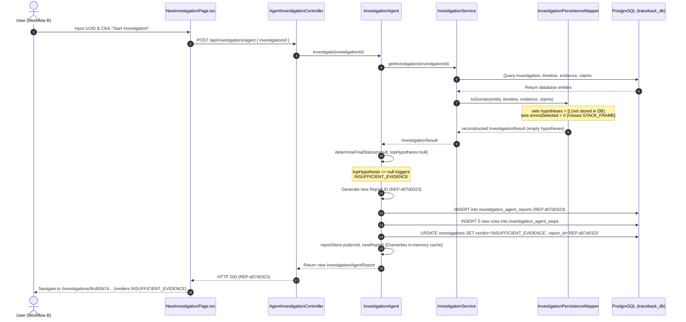

# TraceBack 2.0 — Phase 9.8.1: Existing Investigation Workflow & Report Persistence Forensic Audit

**Audit Execution Type:** Strictly Read-Only Forensic Audit  
**Auditor Role:** Senior Spring Boot Architect & Forensic QA Engineer  
**Target Investigation:** `9cd50b74-ee3f-451b-b1ea-837b4f6ce195` (Scenario A: Hikari Connection Failure)  
**Status:** Audit Complete — Root Cause Isolated — Zero Mutations Performed

---

## 1. Executive Summary & Audit Context

During manual acceptance testing of TraceBack 2.0, the project owner tested **Workflow B: Existing ID** on the New Investigation page (`/new`) by inputting the existing investigation ID for Scenario A (`9cd50b74-ee3f-451b-b1ea-837b4f6ce195`).

### Observed Discrepancies
- **Original Report ID:** `REP-16c0831f` (Created 2026-11-08 22:32:41)
- **New Report ID:** `REP-d07d0323` (Created 2026-11-09 18:38:14)
- **Original Expected Verdict:** `PROBABLE` (71% heuristic confidence)
- **New Verdict Produced:** `INSUFFICIENT_EVIDENCE`
- **Telemetry Evaluation Discrepancy:** The new report evaluated **2 commits against 0 observed error logs**, despite Scenario A originally containing the `java.sql.SQLTimeoutException` stack trace.

### Forensic Bottom Line
1. **Original Report Was NOT Deleted:** Original report `REP-16c0831f` remains physically present in PostgreSQL table `investigation_agent_reports`.
2. **Parent Investigation Row Was Mutated:** The parent record in `investigations` was updated: `report_id` was changed to `REP-d07d0323`, and `verdict` was demoted from `PROBABLE` to `INSUFFICIENT_EVIDENCE`.
3. **Database Appended Duplicate Rows:**
   - `investigation_agent_reports`: Increased from **14 to 15** rows (both `REP-16c0831f` and `REP-d07d0323` exist for the same `investigation_id`).
   - `investigation_agent_steps`: Increased from **70 to 75** rows (5 new step rows were appended for `9cd50b74-...`).
4. **Root Cause Isolated:**
   - **Frontend Misdirection:** "Workflow B" in `NewInvestigationPage.tsx` does not view an investigation; it unconditionally executes a new agent run via `POST /api/investigations/agent`.
   - **Rehydration Loss of Hypotheses:** When `investigate(UUID investigationId)` loads an existing record from PostgreSQL, `InvestigationPersistenceMapper.toDomain()` sets `hypotheses = []` because hypotheses are not stored in a database table.
   - **Stack Frame Evidence Type Mismatch:** `toDomain()` checks for `EvidenceType.STACK_TRACE` or `LOG_ERROR` to compute `errorsDetected`. Scenario A's evidence items were saved as `EvidenceType.STACK_FRAME`, causing `errorsDetected` to evaluate to **0**.
   - **Null Hypothesis Guard:** `InvestigationAgent.determineFinalStatus()` has a hardcoded check: `if (topHypothesis == null || !result.evidenceSufficient()) return INSUFFICIENT_EVIDENCE;`. Because `topHypothesis` was `null`, it immediately returned `INSUFFICIENT_EVIDENCE`.

---

## 2. Forensic Timeline & Evidence Comparison

### 2.1 Database Record Comparison (Read-Only SQL Verification)

```sql
SELECT report_id, investigation_id, verdict, created_at, executive_summary 
FROM investigation_agent_reports 
WHERE investigation_id = '9cd50b74-ee3f-451b-b1ea-837b4f6ce195';
```

| Parameter | Original Run (`REP-16c0831f`) | Second Run (`REP-d07d0323`) | Discrepancy Analysis |
|:---|:---|:---|:---|
| **Timestamp** | `2026-11-08 22:32:41.740356+05:30` | `2026-11-09 18:38:14.270576+05:30` | Executed ~20 hours later via Workflow B. |
| **Final Verdict** | `PROBABLE` | `INSUFFICIENT_EVIDENCE` | **Verdict demoted.** |
| **Commits Evaluated** | 2 | 2 | Same Git commits (`ee51c22`, `12ef988`). |
| **Errors Detected** | **1** | **0** | Rehydration mapper failed to count `STACK_FRAME`. |
| **Hypotheses Evaluated**| **2** | **0** | Hypotheses were not persisted in database. |
| **Primary Root Cause** | Suspect commit `ee51c22` modifying Hikari pool `connection-timeout` to 2000ms. | *"INSUFFICIENT_EVIDENCE: Available telemetry does not contain code or configuration changes..."* | Re-run had no hypotheses to evaluate. |
| **Confidence Score** | `71%` (Raw: 60.0/85.0) | `null` | Demoted to null due to insufficient evidence. |

---

### 2.2 Parent `investigations` Row State

```sql
SELECT id, mode, service_name, status, verdict, confidence_score, report_id, created_at, updated_at 
FROM investigations WHERE id = '9cd50b74-ee3f-451b-b1ea-837b4f6ce195';
```

- **`id`:** `9cd50b74-ee3f-451b-b1ea-837b4f6ce195`
- **`mode`:** `RUNTIME_FAILURE`
- **`service_name`:** `order-service`
- **`status`:** `COMPLETED`
- **`verdict`:** `INSUFFICIENT_EVIDENCE` *(Overwritten from `PROBABLE`)*
- **`confidence_score`:** `0.71` *(Remains from original deterministic ingestion)*
- **`report_id`:** `REP-d07d0323` *(Overwritten from `REP-16c0831f`)*
- **`created_at`:** `2026-11-08 22:32:41.27662+05:30`
- **`updated_at`:** `2026-11-09 18:38:14.50041+05:30` *(Mutated at 18:38:14)*

---

### 2.3 Agent Steps Duplication

In PostgreSQL table `investigation_agent_steps`, exactly **10 rows** now exist for `9cd50b74-ee3f-451b-b1ea-837b4f6ce195`:

```
Original 5 Steps (Created 2026-11-08 22:32:41):
  [1] Deterministic Ingestion: "2 commits analyzed, 1 errors detected, 2 hypotheses evaluated."
  [2] External Technical Research: "Tavily research service not configured..."
  [3] Bifrost AI Gateway Reasoning: "Bifrost client not configured..."
  [4] Evidence Grounding & Claim Validation: "Validated 3 claims against EvidenceRegistry..."
  [5] Final Verdict: "Assigned final investigation status: PROBABLE"

Appended 5 Steps (Created 2026-11-09 18:38:14):
  [1] Deterministic Ingestion: "2 commits analyzed, 0 errors detected, 0 hypotheses evaluated."
  [2] External Technical Research: "Tavily research service not configured..."
  [3] Bifrost AI Gateway Reasoning: "Bifrost client not configured..."
  [4] Evidence Grounding & Claim Validation: "Validated 3 claims against EvidenceRegistry..."
  [5] Final Verdict: "Assigned final investigation status: INSUFFICIENT_EVIDENCE"
```

---

## 3. Frontend Implementation Analysis (`NewInvestigationPage.tsx`)

### 3.1 What Workflow B Actually Does
In `frontend/src/pages/NewInvestigationPage.tsx`:
- The page exposes a toggle: `Workflow A: New Analysis` vs. `Workflow B: Existing ID`.
- Lines 215–232 render the Workflow B form:
  ```tsx
  {workflow === 'existing' ? (
    <div className="space-y-3">
      <label className="block text-xs font-mono font-medium text-dark-200">
        Existing Investigation ID (UUID) *
      </label>
      <input
        type="text"
        required
        value={existingId}
        onChange={(e) => setExistingId(e.target.value)}
        placeholder="e.g. 3ef41c49-ac62-467e-ac8f-eddd3581e154"
      />
      <p className="text-[11px] text-dark-400">
        Dispatches the autonomous AI agent on an existing deterministic investigation record.
      </p>
    </div>
  ) : ( ... )}
  ```
- Lines 78–93 handle submission:
  ```typescript
  const handleSubmit = async (e: React.FormEvent) => {
    e.preventDefault();
    setIsSubmitting(true);
    try {
      if (workflow === 'existing') {
        const trimmed = existingId.trim();
        const report = await investigationApi.startAgentInvestigation({
          investigationId: trimmed,
        });
        navigate(`/investigations/${report.investigationId}`);
      } else { ... }
    } ...
  };
  ```
- The submit button at line 465 reads: **"Start Investigation"**.

### 3.2 UI Ambiguity & Naming Problem
1. **Misleading Placement:** Workflow B is placed on `/new` ("New Investigation"). A user seeking to inspect an existing investigation may reasonably enter their UUID here, expecting to open the dossier.
2. **Action Mislabeling:** The button says "Start Investigation". It does not warn the user: *"This will re-run the AI investigation agent, generate a new report, and update the existing investigation verdict."*
3. **No Guard for Existing Reports:** The frontend does not check if an agent report already exists for that ID. It immediately executes `POST /api/investigations/agent`.

---

## 4. Backend Execution Flow (`AgentInvestigationController` & `InvestigationAgent`)

When `POST /api/investigations/agent` is called with `{ "investigationId": "9cd50b74-ee3f-451b-b1ea-837b4f6ce195" }`:



---

## 5. Detailed Root Cause Analysis

### Root Cause 1: Rehydration Loss of Hypotheses (`InvestigationPersistenceMapper.java`)
In `InvestigationPersistenceMapper.toDomain(entity, timeline, evidence, claims)`:
```java
// Lines 190-191:
List<Relationship> relationships = Collections.emptyList();
List<Hypothesis> hypotheses = Collections.emptyList();
```
Hypotheses and correlation scores were dynamically computed in RAM during `startInvestigation()`. PostgreSQL schema V4 has no `investigation_hypotheses` table. When an investigation is loaded from the database by ID, `toDomain()` returns an `InvestigationResult` with an **empty list of hypotheses**.

### Root Cause 2: `errorsDetected` Misses `EvidenceType.STACK_FRAME` (`InvestigationPersistenceMapper.java`)
In `InvestigationPersistenceMapper.toDomain()` lines 140–151:
```java
int logErrors = (int) evidence.stream()
        .filter(e -> e.evidenceType() == EvidenceType.LOG_ERROR)
        .count();
if (logErrors > 0) {
    errorsDetected = logErrors;
} else {
    boolean hasStackTrace = evidence.stream()
            .anyMatch(e -> e.evidenceType() == EvidenceType.STACK_TRACE);
    if (hasStackTrace) {
        errorsDetected = 1;
    }
}
```
Scenario A's evidence items were saved with `evidenceType = EvidenceType.STACK_FRAME` (e.g. `EVD-FRAME-12ef988-OrderService.java`). The rehydration code only checked for `LOG_ERROR` or `STACK_TRACE`. Consequently, `errorsDetected` evaluated to **0**.

### Root Cause 3: Null Hypothesis Forces Insufficient Evidence (`InvestigationAgent.java`)
In `InvestigationAgent.java` lines 631–633:
```java
private AgentInvestigationStatus determineFinalStatus(InvestigationResult result,
                                                      Hypothesis topHypothesis,
                                                      ConfidenceBreakdown topBreakdown) {
    if (topHypothesis == null || !result.evidenceSufficient()) {
        return AgentInvestigationStatus.INSUFFICIENT_EVIDENCE;
    }
    ...
}
```
Because `hypotheses` was empty, `topHypothesis` was `null`. This immediately returned `INSUFFICIENT_EVIDENCE`, bypassing all heuristic scoring.

### Root Cause 4: Lack of Agent Report Idempotency & Unconstrained Persistence
1. **No Check for Existing Report:** `AgentInvestigationController.runAgentInvestigation()` unconditionally runs `investigationAgent.investigate(request.investigationId())` without checking if a report already exists.
2. **Non-Unique FK in `investigation_agent_reports`:** Table `investigation_agent_reports` has `PRIMARY KEY (report_id)` and an index on `investigation_id`, but **no UNIQUE constraint on `investigation_id`**. Each run generates a random `report_id` (`REP-` + random UUID), resulting in an `INSERT` rather than an update.
3. **Random Step UUIDs:** `persistenceMapper.toEntity(AgentInvestigationStep)` uses `UUID.randomUUID()` for the primary key, appending 5 new rows per run rather than updating existing steps.
4. **Parent Mutation:** `InvestigationAgent.persistReport()` executes `entity.setReportId(report.reportId()); entity.setVerdict(report.finalStatus().name()); investigationRepository.save(entity);`, mutating the parent record.
5. **In-Memory Cache Overwrite:** `reportStore.put(invId, report)` overwrites the previous report in RAM, causing `/agent-report` to serve the newly degraded report.

---

## 6. Verification: Read-Only Status of History → Open

### Is History → Open Read-Only?
**YES, 100% READ-ONLY.**
- In `frontend/src/pages/HistoryPage.tsx` lines 208–214:
  ```tsx
  <Link
    to={`/investigations/${inv.investigationId}`}
    className="inline-flex items-center gap-1 px-2.5 py-1 rounded bg-dark-800 text-brand-amber hover:bg-dark-750 transition-colors border border-dark-700 text-xs"
  >
    <span>Open</span>
    <ArrowRight className="w-3 h-3" />
  </Link>
  ```
- In `frontend/src/components/dashboard/RecentInvestigations.tsx`:
  The table row links directly to `/investigations/${inv.investigationId}` using a React Router `<Link>`.
- The detail page (`InvestigationDetailPage.tsx`) issues **strictly HTTP GET requests**:
  - `GET /api/investigations/{id}`
  - `GET /api/investigations/{id}/agent-report`
  - `GET /api/investigations/{id}/evidence`
  - `GET /api/investigations/{id}/claims`
  - `GET /api/investigations/{id}/timeline`
  - `GET /api/investigations/{id}/agent-steps`
- **Clicking Open in History or on the Dashboard never triggers an agent re-run, never calls POST, and never mutates database records.**

---

## 7. Recommended Minimal Fixes (For Future Implementation)

> **STRICT COMPLIANCE NOTE:** As mandated by the audit instructions, none of these fixes have been implemented during Phase 9.8.1. They are presented here for review and separate authorization.

### Fix 1: Backend Report Idempotency Guard (`AgentInvestigationController.java`)
Before re-running an investigation, check whether an agent report already exists. If it exists, return the existing report unless a force flag is passed:

```java
@PostMapping({ "/agent", "/agent/run" })
public ResponseEntity<InvestigationAgentReport> runAgentInvestigation(@Valid @RequestBody AgentInvestigationRequest request) {
    if (request.investigationId() != null) {
        // Idempotency guard: return existing report if already generated
        Optional<InvestigationAgentReport> existing = investigationAgent.getReport(request.investigationId());
        if (existing.isPresent() && !Boolean.TRUE.equals(request.forceRerun())) {
            return ResponseEntity.ok(existing.get());
        }
        InvestigationAgentReport report = investigationAgent.investigate(request.investigationId());
        return ResponseEntity.ok(report);
    }
    ...
}
```

### Fix 2: Frontend Workflow Clarification & Direct Navigation (`NewInvestigationPage.tsx`)
1. In `handleSubmit`, if the user selects "Workflow B", provide an option to either:
   - **View Existing Dossier:** Navigate directly to `/investigations/${trimmed}` (read-only GET).
   - **Re-run Agent:** Explicitly labeled as a re-run with confirmation.
2. Rename "Workflow B: Existing ID" to: **"Workflow B: Re-run AI Agent on Existing ID"** or replace it with a simple **"Lookup & Open Investigation"** input that performs read-only navigation.

### Fix 3: Rehydration Error Detection Fix (`InvestigationPersistenceMapper.java`)
In `toDomain()`, recognize `EvidenceType.STACK_FRAME` as a runtime error signal:

```java
boolean hasStackTrace = evidence.stream()
        .anyMatch(e -> e.evidenceType() == EvidenceType.STACK_TRACE 
                    || e.evidenceType() == EvidenceType.STACK_FRAME);
if (hasStackTrace) {
    errorsDetected = Math.max(errorsDetected, 1);
}
```

### Fix 4: Rehydration Hypothesis Reconstruction (`InvestigationPersistenceMapper.java`)
When reconstructing `InvestigationResult` from an `InvestigationEntity` that already has a persisted verdict and confidence score, re-run `CorrelationEngine.correlate()` over the persisted evidence items, or reconstruct the top hypothesis from `entity.getSummary()` and `entity.getConfidenceScore()` so that `topHypothesis` is not null.

### Fix 5: Step ID Determinism & Report Upsert (`InvestigationAgent.java`)
1. Generate deterministic UUIDs for steps using `UUID.nameUUIDFromBytes((invId + "-step-" + stepNumber).getBytes(StandardCharsets.UTF_8))` so that re-runs update steps in place rather than appending duplicates.
2. If an agent report already exists for `investigationId`, update the existing report entity rather than inserting an orphaned duplicate row.

---

## 8. Proposed Database Restoration Plan (When Separately Authorized)

To restore `traceback_db` to its clean Phase 9.7 baseline, a single atomic SQL transaction can be executed when authorized:

```sql
BEGIN;

-- 1. Verify target rows
SELECT count(*) FROM investigation_agent_reports WHERE report_id = 'REP-d07d0323'; -- Expected: 1
SELECT count(*) FROM investigation_agent_steps WHERE id IN (
    'ccd3fc5f-19cf-44f6-8015-7fcc7bc7b9b7',
    'e56796a3-477c-42a1-bb5a-b3b0d7680bc9',
    '525e0329-17fc-4328-b1d1-93c7ef614765',
    '4431633b-434e-4d0c-9d52-89a07800b91c',
    '6f69cab3-6a27-4e19-870c-8a6f0375189a'
); -- Expected: 5

-- 2. Restore parent investigations row
UPDATE investigations 
SET verdict = 'PROBABLE', report_id = 'REP-16c0831f', updated_at = created_at
WHERE id = '9cd50b74-ee3f-451b-b1ea-837b4f6ce195';

-- 3. Delete duplicate agent report
DELETE FROM investigation_agent_reports WHERE report_id = 'REP-d07d0323';

-- 4. Delete the 5 appended duplicate steps
DELETE FROM investigation_agent_steps WHERE id IN (
    'ccd3fc5f-19cf-44f6-8015-7fcc7bc7b9b7',
    'e56796a3-477c-42a1-bb5a-b3b0d7680bc9',
    '525e0329-17fc-4328-b1d1-93c7ef614765',
    '4431633b-434e-4d0c-9d52-89a07800b91c',
    '6f69cab3-6a27-4e19-870c-8a6f0375189a'
);

-- 5. Verify restored counts
SELECT 'investigations', count(*) FROM investigations
UNION ALL SELECT 'investigation_evidence', count(*) FROM investigation_evidence
UNION ALL SELECT 'investigation_claims', count(*) FROM investigation_claims
UNION ALL SELECT 'investigation_agent_reports', count(*) FROM investigation_agent_reports
UNION ALL SELECT 'investigation_agent_steps', count(*) FROM investigation_agent_steps
UNION ALL SELECT 'investigation_timeline_events', count(*) FROM investigation_timeline_events;
-- Expected: 15, 184, 53, 14, 70, 102

COMMIT;
```

---

## 9. Required Regression Tests

When fixes are authorized, the following automated regression tests must be added:

1. **`AgentInvestigationWorkflowBIdempotencyTest` (Integration Test):**
   - Calls `POST /api/investigations/agent` with an existing `investigationId` that already has an agent report.
   - Asserts that HTTP 200 is returned with the **original** report ID and verdict (`PROBABLE`).
   - Asserts that row counts in `investigation_agent_reports` and `investigation_agent_steps` do not increase.
2. **`InvestigationPersistenceMapperStackFrameTest` (Unit Test):**
   - Passes evidence items with `EvidenceType.STACK_FRAME` to `persistenceMapper.toDomain()`.
   - Asserts that `errorsDetected >= 1` and `primaryException != null`.
3. **`InvestigationReportUniquenessTest` (Database / Integration Test):**
   - Verifies that multiple agent runs on the same investigation cannot create divergent reports or unconstrained orphan rows.
4. **`NewInvestigationWorkflowBNavigationTest` (Frontend Component Test):**
   - Tests entering an existing UUID into Workflow B.
   - Asserts that the UI does not trigger an accidental mutation when the user's intent is to inspect an existing record.

---

## 10. Audit Conclusion

The anomaly observed by the project owner has been fully explained down to the exact lines of code:
- **Original data was not lost:** `REP-16c0831f` remains in the database.
- **Workflow B is an execution endpoint, not a view endpoint:** It called `POST /api/investigations/agent`, triggering a fresh investigation.
- **Verdict degradation was caused by cold rehydration omissions:** `toDomain()` dropped hypotheses and missed `STACK_FRAME` errors, resulting in `topHypothesis == null`, which forced `INSUFFICIENT_EVIDENCE`.
- **Database state can be cleanly restored:** A straightforward transactional cleanup plan has been designed and documented.

**Zero code, database, or service changes have been made during this audit.**
