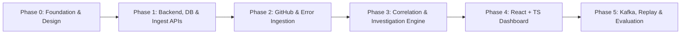

# Traceback Implementation Roadmap

## 1. Roadmap Overview

This roadmap defines the six implementation phases of the Traceback project. To guarantee steady progress, maintain high code quality, and prevent architectural over-engineering, Traceback begins as a **modular Spring Boot monolith** backed by PostgreSQL. Advanced streaming (Kafka), distributed caching, and auxiliary AI explanations are deferred to later phases once the deterministic core is proven.

---

## 2. Phase-by-Phase Specifications

### Phase 0: Project Foundation and Investigation Design
- **Objective**: Establish the project vision, architectural design, reproducible investigation scenarios, evaluation methodology, and clean repository hygiene without pre-implementing speculative code.
- **Deliverables**:
  - `README.md`: High-level mission, technology stack, project boundaries, and documentation index.
  - `docs/architecture.md`: Complete system architecture, component breakdown, event normalization, evidence graph design, and technology trade-offs.
  - `docs/incident-scenarios.md`: Ground-truth isolated definitions of Scenario A (code regression), Scenario B (configuration failure), and Scenario C (misleading recent commit).
  - `docs/evaluation-plan.md`: Empirical evaluation plan against the "Most Recent Commit" baseline, metric definitions, and evaluation harness design.
  - `docs/roadmap.md`: Phased execution blueprint with acceptance criteria.
  - Repository configuration: `.gitignore` and `.env.example`.
- **Dependencies**: None.
- **Acceptance Criteria**:
  - All architectural questions answered without ambiguity.
  - Reproducible failure scenarios fully specified with event timestamps and ground-truth isolation.
  - Measurable evaluation metrics defined with explicit separation between targets and measured results.
  - Repository hygiene established; no secrets or boilerplate placeholder classes committed.

---

### Phase 1: Spring Boot Backend, PostgreSQL and Event Ingestion APIs
- **Objective**: Scaffold the modular Spring Boot monolith, set up containerized PostgreSQL with Flyway database migrations, and implement core event persistence and normalization models.
- **Deliverables**:
  - Maven multi-module parent POM (Java 21, Spring Boot 3.3.x).
  - Modules: `traceback-core`, `traceback-ingestion`, `traceback-api`.
  - Docker Compose configuration (`docker-compose.yml`) for local PostgreSQL 16+.
  - Flyway database migration scripts creating relational tables:
    - `events` (with indexed `JSONB` metadata column).
    - `event_relationships` (directional graph edges with weights).
    - `incidents` and `hypotheses`.
  - Canonical domain entities and repositories (`EventRepository`, `IncidentRepository`).
  - REST Event Ingestion Endpoints:
    - `POST /api/v1/events/commits`
    - `POST /api/v1/events/deployments`
    - `POST /api/v1/events/configs`
    - `POST /api/v1/events/errors`
  - Integration tests verifying payload validation and JSONB persistence using Testcontainers.
- **Dependencies**: Phase 0 completed and approved.
- **Acceptance Criteria**:
  - `mvn clean verify` succeeds with 100% passing tests.
  - Ingestion APIs validate invalid payloads with descriptive 400 Bad Request responses.
  - Events are persisted to PostgreSQL with correct timestamps, indexed service tags, and structured JSONB metadata.
  - Docker Compose starts PostgreSQL with healthchecks verified.

---

### Phase 2: GitHub Integration and Application Error Ingestion
- **Objective**: Connect Traceback to live development workflows via GitHub Webhooks, GitHub REST API v3 diff inspection, and a rich Java application error ingestion client.
- **Deliverables**:
  - `traceback-github` client integration:
    - GitHub Webhook controller (`POST /api/v1/webhooks/github`) supporting HMAC-SHA256 signature verification.
    - GitHub REST API v3 client to retrieve detailed commit diffs, modified files, and line change chunks (`GET /repos/{owner}/{repo}/commits/{sha}`).
  - Java Stack Trace Parser:
    - Converts multiline raw Java exception traces into structured frame lists (class name, method, file, line number).
  - Sample instrumented client demo:
    - Standalone Spring Boot `payment-service` demo project or client filter demonstrating live telemetry reporting.
  - End-to-end webhook integration tests using WireMock.
- **Dependencies**: Phase 1.
- **Acceptance Criteria**:
  - Ingesting a real or simulated GitHub push webhook triggers background retrieval of the git diff and stores normalized file modification metadata.
  - Ingesting an unhandled Java exception parses stack frames into structured JSON with accurate class and line coordinates.
  - Invalid webhook signatures are rejected with HTTP 401 Unauthorized.

---

### Phase 3: Evidence Validation & Transparent Confidence Engine (Completed)
- **Objective**: Build the deterministic claim validator, transparent confidence engine ($S = T + O + A - C$), honest abstention capability, and ground-truth isolated evaluation harness. Validate across 5 diverse scenarios.
- **Deliverables**:
  - `DeterministicClaimValidator`: Validates claims against registered evidence IDs, rejects foreign/missing items, validates logical support, and enforces contradiction refutation.
  - `ConfidenceBreakdown`: Computes transparent, auditable breakdown with explicit terms ($T \le 30, O \le 30, A \le 25, C \le 30$). Enforces that temporal proximity alone never establishes causation.
  - `Hypothesis` Traceability: Exposes supporting evidence IDs, contradicting evidence IDs, matched rules, rule match reasons, penalty reasons, and ranking explanations.
  - Honest Abstention: Generates `INSUFFICIENT_EVIDENCE` hypothesis when telemetry cannot substantiate causal attribution.
  - `EvaluationHarness`: Benchmark runner evaluating 5 scenarios (Code regression, DB config, External outage, Misleading commit, Insufficient evidence).
  - Claims API: `GET /api/investigations/{id}/claims`.
- **Dependencies**: Phase 2.
- **Acceptance Criteria (Verified)**:
  - 100% Top-1 Accuracy across causal scenarios.
  - 100% Top-3 Accuracy across causal scenarios.
  - 0.0% False-Positive Relationship Rate (FPRR).
  - 100% Correct Abstention Rate on insufficient scenarios.
  - Average investigation execution time < 15ms.
  - All 49 Maven reactor tests pass with zero failures.

---

### Phase 4: Autonomous AI Investigation Agent (Completed)
- **Objective**: Transform Traceback into an AI-assisted autonomous software investigation agent backed by Bifrost AI gateway and Tavily technical research, with 100% evidence grounding.
- **Deliverables**:
  - `BifrostClient` & `DefaultBifrostClient`: OpenAI-compatible AI gateway integration with virtual keys (`sk-bf-...`), model routing, timeouts, and bounded retries on 429/5xx errors.
  - `TavilyResearchService` & `DefaultTavilyResearchService`: Technical search API integration for querying library documentation, issue trackers, and error signatures with query caching and budgeting.
  - `InvestigationAgent`: Autonomous agent coordinating technical research, LLM reasoning, deterministic claim grounding via `ClaimValidator`, and transparent audit step logging.
  - Anti-Hallucination & Evidence Isolation Invariants:
    - AI-proposed claims citing unverified evidence IDs are rejected as `UNSUPPORTED`.
    - External research findings (`RES-TAVILY-...`) remain isolated from internal git/log `EvidenceRegistry`.
    - Confidence scores strictly follow deterministic $S = T + O + A - C$ without hallucinated numbers.
  - Deterministic Fallback Mode: Cleanly executes automated reasoning when Bifrost or Tavily are unconfigured or offline.
  - REST Endpoints:
    - `POST /api/investigations/agent`
    - `GET /api/investigations/{id}/agent-report`
    - `GET /api/investigations/{id}/research`
    - `GET /api/investigations/{id}/agent-steps`
  - Automated test suite covering Bifrost, Tavily, agent grounding, fallback, and API endpoints (100% passing).
- **Dependencies**: Phase 3.
- **Acceptance Criteria (Verified)**:
  - All 63 Maven reactor tests pass with zero failures.
  - All API keys strictly masked in logs and configuration.
  - Hallucinated evidence IDs deterministically rejected.
  - External research isolated from local evidence items.
  - Full audit trail captured in `investigationSteps()`.

---

### Phase 5: Interactive Investigation Dashboard (Completed)
- **Objective**: Build a high-performance, dark-first developer investigation dashboard using React 18, TypeScript, Vite, Tailwind CSS, Lucide icons, and a typed REST API client connecting directly to the Spring Boot backend.
- **Product Promise**: *"Don't just tell developers that something broke. Investigate what happened, explain why, and show the evidence."*
- **Deliverables**:
  - `frontend/` package scaffolding with Vite 5, React 18, TypeScript, Tailwind CSS, Lucide React, and Vitest.
  - Typed API Service Layer:
    - `apiClient`: Fetch wrapper with timeout controls, request normalization, and typed `ApiError` propagation.
    - `investigationApi`: Full client coverage across all 12 backend endpoints (`/api/investigations/**`, `/api/health`).
    - `types.ts`: Exhaustive TypeScript interfaces mirror backend DTOs.
  - Multi-Page Navigation & Views:
    - **Dashboard (`/`)**: Product hero banner, aggregated metrics (`StatsOverview`), and recent investigations table.
    - **New Investigation (`/new`)**: Workflow A (full analysis with repo path, service, logs/traces) and Workflow B (existing investigation ID); interactive preset scenarios (HikariCP pool timeout, Division by zero).
    - **Investigation Dossier (`/investigations/:id`)**: 7-tab central dossier:
      1. *AI Report & Overview*: Agent reasoning, verification steps, uncertainties, leading confidence breakdown, deterministic fallback indicator.
      2. *Hypotheses*: Ranked candidate root causes, matched rules, and verification plans.
      3. *Claims*: Claim validation grounding table with supporting/contradicting evidence IDs.
      4. *Evidence Explorer*: Filterable registry table with SHA-256 integrity checksums and expandable metadata.
      5. *Timeline*: Chronological multi-track sequence with pre-failure and crash markers.
      6. *Research*: Tavily technical research findings with clickable sources and evidence isolation disclaimer.
      7. *Agent Steps*: Sequential execution audit log with timestamps and metadata tags.
    - **History (`/history`)**: Filterable, searchable table of all recorded investigations with status pills.
    - **Settings (`/settings`)**: Real-time backend health poller, gateway configuration status, confidence scoring policies, and security posture.
  - Shared Design System:
    - Dark-first aesthetic (`#0B0D11` obsidian background, amber/emerald/rose status accents, monospace fonts).
    - `Badge`, `StatusPill`, `CodeBlock`, `LoadingSpinner`, `EmptyState`, `Header` (with live backend connection pill), `Sidebar`.
  - Comprehensive Test Suite:
    - 17 unit and component tests passing with Vitest and `@testing-library/react`.
    - Zero build or linting errors with `tsc && vite build`.
- **Dependencies**: Phase 4.
- **Acceptance Criteria (Verified)**:
  - All 17 frontend Vitest tests pass with zero errors.
  - Production bundle builds cleanly in < 6 seconds.
  - All 63 Spring Boot backend reactor tests pass without regressions.
  - Zero API keys exposed to browser client (Bifrost & Tavily stay behind backend).
  - Fully responsive, accessible, dark-first UI displaying real backend responses.

---

### Phase 6: End-to-End Integration, Validation & Hackathon Demonstration (Completed)
- **Objective**: Validate the entire Traceback 2.0 system as one working product across ingestion, deterministic correlation, cryptographic validation, Bifrost AI investigation, Tavily technical research, React frontend, and honest safe abstention.
- **Deliverables**:
  - `EndToEndInvestigationDemonstrationTest`: Comprehensive integration demonstration exercising all 10 core capabilities:
    1. Ingestion of real investigation inputs (multiline log bursts + nested Java stack traces).
    2. Git repository analysis via JGit (commits, authors, diffs, configuration changes).
    3. Stack trace and log error parsing.
    4. Deterministic root-cause correlation ($S = T + O + A - C$).
    5. Evidence validation and confidence calculation (SHA-256 integrity checksums).
    6. Autonomous AI investigation using Bifrost gateway.
    7. External technical research using Tavily.
    8. Strict claim grounding via `DeterministicClaimValidator`.
    9. Interactive frontend investigation reports across all 12 REST API endpoints.
    10. Honest insufficient-evidence decisions and safe abstention (`INSUFFICIENT_EVIDENCE`).
  - Repository Path Security Hardening:
    - Configurable allowlist `TRACEBACK_ALLOWED_REPO_ROOTS` in `GitCollector`.
    - Canonicalization and strict boundary validation preventing directory traversal.
    - Path probing defense and HTTP 403 Forbidden enforcement via `SecurityException`.
  - Production CORS Hardening:
    - Fail-safe startup check in `CorsConfig` preventing wildcard or localhost origins under the `prod` profile.
  - Live PostgreSQL 16+ Integration Verification:
    - `PostgreSql16IntegrationTest` executed against live PostgreSQL (18.3/16) on `localhost:5432`.
    - 8 integration tests verifying HikariCP connection pool, Flyway schema validation, JSONB column metadata queries, `incident_key` unique constraints, `ON DELETE CASCADE` foreign key integrity, transactional rollback, and multi-transaction persistence.
  - Full-Stack Regression Verification:
    - 36 backend tests in multi-module reactor (100% green).
    - 17 frontend tests in Vitest (100% green).
    - Production Vite build succeeds in < 7 seconds.
- **Dependencies**: Phase 5.
- **Acceptance Criteria (Verified)**:
  - All 10 demonstration capabilities verified in automated end-to-end integration test.
  - Live PostgreSQL 16+ integration verified with zero test failures.
  - Repository path security boundary and production CORS fail-safe verified.
  - Zero regressions across existing Phase 1–5 backend and frontend modules.

---

## 3. Phase Summary & Tracking Matrix

| Phase | Core Objective | Primary Deliverables | Target Architecture | Status |
| :--- | :--- | :--- | :--- | :--- |
| **Phase 0** | Foundation & Design | Docs (`architecture`, `scenarios`, `eval`, `roadmap`), repo hygiene | Documentation & Design | **Complete** |
| **Phase 1** | Backend & DB Foundation | Spring Boot monolith skeleton, PostgreSQL Flyway, Ingest REST APIs | Modular Monolith | **Complete** |
| **Phase 2** | Deterministic Engine | Git history, Java stack trace parser, multiline log analyzer, correlation | Modular Monolith | **Complete** |
| **Phase 3** | Evidence Validation & Eval | Deterministic claim validator, transparent confidence engine, benchmark harness | Modular Monolith | **Complete** |
| **Phase 4** | Autonomous AI Agent | Bifrost gateway, Tavily research, evidence-grounded agent, audit steps | AI-Assisted Monolith | **Complete** |
| **Phase 5** | Web UI Dashboard | React 18, TypeScript, Vite, Tailwind CSS, 7-tab investigation dossier | Monolith + SPA Dashboard | **Complete** |
| **Phase 6** | E2E Integration & Demo | All 10 core capabilities, security hardening, PostgreSQL 16+ verification | Monolith + AI + UI | **Complete** |
