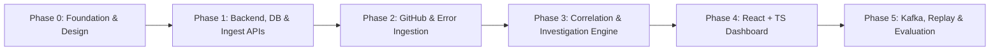

# Traceback Implementation Roadmap

## 1. Roadmap Overview

This roadmap defines the six implementation phases of the Traceback project. To guarantee steady progress, maintain high code quality, and prevent architectural over-engineering, Traceback begins as a **modular Spring Boot monolith** backed by PostgreSQL. Advanced streaming (Kafka), distributed caching, and auxiliary AI explanations are deferred to later phases once the deterministic core is proven.

---

## 2. Phase-by-Phase Specifications

### Phase 0: Project Foundation and Investigation Design
- **Objective**: Establish the project vision, architectural design, reproducible investigation scenarios, evaluation methodology, and clean repository hygiene without pre-implementing speculative code.
- **Deliverables**:
  - `README.md`: High-level mission, technology stack, project boundaries, and documentation index.
  - `docs/architecture.md`: Complete system architecture, component breakdown, event normalization, evidence graph design, and technology trade-offs.
  - `docs/incident-scenarios.md`: Ground-truth isolated definitions of Scenario A (code regression), Scenario B (configuration failure), and Scenario C (misleading recent commit).
  - `docs/evaluation-plan.md`: Empirical evaluation plan against the "Most Recent Commit" baseline, metric definitions, and evaluation harness design.
  - `docs/roadmap.md`: Phased execution blueprint with acceptance criteria.
  - Repository configuration: `.gitignore` and `.env.example`.
- **Dependencies**: None.
- **Acceptance Criteria**:
  - All architectural questions answered without ambiguity.
  - Reproducible failure scenarios fully specified with event timestamps and ground-truth isolation.
  - Measurable evaluation metrics defined with explicit separation between targets and measured results.
  - Repository hygiene established; no secrets or boilerplate placeholder classes committed.

---

### Phase 1: Spring Boot Backend, PostgreSQL and Event Ingestion APIs
- **Objective**: Scaffold the modular Spring Boot monolith, set up containerized PostgreSQL with Flyway database migrations, and implement core event persistence and normalization models.
- **Deliverables**:
  - Maven multi-module parent POM (Java 21, Spring Boot 3.3.x).
  - Modules: `traceback-core`, `traceback-ingestion`, `traceback-api`.
  - Docker Compose configuration (`docker-compose.yml`) for local PostgreSQL 16+.
  - Flyway database migration scripts creating relational tables:
    - `events` (with indexed `JSONB` metadata column).
    - `event_relationships` (directional graph edges with weights).
    - `incidents` and `hypotheses`.
  - Canonical domain entities and repositories (`EventRepository`, `IncidentRepository`).
  - REST Event Ingestion Endpoints:
    - `POST /api/v1/events/commits`
    - `POST /api/v1/events/deployments`
    - `POST /api/v1/events/configs`
    - `POST /api/v1/events/errors`
  - Integration tests verifying payload validation and JSONB persistence using Testcontainers.
- **Dependencies**: Phase 0 completed and approved.
- **Acceptance Criteria**:
  - `mvn clean verify` succeeds with 100% passing tests.
  - Ingestion APIs validate invalid payloads with descriptive 400 Bad Request responses.
  - Events are persisted to PostgreSQL with correct timestamps, indexed service tags, and structured JSONB metadata.
  - Docker Compose starts PostgreSQL with healthchecks verified.

---

### Phase 2: GitHub Integration and Application Error Ingestion
- **Objective**: Connect Traceback to live development workflows via GitHub Webhooks, GitHub REST API v3 diff inspection, and a rich Java application error ingestion client.
- **Deliverables**:
  - `traceback-github` client integration:
    - GitHub Webhook controller (`POST /api/v1/webhooks/github`) supporting HMAC-SHA256 signature verification.
    - GitHub REST API v3 client to retrieve detailed commit diffs, modified files, and line change chunks (`GET /repos/{owner}/{repo}/commits/{sha}`).
  - Java Stack Trace Parser:
    - Converts multiline raw Java exception traces into structured frame lists (class name, method, file, line number).
  - Sample instrumented client demo:
    - Standalone Spring Boot `payment-service` demo project or client filter demonstrating live telemetry reporting.
  - End-to-end webhook integration tests using WireMock.
- **Dependencies**: Phase 1.
- **Acceptance Criteria**:
  - Ingesting a real or simulated GitHub push webhook triggers background retrieval of the git diff and stores normalized file modification metadata.
  - Ingesting an unhandled Java exception parses stack frames into structured JSON with accurate class and line coordinates.
  - Invalid webhook signatures are rejected with HTTP 401 Unauthorized.

---

### Phase 3: Evidence Validation & Transparent Confidence Engine (Completed)
- **Objective**: Build the deterministic claim validator, transparent confidence engine ($S = T + O + A - C$), honest abstention capability, and ground-truth isolated evaluation harness. Validate across 5 diverse scenarios.
- **Deliverables**:
  - `DeterministicClaimValidator`: Validates claims against registered evidence IDs, rejects foreign/missing items, validates logical support, and enforces contradiction refutation.
  - `ConfidenceBreakdown`: Computes transparent, auditable breakdown with explicit terms ($T \le 30, O \le 30, A \le 25, C \le 30$). Enforces that temporal proximity alone never establishes causation.
  - `Hypothesis` Traceability: Exposes supporting evidence IDs, contradicting evidence IDs, matched rules, rule match reasons, penalty reasons, and ranking explanations.
  - Honest Abstention: Generates `INSUFFICIENT_EVIDENCE` hypothesis when telemetry cannot substantiate causal attribution.
  - `EvaluationHarness`: Benchmark runner evaluating 5 scenarios (Code regression, DB config, External outage, Misleading commit, Insufficient evidence).
  - Claims API: `GET /api/investigations/{id}/claims`.
- **Dependencies**: Phase 2.
- **Acceptance Criteria (Verified)**:
  - 100% Top-1 Accuracy across causal scenarios.
  - 100% Top-3 Accuracy across causal scenarios.
  - 0.0% False-Positive Relationship Rate (FPRR).
  - 100% Correct Abstention Rate on insufficient scenarios.
  - Average investigation execution time < 15ms.
  - All 49 Maven reactor tests pass with zero failures.

---

### Phase 4: React + TypeScript Dashboard and Evidence Visualization
- **Objective**: Deliver an interactive web dashboard for on-call software engineers to visualize incident timelines, navigate evidence graphs, and execute verification checklists.
- **Deliverables**:
  - React 18 + TypeScript SPA created with Vite and styled with Tailwind CSS.
  - Incident List View: Filterable overview of active and resolved incidents with severity badges.
  - Chronological Timeline View: Interactive multi-track timeline displaying commits, CI runs, deployments, config updates, and error spikes.
  - Evidence Graph Visualizer: Visual node-and-edge graph highlighting solid causal paths vs dotted temporal correlations.
  - Side-by-Side Diff Inspector: Visual comparison of git diff chunks alongside the failing stack trace frame.
  - Interactive Verification Checklist: Step-by-step checklist with clickable verification actions and status toggles.
  - Vite dev proxy configuration routing to the Spring Boot backend.
- **Dependencies**: Phase 3.
- **Acceptance Criteria**:
  - UI loads and displays full investigation results for any scenario in under 2 seconds.
  - Users can click on a hypothesis and immediately see the supporting evidence trail and git diff.
  - Clean responsive design tested in modern Chromium and Firefox browsers.
  - Frontend TypeScript code compiles with zero errors under strict mode (`tsc --noEmit`).

---

### Phase 5: Kafka Reliability, Replay, Optional AI Explanations, Security and Evaluation
- **Objective**: Production-grade scalability, event replay, optional grounded AI explanation summaries, API security, and empirical evaluation on an expanded benchmark suite.
- **Deliverables**:
  - Apache Kafka integration:
    - Decoupled event ingestion pipeline with topic partitioning (`events.commits`, `events.deployments`, `events.errors`).
    - Event replay service enabling historical re-investigation from arbitrary point-in-time snapshots.
  - Auxiliary AI Narrative Explainer:
    - Optional LLM service that synthesizes human-readable incident executive summaries.
    - **Strict Constraint**: The LLM prompt is strictly grounded in the deterministic evidence graph; the LLM does not perform root-cause ranking or hypothesis scoring.
  - Security & Authentication:
    - Spring Security with JWT / API key authentication for ingestion and management APIs.
  - Expanded Evaluation Report:
    - Benchmarking across 15–20 diverse scenarios with published metrics comparing Traceback vs. MRC baseline.
- **Dependencies**: Phase 4.
- **Acceptance Criteria**:
  - Ingestion buffer handles burst traffic without event loss under Kafka buffer testing.
  - Event replay accurately reproduces identical investigation graph outputs from historical snapshots.
  - Auxiliary AI summaries contain zero hallucinations contradictory to the evidence graph.
  - Comprehensive evaluation benchmark report published documenting measured $\text{Acc@1}$, $\text{Acc@3}$, $\text{FPRR}$, and latency across all 15+ incidents.

---

## 3. Phase Summary & Tracking Matrix

| Phase | Core Objective | Primary Deliverables | Target Architecture | Status |
| :--- | :--- | :--- | :--- | :--- |
| **Phase 0** | Foundation & Design | Docs (`architecture`, `scenarios`, `eval`, `roadmap`), repo hygiene | Documentation & Design | **Complete** |
| **Phase 1** | Backend & Ingestion | Spring Boot monolith skeleton, PostgreSQL Flyway, Ingest REST APIs | Modular Monolith | Next |
| **Phase 2** | Integrations | GitHub webhook receiver, diff poller, Java stack trace parser | Modular Monolith | Pending |
| **Phase 3** | Correlation Engine | Evidence graph, code/config matchers, hypothesis scoring, eval suite | Modular Monolith | Pending |
| **Phase 4** | Web UI Dashboard | React + TypeScript + Vite, interactive timeline & evidence graph | Monolith + SPA | Pending |
| **Phase 5** | Scale, AI & Eval | Kafka streaming, event replay, grounded AI summaries, 15+ eval report | Monolith + Kafka | Pending |
